# Tutorial del dashboard de mediaOrquestator

[English version](TUTORIAL.md)

Guía para quien llega por primera vez y no sabe por dónde empezar. Está escrita para la interfaz web (el *dashboard*); el final explica cómo hacer lo mismo desde la terminal.

En las capturas, los **círculos naranjas numerados** señalan lo que explica el texto de debajo de cada una.

> **El dashboard arranca en inglés**: cambia a español con el interruptor *English / Español* del final del menú lateral (se recuerda en el navegador y la página se recarga en la misma ruta). Esta guía y sus capturas usan las etiquetas en español.

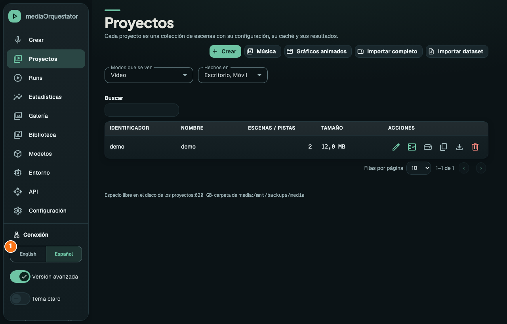


> Las capturas son de unos proyectos de ejemplo (`live`, `acuarelas`, `cancion-demo`, `chicas-patines`) hechos para esta guía, con el dashboard en español. Tu pantalla tendrá tus propios proyectos y modelos. La versión en inglés de esta guía ([TUTORIAL.md](TUTORIAL.md)) tiene las mismas figuras con las etiquetas en inglés.

> Esta es la mitad de la guía que va pantalla a pantalla. Los conceptos (1 y 2), cuando algo falla (11), la terminal (12), el glosario (13), la pantalla de API y el ejemplo completo con su `scenes.yaml` se quedan con el servidor, en [su TUTORIAL.es.md](../../mediaOrquestator/docs/TUTORIAL.es.md), y los enlaces a ellos apuntan allí.

## Índice

- [3. Antes de empezar: arrancar y comprobar el entorno](#3-antes-de-empezar-arrancar-y-comprobar-el-entorno)
    - [Pantalla «Entorno»: lo primero que hay que mirar](#pantalla-entorno-lo-primero-que-hay-que-mirar)
    - [Pantalla «Configuración»: dónde está Ollama](#pantalla-configuración-dónde-está-ollama)
    - [Proveedores y claves de API](#proveedores-y-claves-de-api)
    - [Tareas: elegir dónde se ejecuta cada cosa](#tareas-elegir-dónde-se-ejecuta-cada-cosa)
- [4. Modelos: descargar lo que hace falta](#4-modelos-descargar-lo-que-hace-falta)
    - [Instalado y catálogo](#instalado-y-catálogo)
    - [Descargar por URL, Hugging Face o Civitai](#descargar-por-url-hugging-face-o-civitai)
- [5. Crear un proyecto](#5-crear-un-proyecto)
    - [Tener el espacio bajo control](#tener-el-espacio-bajo-control)
- [6. El editor, por secciones](#6-el-editor-por-secciones)
    - [Salida](#salida)
    - [Revisar los clips desde el dashboard](#revisar-los-clips-desde-el-dashboard)
    - [Usar un clip que ya tienes](#usar-un-clip-que-ya-tienes)
    - [Estilo y calidad: elegir sin perderse](#estilo-y-calidad-elegir-sin-perderse)
    - [Soy un vago: elígelo todo por mí](#soy-un-vago-elígelo-todo-por-mí)
    - [Defaults: el modelo y los ajustes comunes](#defaults-el-modelo-y-los-ajustes-comunes)
    - [Animación (Wan o AnimateDiff)](#animación-wan-o-animatediff)
    - [Vídeo con audio: MiniMax H3](#vídeo-con-audio-minimax-h3)
    - [Escenas](#escenas)
- [7. Lanzar un run y seguirlo](#7-lanzar-un-run-y-seguirlo)
    - [El monitor de un run](#el-monitor-de-un-run)
    - [Desde el móvil: la pantalla Crear](#desde-el-móvil-la-pantalla-crear)
- [8. Historial y borrado](#8-historial-y-borrado)
- [9. Estadísticas](#9-estadísticas)
- [10. Receta rápida: tu primer vídeo en 10 pasos](#10-receta-rápida-tu-primer-vídeo-en-10-pasos)
- [Móvil y tema claro](#móvil-y-tema-claro)
- [Música: crear canciones](#música-crear-canciones)
    - [Qué hace falta](#qué-hace-falta)
    - [El estudio](#el-estudio)
    - [Voz y calidad](#voz-y-calidad)
    - [Variantes: comparar, quedarte con una, favoritas y alargar](#variantes-comparar-quedarte-con-una-favoritas-y-alargar)
    - [La onda: elegir un tramo para repintar y separar instrumentos](#la-onda-elegir-un-tramo-para-repintar-y-separar-instrumentos)
    - [Plantillas de estilo](#plantillas-de-estilo)
    - [Remix: una canción que ya existe](#remix-una-canción-que-ya-existe)
    - [Referencia: el sonido de otra grabación](#referencia-el-sonido-de-otra-grabación)
    - [Mezclas: juntar canciones y audios](#mezclas-juntar-canciones-y-audios)
    - [HeartMuLa: canciones de más calidad (opcional)](#heartmula-canciones-de-más-calidad-opcional)
    - [DiffRhythm2: canciones completas en medio minuto (opcional)](#diffrhythm2-canciones-completas-en-medio-minuto-opcional)
    - [Importar canciones](#importar-canciones)
    - [Exportar un proyecto e importarlo en otro sitio](#exportar-un-proyecto-e-importarlo-en-otro-sitio)
    - [El asistente de IA para canciones](#el-asistente-de-ia-para-canciones)
    - [Sacar de un vídeo o audio](#sacar-de-un-vídeo-o-audio)
    - [Otras opciones de música](#otras-opciones-de-música)
- [Tus propias imágenes y música de fondo](#tus-propias-imágenes-y-música-de-fondo)
    - [Una escena con tu imagen (vídeo)](#una-escena-con-tu-imagen-vídeo)
    - [Partir de una imagen tuya para generar otra (img2img)](#partir-de-una-imagen-tuya-para-generar-otra-img2img)
    - [Describir una imagen o un vídeo: un prompt a partir de una referencia](#describir-una-imagen-o-un-vídeo-un-prompt-a-partir-de-una-referencia)
    - [Música de fondo bajo la voz](#música-de-fondo-bajo-la-voz)

---

## 3. Antes de empezar: arrancar y comprobar el entorno

Desde la carpeta del proyecto:

```bash
go build -o bin/orchestrator ./cmd/orchestrator   # una vez
bin/orchestrator serve --addr 127.0.0.1:4666 --projects-dir projects
```

Si vas a usarlo desde otra máquina, arráncalo mejor con el script, que crea un token, lo muestra en pantalla y lo reutiliza en cada arranque (se pega en el menú lateral, en «Conexión»):

```bash
./serve.sh                  # el servidor, accesible por la red (0.0.0.0:4666)
./serve.sh --local          # solo 127.0.0.1; accede con un túnel SSH
./serve.sh --stop           # lo para (apagado limpio; interrumpe el run en curso)
MEM_MAX=40G ./serve.sh      # cambia el límite de RAM (por defecto 24G; MEM_MAX=0 lo quita)
```

Abre <http://127.0.0.1:4666> en el navegador. La primera vez, la lista de proyectos estará vacía:

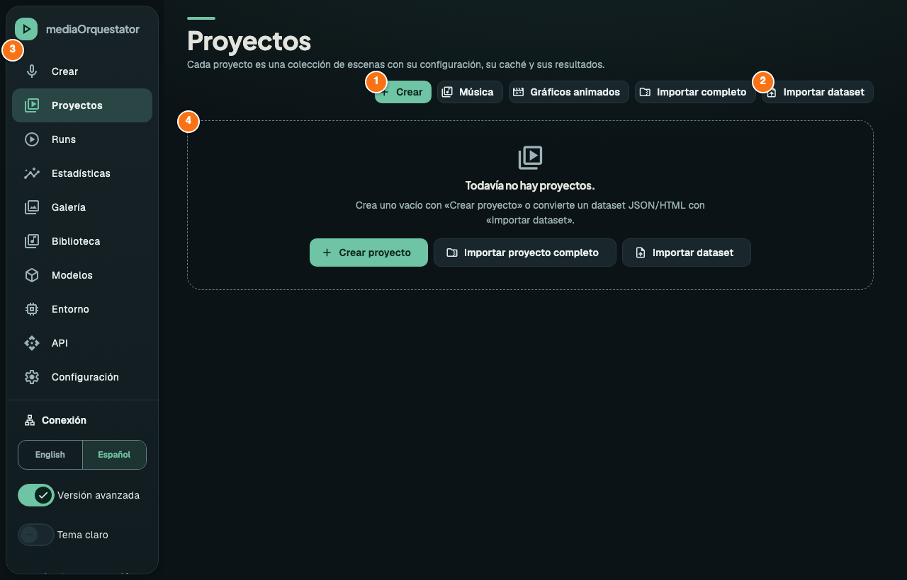

1. **Crear**: empieza uno desde cero (el recuadro del centro de la pantalla tiene el mismo botón, **Crear proyecto**). A su lado, **Música** empieza un proyecto de canciones y **Gráficos animados** uno de gráficos animados.
2. **Importar dataset**: convierte una lista que ya tengas (JSON o HTML) en un proyecto. Eliges el tipo: **escenas de vídeo**, **gráficos animados** (cada entrada es un gráfico descrito con palabras, con su duración y, si quieres, un rótulo encima) o **canciones**. En [docs/IMPORT.md](../../mediaOrquestator/docs/IMPORT.md#worked-examples) hay un fichero de muestra y un ejemplo paso a paso de cada uno (en inglés). Junto a él, **Importar proyecto completo** lee el `.zip` que exportó otra instalación y te dice qué modelos tienes y cuáles faltan.
3. **Menú lateral**: las pantallas: Crear, Proyectos, Runs, Estadísticas, Galería (con un botón **Refrescar** arriba a la derecha que vuelve a leer el proyecto; las imágenes de un proyecto de imágenes, el vídeo final y el clip de cada escena de uno de vídeo, y las canciones de uno de música, cada uno con su reproductor), Biblioteca (las canciones de los proyectos de música), Modelos, Entorno, API y Configuración. También tiene el **interruptor de idioma** (English / Español) y el de tema claro/oscuro.
4. **Estado vacío**: cuando no hay nada, la pantalla te dice qué hacer, no se queda en blanco.

### Pantalla «Entorno»: lo primero que hay que mirar

Aquí ves si tu máquina tiene todo lo necesario **antes** de lanzar nada:

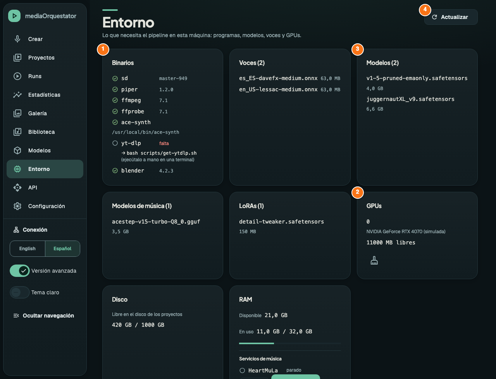

1. **Binarios**: `piper`, `sd`, `ffmpeg`, `ffprobe` (los cuatro obligatorios) y `nvidia-smi` (opcional, solo para avisar de la VRAM). También `yt-dlp`, opcional, solo para añadir como origen el audio de un vídeo de YouTube (`bash scripts/get-ytdlp.sh`). También aparecen `ace-lm`, `ace-synth` y `ace-server`, el motor de música: son opcionales y solo hacen falta para los proyectos de música y para la música de fondo generada (se instalan con `bash scripts/build-acestep.sh`; `ace-server` solo si eliges el motor de servidor). Si alguno sale como «falta», debajo aparece el comando que lo arregla (por ejemplo `bash scripts/get-piper.sh`).
2. **GPUs**: tus tarjetas, con el índice (0, 1…) que usarás después para elegirlas y la memoria libre ahora mismo. Si el escritorio o Ollama usan una GPU, aquí verás menos memoria libre. Si Ollama tiene un modelo cargado en una GPU (lo retiene unos minutos tras usarlo) o queda poca VRAM libre (menos de 6 GB), la tarjeta lleva un aviso, el mismo que sale en el formulario de lanzar de Runs; el botón **Liberar VRAM de Ollama** descarga los modelos cargados para que el render tenga la memoria. Cada tarjeta tiene un botón **Liberar memoria**: descarga esos modelos, para esos contenedores y dice qué soltó (un contenedor que un run está usando no se para, y la fila dice por qué). El último panel, **RAM**, muestra la memoria disponible y en uso (`ram` en el informe). Debajo, **Disco** muestra el espacio libre del disco que guarda los proyectos y avisa cuando es poco (menos de 20 GB; se cambia con `ORCHESTRATOR_MIN_FREE_GB`, o `0` para quitar el aviso). El mismo aviso sale bajo la tabla de proyectos y en el formulario de lanzar de Runs; nunca impide un run.
3. **Modelos**: lo que ya hay instalado en `models/`. Los de música (`models/music/`) y los de retoque (FLUX.1 Kontext y Qwen-Image-Edit, con sus codificadores de texto y VAE) tienen cada uno su propio recuadro, para no confundirlos con los modelos de imagen.
4. **Actualizar**: vuelve a comprobar (útil tras instalar algo).

> Si algo obligatorio falta, instálalo con los scripts de `scripts/` (ver la [guía de instalación](../../mediaOrquestator/docs/INSTALL.md); también puedes ejecutar `bash scripts/install.sh`, que detecta lo que falta y te pregunta si instalarlo) y pulsa **Actualizar**.

### Pantalla «Configuración»: dónde está Ollama

El asistente de prompts, **Describir una referencia** y la revisión de clips usan un Ollama. **Configuración** (la última del menú lateral) muestra la dirección en uso y de dónde sale: la **guardada ahí**, la variable `OLLAMA_HOST` del servidor, o la de por defecto (`http://127.0.0.1:11434`, este equipo). Para usar un Ollama de otra máquina de tu red, escribe su dirección (por ejemplo `192.0.2.50:11434`), pulsa **Probar conexión** (te dice si responde, su versión y sus modelos, marcando los que **leen imágenes**) y **Guardar**: vale al momento, sin reiniciar. **Usar la del entorno** quita lo que guardaste. Una dirección con usuario, ruta u otro esquema se rechaza con el motivo.

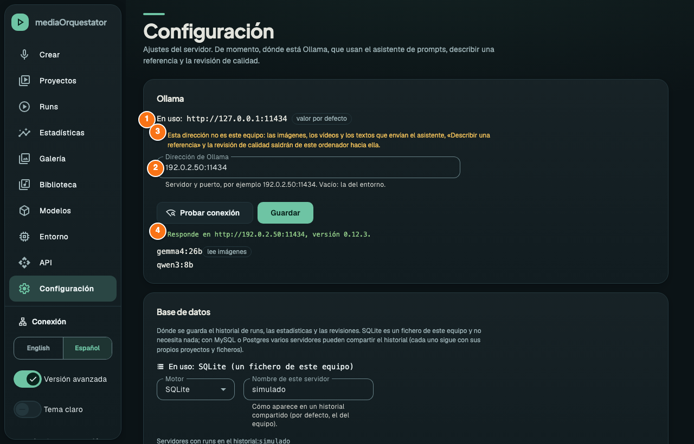

1. **En uso**: la dirección en que se alcanza a Ollama y de dónde sale (aquí la de por defecto, este equipo).
2. **La dirección**: escribe otra (una máquina de tu red, por ejemplo `192.0.2.50:11434`).
3. **El aviso**: aparece siempre que la dirección no es este equipo; lo que envían el asistente, Describir una referencia y la revisión de calidad sale de tu máquina.
4. **Probar conexión**: si responde, su versión y sus modelos, marcando los que **leen imágenes**. **Guardar** la deja en uso, sin reiniciar.

**Privacidad.** Cuando la dirección no es este equipo, la pantalla muestra un aviso: las imágenes, los vídeos y los textos que envían el asistente, Describir una referencia y la revisión de calidad **saldrán de tu máquina** hacia esa dirección. Usa solo un Ollama de tu confianza.

### Proveedores y claves de API

Bajo la tarjeta de Ollama, **Proveedores** lista el Ollama integrado (solo lectura) y los que añades: otro **Ollama**, o cualquier servidor **compatible con OpenAI** (OpenAI, OpenRouter, Together, Groq, vLLM, LM Studio…). **Añadir proveedor**: un nombre, el tipo, la dirección (en los compatibles con OpenAI con `https://`, terminando en `/v1` si lleva ruta, como `https://openrouter.ai/api/v1`), el modelo de texto y el de visión, y la clave de API. **Probar** lista los modelos que ofrece y te dice si la clave se rechaza.

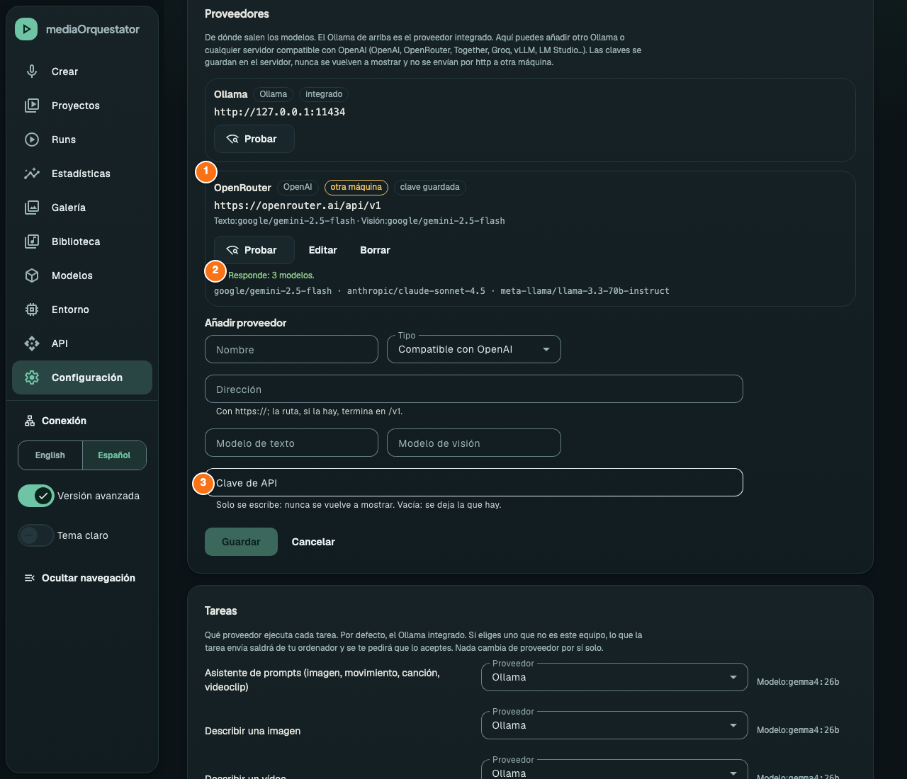

1. **Un proveedor**: su tipo, las marcas *otra máquina* y *clave guardada*, su dirección y los modelos de texto y de visión, con **Probar**, **Editar** y **Borrar**.
2. **El resultado de la prueba**: si respondió y los modelos que ofrece (o el motivo si no).
3. **La clave**: de solo escritura; no se vuelve a mostrar.

- **La clave es de solo escritura.** Se guarda en el servidor, en su propio fichero, y no se vuelve a mostrar: al editar un proveedor el campo sale vacío y una marca dice que hay una clave guardada; déjalo vacío para conservarla o usa **Quitar la clave**. Nunca se envía por `http` plano a otra máquina (usa `https`; `http` solo vale hacia este equipo) y nunca aparece en la API, en las exportaciones, en `scenes.yaml` ni en los logs.
- **Otra máquina.** Un proveedor que no es este equipo se marca como «otra máquina».
- Estos proveedores se registran y se prueban aquí; **Tareas**, más abajo, elige cuál ejecuta cada tarea.

### Tareas: elegir dónde se ejecuta cada cosa

Bajo Proveedores, **Tareas** tiene una fila por tarea (el asistente de prompts, describir una imagen, describir un vídeo, la revisión de clips) con un selector de proveedor. Todo empieza en el Ollama integrado. Si eliges un proveedor que **no es este equipo**, un diálogo dice qué envía esa tarea (textos, imágenes y vídeos, o fotogramas de tus clips) y a qué dirección, y la elección solo se guarda si aceptas; si luego cambias la dirección del proveedor hay que volver a aceptar. Aparece entonces una insignia **☁ externo · nombre** junto a los botones que lo usan (Mejorar con IA, Describir una referencia, la revisión de calidad…), y Describir una referencia muestra «hasta N llamadas a nombre» antes de empezar (un trabajo en un proveedor remoto hace como mucho 60 llamadas; se cambia en la tarjeta).

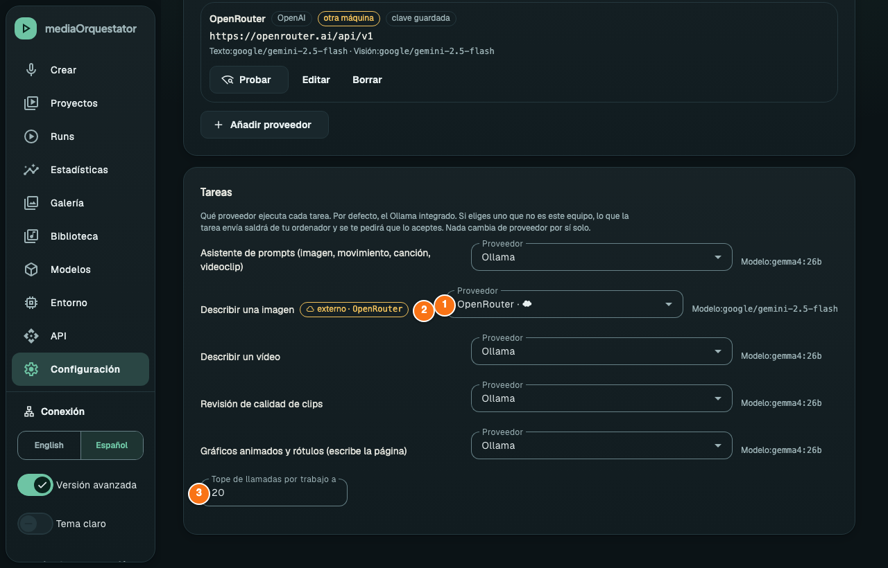

1. **El proveedor** de una tarea; los que no tienen el modelo que la tarea necesita aparecen deshabilitados, con el motivo. Elegir uno que no es este equipo abre el diálogo de consentimiento.
2. **La insignia** «☁ externo · nombre», que también sale junto a los botones que usan esa tarea.
3. **El tope** de llamadas que un trabajo puede hacer a un proveedor remoto.

Si un modelo de la nube **se niega** a describir algo, el editor ofrece **Probar con** los demás proveedores, el Ollama local entre ellos: un clic, y solo entonces se envía algo. Nada cambia de proveedor por sí solo.

Si no tienes conexión con un modelo, los botones que lo necesitan **no se muestran** (Mejorar con IA, Sugerir movimiento, Escribir con IA en canciones, la IA del plan de videoclip, Describir una referencia). Si Ollama (o el proveedor que elegiste) **responde pero le falta el modelo adecuado**, donde irían los botones aparece un aviso breve que dice qué instalar (por ejemplo `ollama pull gemma4:26b` para un modelo que lea imágenes) con un enlace a **Configuración**. Cuando el modelo está y vuelves a la ventana, los botones reaparecen solos. El botón *Analizar* de la revisión de calidad se muestra siempre: mide color y nitidez sin modelo.

## 4. Modelos: descargar lo que hace falta

Todo se hace desde la pantalla **Modelos**, sin tocar la terminal.

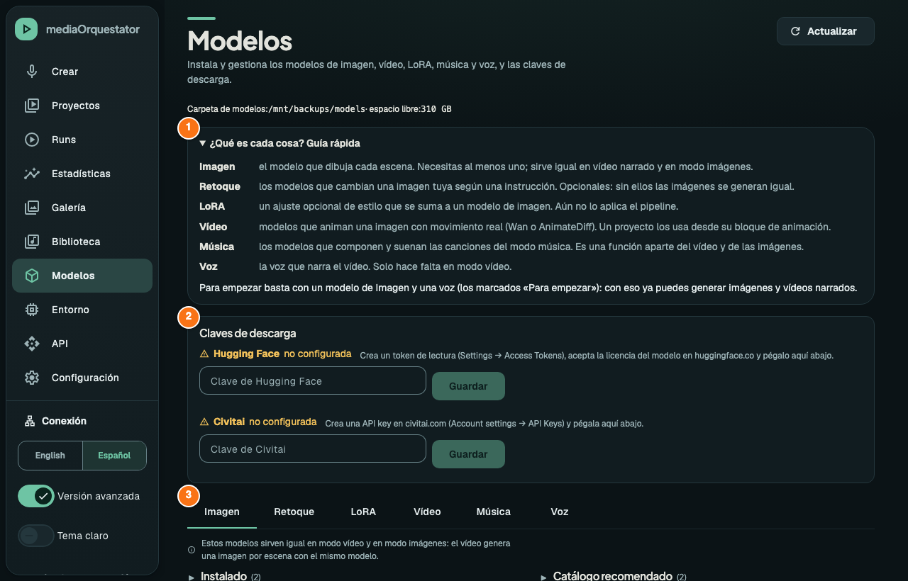

1. **Guía**: un desplegable corto que explica para qué sirve cada tipo de archivo y por cuál empezar.
2. **Claves de descarga**: Hugging Face<!--[private]--> y Civitai<!--[/private]-->. Algunas descargas exigen una cuenta (la clave se pega aquí y se guarda en tu máquina). Verás un candado/aviso solo en los modelos que la necesitan.
3. **Pestañas**: separan Imagen, Retoque (los modelos que editan una imagen con una instrucción), LoRA, Vídeo, Música y Voz (la de música se explica [más abajo](#música-crear-canciones)).

### Instalado y catálogo

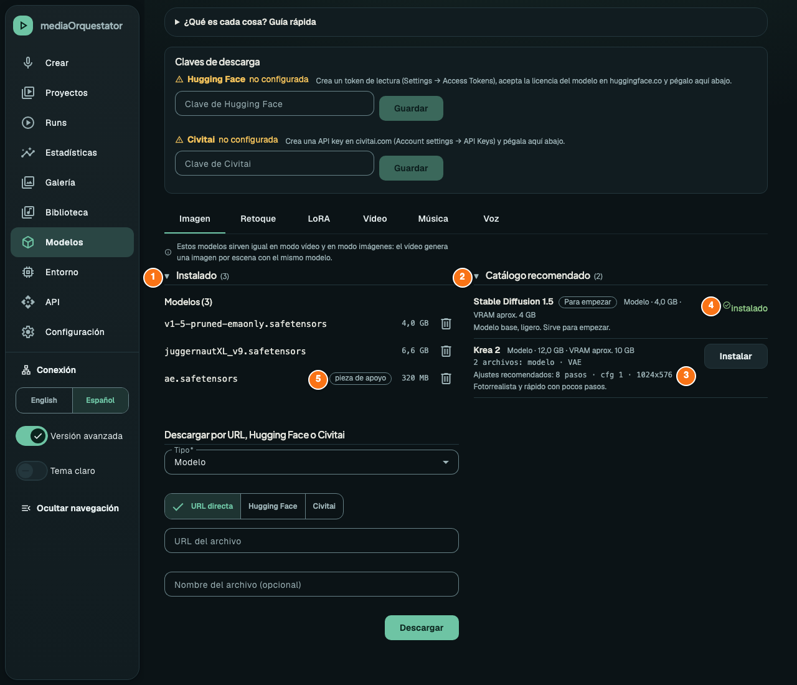

1. **Instalado**: lo que ya tienes. Puedes borrarlo con la papelera.
2. **Catálogo recomendado**: modelos probados con este proyecto. Los que ya tienes aparecen como «instalado»; los demás tienen un botón **Instalar**, y el progreso se ve ahí mismo.
3. **Ajustes recomendados**: lo que ese modelo necesita para dar buena imagen (por ejemplo, Krea 2 e IntoRealism: **8 pasos, cfg 1, 1024x576**). Luego el editor puede aplicarlos con un botón.
4. **instalado**: no hay que volver a descargarlo.
5. **pieza de apoyo**: archivos como el codificador de texto o el VAE. Son parte de un conjunto, **no** se eligen como modelo por sí solos.

Las dos listas **se pliegan** y empiezan **plegadas**: pulsa el título de **Instalado** o de **Catálogo recomendado** (el número entre paréntesis dice cuántas entradas tiene) para abrirla o cerrarla. Funciona igual en todas las pestañas (Imagen, LoRA, Vídeo, Música y Voz), el navegador recuerda cómo dejaste cada una y una lista cerrada no pierde nada: solo se oculta.

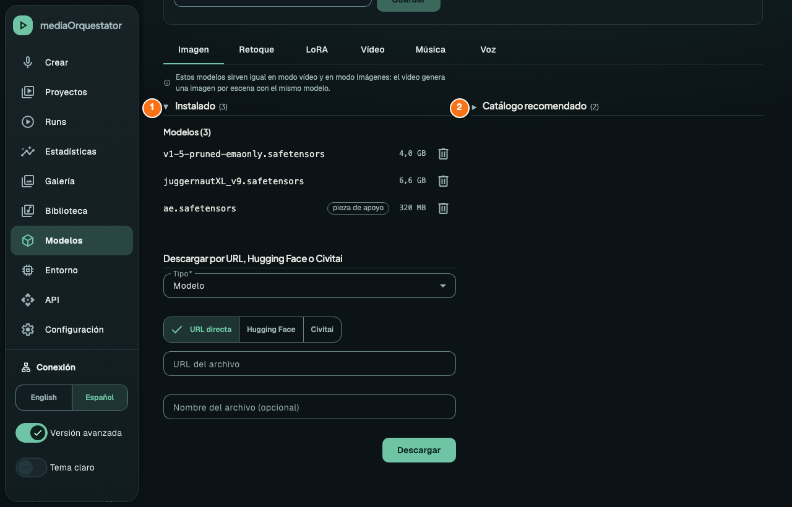

1. **Instalado (3)**: abierta, con sus archivos.
2. **Catálogo recomendado (2)**: plegada; púlsala para abrirla.

### Descargar por URL, Hugging Face<!--[private]--> o Civitai<!--[/private]-->

Para algo que no está en el catálogo:

<!-- private:start -->
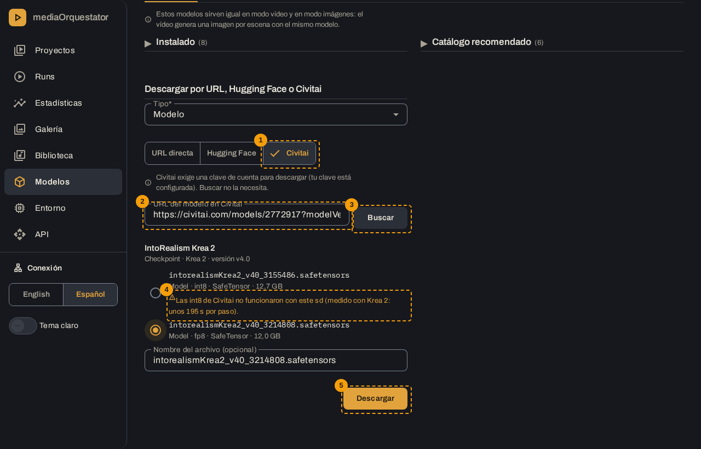
<!-- private:end -->

1. Elige el origen: **URL directa**, **Hugging Face**<!--[private]--> o **Civitai**<!--[/private]-->.
2. Pega la dirección de la página del modelo.
3. **Buscar** consulta los archivos disponibles (no necesita clave).
4. Si hay varias versiones, elige una.<!--[private]--> Verás avisos cuando una variante se sabe que no funciona bien aquí: por ejemplo, **las versiones int8 de Civitai no sirven** tal cual con este `sd` (van en la CPU, unos 26 minutos por imagen); elige fp8 o GGUF. **IntoRealism v5.0** del catálogo, que Civitai solo publica en int8, se convierte a GGUF al instalarlo, así que sí funciona.<!--[/private]-->
5. **Descargar**.<!--[private]--> La clave de Civitai sí se necesita en este paso.<!--[/private]-->

Los modelos se guardan en `models/`, y aparecen solos en el editor.

## 5. Crear un proyecto

En **Proyectos**, **Crear proyecto**, ponle un identificador (sin espacios) y listo. Si quieres, elige ya un **estilo** y una **calidad** (ver [Estilo y calidad](#estilo-y-calidad-elegir-sin-perderse)); si no, el proyecto nace con los valores de siempre.

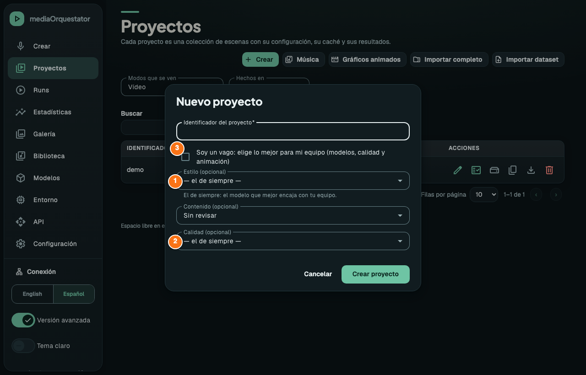

Luego verás la lista:

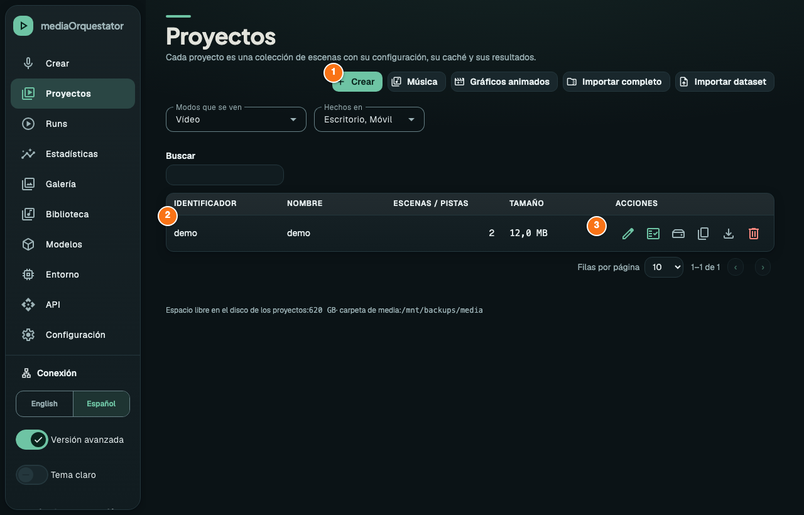

1. **Crear** (el botón destacado es siempre la acción principal de la pantalla). Junto a él, **Música** crea uno para canciones.
2. La fila del proyecto: identificador, nombre, número de escenas (o de pistas, si es de música) y tamaño. El selector **Modos que se ven** sobre la tabla dice qué tipos de proyecto se listan (solo vídeo la primera vez, así que no hay columna de modo; ver [Buscar y elegir los modos](#8-historial-y-borrado)).
3. Acciones de la fila: **editar** (el editor de escenas, o el estudio de música si el proyecto es de música), **revisar los clips**, **almacenamiento**, **duplicar**, **exportar** y **borrar**.

### Tener el espacio bajo control

La lista tiene una columna **Tamaño** (puedes ordenar por ella) y, bajo la tabla, el **espacio libre** del disco. El botón de **almacenamiento** de una fila abre el desglose de ese proyecto, parte por parte, con lo que es cada una y lo que cuesta limpiarla:

- **Caché de escenas** (`tmp/`): suele ser la parte más grande (el 70 % de un proyecto de vídeo). Es lo que evita repetir minutos de GPU; si la vacías, el próximo run rehace todas las escenas.
- **Restos de escenas que ya no existen**: ficheros de escenas que quitaste o renombraste. Tras cada run se borran solos; el botón sirve para proyectos anteriores.
- **Clips de cada escena** y **Animaciones completas** (`out/clips/`): lo que enseña la Galería y lo que otros proyectos pueden copiar.
- **Revisiones** (los fotogramas que enseñan) y **Copias de scenes.yaml** (`scenes.yaml.bak` y similares).
- **Vídeo final y exportaciones** y **Orígenes** son tus resultados y tus entradas: se muestran, pero no se limpian desde aquí.

Cada botón pide confirmación diciendo lo que cuesta, y un proyecto con un run en marcha no se puede limpiar.

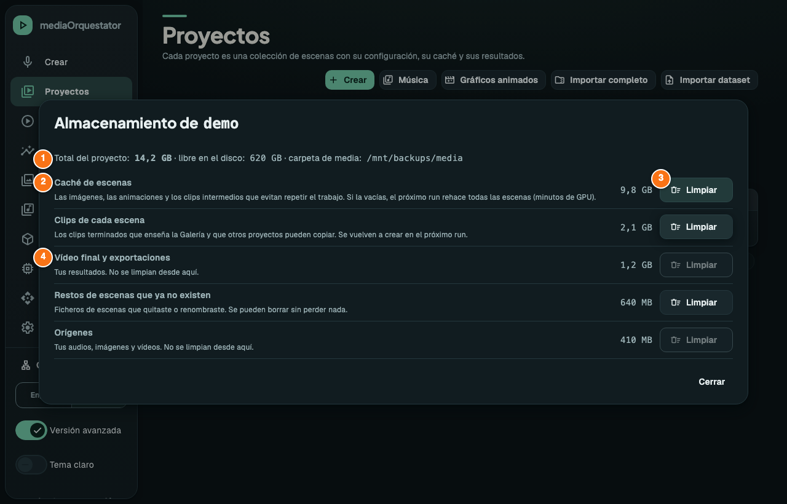

1. El **total** del proyecto y el **espacio libre** del disco.
2. Cada parte dice **qué es y lo que cuesta limpiarla**; la más grande primero.
3. **Limpiar** quita solo esa parte, tras preguntar.
4. **Vídeo final y exportaciones** y **Orígenes** se muestran, pero su botón está desactivado: son tuyos.

## 6. El editor, por secciones

El editor tiene varias tarjetas apiladas, plegadas al abrirlo: Salida, Estilo y calidad, Defaults, Animación, Música de fondo, Escenas con partes del catálogo (ver [Escenas dibujadas por una parte del catálogo](../apps/dashboard-full/README.md#scenes-drawn-by-a-part-of-the-catalog)) y la lista de Escenas. Todo lo que cambias se guarda en el `scenes.yaml` del proyecto.

### Salida

Elige el **modo**: `video` (todo el pipeline), `images` (solo imágenes, sin narración) o `music` (canciones; ver [Música](#música-crear-canciones)) y el archivo de salida (`out/live.mp4` en el ejemplo).

**Contenido.** Debajo del modo dices si el proyecto es para adultos: **Sin revisar** (por omisión), **Revisado: apto para todos** o **Para mayores de 18**. El servidor arranca *censurado*: los proyectos marcados para mayores de 18 no aparecen en ningún sitio (lista, galería, runs, estadísticas) y no se pueden abrir. Si lo arrancas con `--strict`, también oculta los que no están marcados como revisados. La pantalla Entorno dice en qué modo está el servidor.

### Revisar los clips desde el dashboard

Cuando el vídeo está hecho, abre **Proyectos → Revisar los clips** (o *Revisar los clips* en el run terminado). *Analizar* mide el color y la nitidez de cada clip y, si eliges un modelo de visión de Ollama, busca caras y cuerpos deformados. Cada **hallazgo** muestra el fotograma señalado, lo que se ha visto y **cómo se arreglará**: recortar el clip, rehacerlo con otra semilla, cambiar el prompt de movimiento (el asistente puede proponer uno más tranquilo) o el de la imagen. Puedes cambiar el arreglo, ignorar un hallazgo y lanzar uno, los marcados o todos como tareas por la cola de runs; cada hallazgo sigue a su run. Si has visto algo que el análisis no vio, escríbelo en *Añadir lo que has visto* con la escena y el segundo. Las revisiones antiguas se borran como los runs. Lo mismo está en el terminal con `orchestrator check`.

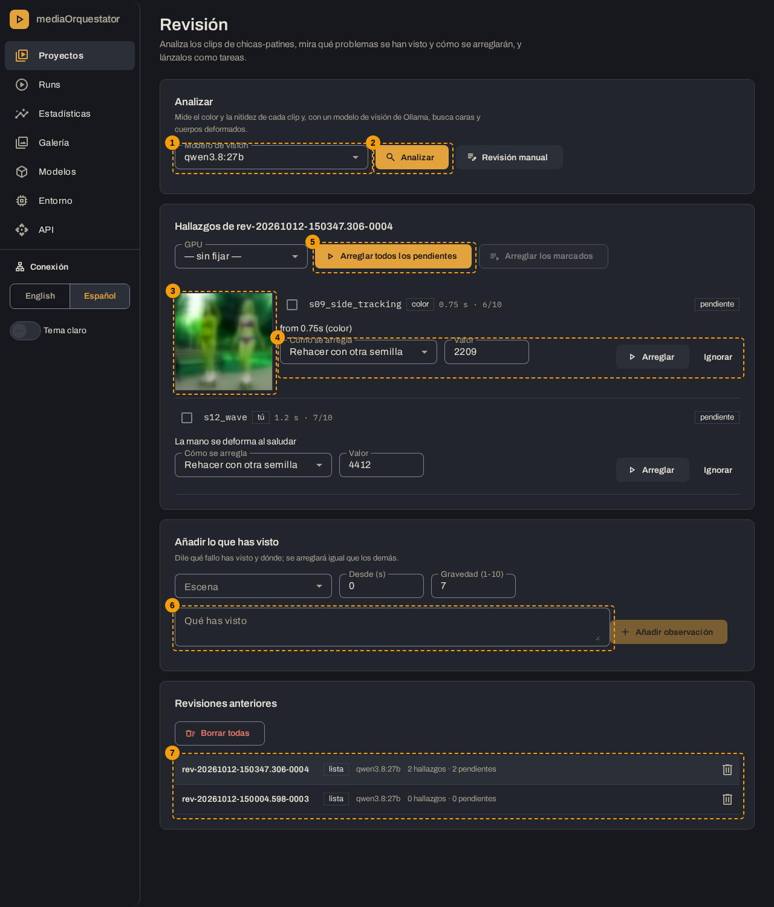

1. **Modelo de visión**: los modelos de Ollama que saben leer imágenes (se recuerda el último que usaste); sin uno solo se miden el color y la nitidez.
2. **Analizar**: revisa cada clip animado del proyecto, con su progreso.
3. **El fotograma** señalado, como prueba. (En esta imagen se difuminó a propósito el clip de `s09_side_tracking` para que el análisis encuentre algo.)
4. **Cómo se arreglará**: el tipo de arreglo y su valor; puedes cambiar los dos (recortar el clip, otra semilla, otro prompt de movimiento, otro prompt de imagen) o ignorar el hallazgo.
5. **Arreglar todos los pendientes** (o solo los marcados, o uno con su propio botón *Arreglar*): cada arreglo se aplica a `scenes.yaml` y la escena se rehace por la cola de runs; el hallazgo sigue a su run.
6. **Añadir lo que has visto**: un hallazgo tuyo, con la escena, el segundo y lo que viste (el segundo hallazgo de la imagen, `s12_wave`, es uno de esos).
7. **Revisiones anteriores**, que se borran de una en una o todas a la vez, como los runs.

### Usar un clip que ya tienes

Si un plano sale mal con el modelo del proyecto, hazlo en otro sitio (otro proyecto con un modelo mejor, otra herramienta) y tráelo: en la escena elige **Mi clip**, junto a *Generar con IA* y *Mi imagen*, y escoge un vídeo, sube uno o toma **un clip que otro proyecto conservó** (cada run conserva el clip de cada escena y, en las generadas, su animación completa, así que puedes reutilizar el bueno y recortarlo de nuevo). La escena dura lo que diga su narración o `silence_seconds`: un vídeo más largo se corta, uno más corto se ralentiza un poco y se repite. El clip tiene los campos **Desde** y **Hasta** (una escena animada también los tiene, para usar solo la parte buena de la animación) y un campo **Velocidad**: 0,5 la reproduce a la mitad, 2 al doble, vacío la deja automática (en segundos) con botones que toman el instante en que has pausado la vista previa, para usar solo la parte buena. Un clip tomado de otro proyecto se **copia**, así que borrar ese proyecto no rompe este. No queda nada suelto: tras un run se quitan los clips de escenas que ya no existen, el vídeo que ninguna escena usa se borra al guardar, y borrar un proyecto o los ficheros de un run borra los clips conservados. En el fichero es `clip: stand-up.mp4` (ver `SCENES_YAML.md`).

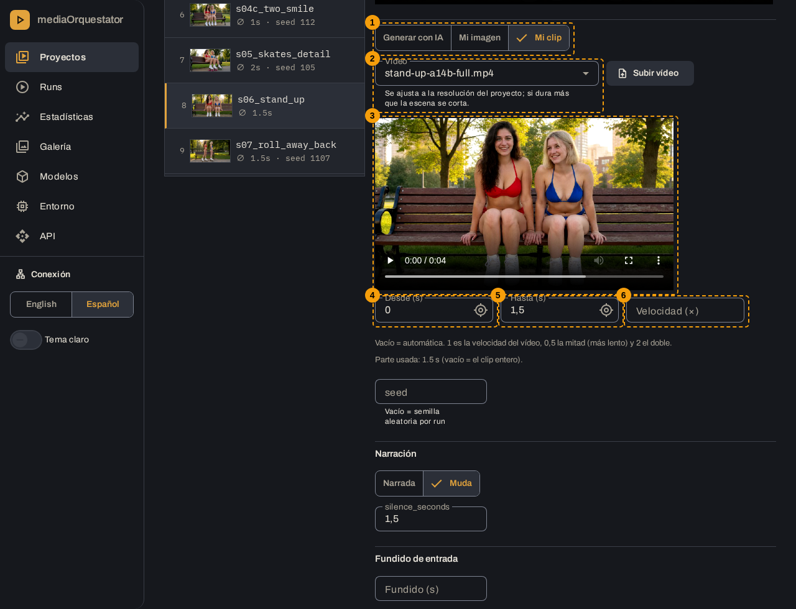

1. **Mi clip**, junto a *Generar con IA* y *Mi imagen*.
2. **El vídeo**: uno de los `sources/` del proyecto, uno que **conservó otro proyecto** (el grupo *Clips de otros proyectos*, que se copia al elegirlo) o *Subir vídeo*.
3. **La vista previa** del clip elegido (aquí, la animación completa hecha con el A14B para el plano de levantarse).
4. **Desde** y 5. **Hasta**, en segundos, con el botón dentro de cada campo que toma el instante en que has pausado la vista previa; aquí la parte va de 0 a 1,5 s.
6. **Velocidad**: vacío es automática, 0,5 la reproduce a la mitad y 2 al doble.

### Estilo y calidad: elegir sin perderse

Con tantos modelos y ajustes, esta tarjeta rellena el formulario de una vez a partir de lo que **ya tienes instalado**:

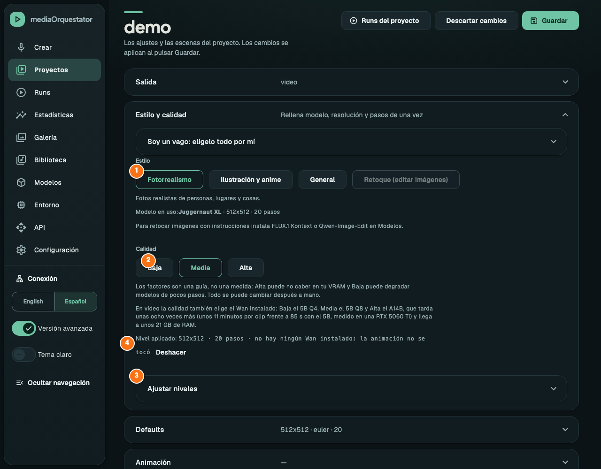

1. **Estilo** (Fotorrealismo, Ilustración y anime, General, **Retoque**): elige el mejor modelo instalado para ese estilo y sus ajustes recomendados. Un estilo sin ningún modelo instalado aparece desactivado. El actual aparece resaltado y una línea bajo los botones dice qué es. **Retoque (editar imágenes)** cambia el proyecto al modelo de edición (FLUX.1 Kontext o Qwen-Image-Edit, que se instalan desde Modelos; con los dos instalados eliges **Rápida**, unos 40 s y con licencia no comercial, o **Precisa**, unos 2 min y de uso comercial libre): cada escena necesita entonces su imagen de partida y su prompt es la instrucción («ponle una gorra roja»). También es una opción en la lista de estilos de **Crear proyecto**, y elegir otro estilo devuelve al proyecto su modelo de imágenes.
2. **Calidad** (Baja, Media, Alta): escribe resolución y pasos (la resolución **nunca pide más de lo que aguanta tu tarjeta** con ese modelo: Alta con IntoRealism en una de 16 GB pide 1216x640, no 1280x704, que se quedó sin memoria en un run real) (Media es el preset del modelo; Baja usa menos resolución y la mitad de pasos; Alta, más resolución y 1,5 veces los pasos). En modo imágenes pone además las **variantes** (1, 2 o 4 semillas distintas por escena) y, si lo defines, un **LoRA**. En modo vídeo elige también el **Wan** instalado: Baja el 5B Q4, Media el 5B Q8 y Alta el A14B (mucho más lento).
3. **Ajustar niveles**: cambia los valores de cada nivel (resolución, pasos, variantes, LoRA, ajustes de Wan). Se guardan en tu navegador; **Restaurar** vuelve a los calculados.
4. Tras aplicar un nivel, una nota dice lo que escribió y ofrece **Deshacer**. Nada se aplica al abrir un proyecto, y el estilo y el nivel no se guardan en el proyecto: solo los valores que escriben, que sigues pudiendo cambiar a mano.

Los factores son una guía, no una medida: Alta puede no caber en tu VRAM y Baja puede dejar corto a un modelo de pocos pasos.

**Calidad por escena.** Lo de arriba fija la calidad común del proyecto.

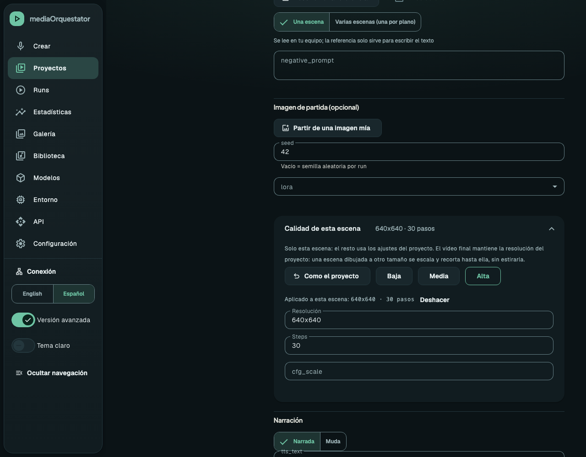

 Cada escena tiene además su sección plegable **«Calidad de esta escena»** (en el formulario de la escena): ahí le das **Baja, Media o Alta solo a esa escena**, o editas a mano su resolución, pasos y cfg_scale (y, si la escena anima, la resolución, los fotogramas y los pasos de Wan). **«Como el proyecto»** le quita los ajustes propios y **«Deshacer»** devuelve lo que tenía. Así puedes dibujar una escena clave a más resolución y con más pasos (y animarla con más fotogramas) y el resto rápido y barato. Notas: el **modelo** (y el modelo Wan) sigue siendo el del proyecto; el **vídeo final mantiene la resolución del proyecto** (una escena dibujada a otro tamaño se recorta hasta ella, sin estirarla); y cada escena tiene su propia caché, así que cambiar los ajustes de una solo la regenera a ella.

### Soy un vago: elígelo todo por mí

Si no quieres elegir nada, arriba de la tarjeta **Estilo y calidad** está **Soy un vago**. Solo dices **cuánto estás dispuesto a esperar** (de 15 minutos a «toda la noche», o «lo que haga falta», que es la mejor calidad que hay) y él elige lo demás:

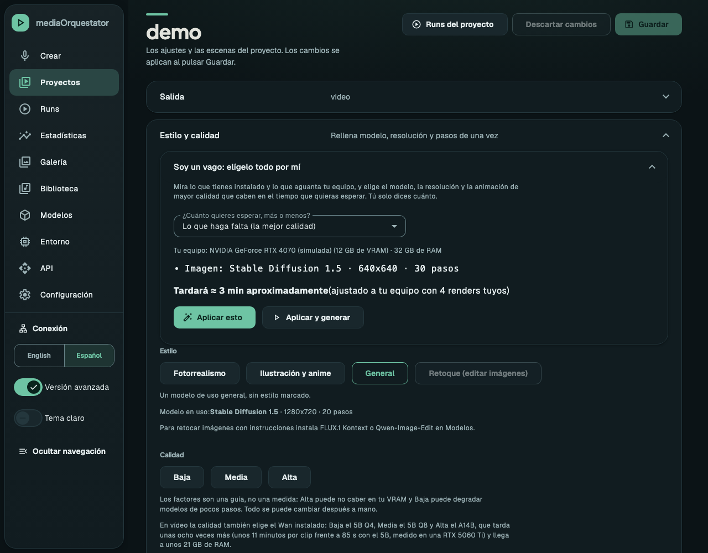

- Mira **lo que tienes instalado** (modelos de imagen, Wan, AnimateDiff, MiniMax H3, LTX 2.3) y **tu equipo**: la memoria de la tarjeta gráfica y la RAM. Lo que no cabe se deja fuera y te dice por qué («MiniMax H3 está instalado pero no cabe en este equipo»).
- Elige la **mejor animación que cabe en el tiempo** que le diste, de mejor a peor: MiniMax H3, Wan A14B, LTX 2.3, MiniMax H3 en borrador (con el LoRA turbo), Wan 5B Q8, Wan 5B Q4 y AnimateDiff; y el mejor modelo de imagen para el estilo que ya tiene el proyecto. Si la mejor animación no cabe, primero abarata las imágenes antes de bajar a una animación peor.
- **Anima las escenas**: la casilla **Animar las escenas** (marcada por defecto, aparece cuando algo instalado puede animar en tu equipo) activa la animación en todas las escenas que no traen su propio clip, para que el vídeo se mueva; desmárcala para dejar las escenas como están. Una escena que añadas después a un proyecto que ya tiene animación configurada también nace animada.
- **Limita la resolución de las imágenes a lo que aguanta tu tarjeta**: un modelo que usa casi toda la memoria (IntoRealism en 16 GB) no recibe el nivel más alto, porque a 1280x704 se quedó sin memoria en un run real; te avisa con «la resolución se limita a 1216x640» cuando lo hace.
- Te enseña **lo que escribiría** (modelo de imagen, resolución, pasos, animación) y **cuánto tardaría**. No cambia nada hasta que pulsas **Aplicar esto**, y **Deshacer** deja el proyecto exactamente como estaba.
- Si ni lo más rápido cabe en la espera, te lo dice y te propone eso más rápido. Si hay un modelo mejor que no tienes instalado pero cabría en tu equipo, te sugiere instalarlo desde Modelos.
- **Aplicar y generar** lo hace todo de un clic: aplica el plan, guarda el proyecto, lanza el run y te lleva a verlo. El estudio de música tiene lo mismo (**Aplicar y crear las canciones**). Y al crear un proyecto, marca **Soy un vago** en la ventana de proyecto nuevo: el proyecto nace con el mejor modelo de imagen, su nivel más alto y la mejor animación que tu equipo aguanta, sin escenas todavía.

Los tiempos son **una estimación**: cada modelo lleva cuánto tardó en la máquina donde se midió (una RTX 5060 Ti de 16 GB). Hasta que hayas generado unas cuantas imágenes, los escala a tu tarjeta con una tabla por familias (si tu tarjeta no está en la tabla, te avisa de que la cifra es a ojo). **Tras tus primeros runs aprende de ellos**: compara cada imagen y cada animación que hace tu equipo con lo que esperaba y usa la mediana de las últimas, y el panel dice «ajustado a tu equipo con N renders tuyos». Sirve para decidir, no es una promesa.

### Defaults: el modelo y los ajustes comunes

Lo que pones aquí vale para **todas** las escenas (cada una puede sobrescribirlo).

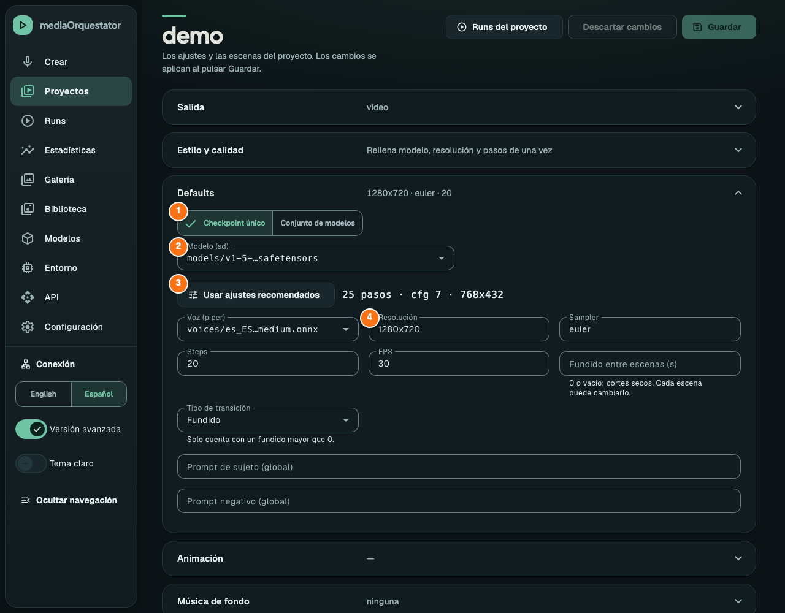

1. **Checkpoint único / Conjunto de modelos**: elige cómo vas a configurar el modelo (ver [conceptos](../../mediaOrquestator/docs/TUTORIAL.es.md#2-conceptos-mínimos)).
2. **Modelo de difusión** (y, en conjunto, también codificador de texto y VAE). Las listas se llenan con lo que tienes instalado.
3. **Usar ajustes recomendados**: aparece cuando el modelo elegido tiene preset. Escribe de una vez pasos, resolución y cfg_scale. **Nunca se aplica solo**: tú decides.
4. **Resolución, Steps, Sampler, FPS…**: los valores que acaba de rellenar el botón. `Steps` son los pasos de dibujado: más pasos = más tiempo; los modelos «Turbo» están hechos para pocos (8).

Además tienes **Voz (piper)** para la narración y los prompts globales: **sujeto** (se antepone a todas las escenas, útil para que el personaje sea el mismo) y **negativo** (lo que no quieres ver).

### Animación (Wan o AnimateDiff)

Si no marcas nada, cada escena se queda como una imagen con un zoom o un paneo suave (lo decide el campo «movimiento de cámara»). Si quieres que la imagen **se mueva de verdad**, activa la animación (con Wan, o con AnimateDiff si prefieres algo más ligero y sutil):

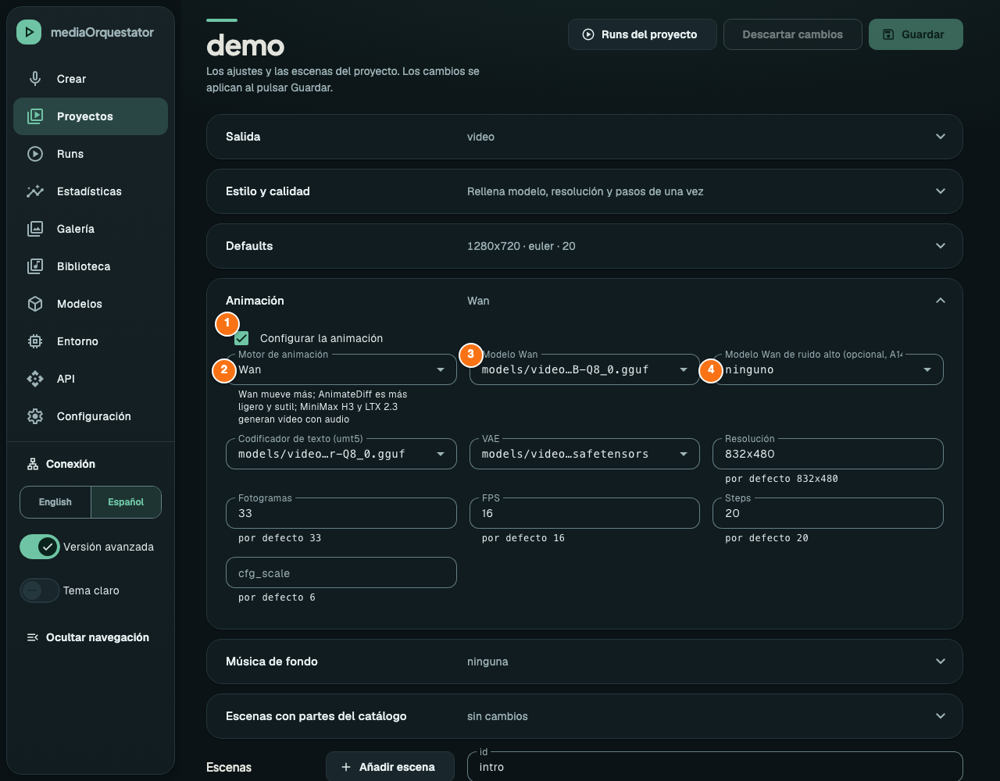

1. **Configurar la animación**: activa la sección. Necesita archivos de la pestaña Vídeo de Modelos.
2. **Motor de animación**: Wan (mueve más) o AnimateDiff (más ligero y de movimiento sutil: olas, viento, un retrato que respira). Al elegir AnimateDiff se rellenan solos el módulo de movimiento y el modelo SD 1.5 instalados, con los ajustes recomendados y un «Deshacer». Hay dos más, **MiniMax H3** (vídeo con audio, se explica más abajo) y **LTX 2.3** (vídeo con audio, más rápido, con un paquete de cinco ficheros de Modelos > Vídeo: al elegirlo se rellenan sus ficheros y ajustes, la imagen es el primer fotograma del clip y cabe en una tarjeta de 12 GB).
3. **Modelo Wan**: el modelo de vídeo (el de 5B es el rápido).
4. **Modelo Wan de ruido alto (opcional)**: solo para la versión A14B, de más calidad pero mucho más lenta y con más RAM. Déjalo en «ninguno» si empiezas.

Con AnimateDiff, en lugar de los modelos de Wan ves el **modelo de imagen SD 1.5** (no vale uno SDXL), el **módulo de movimiento** y el campo **strength** (cuánto se aleja de la imagen: más alto, más movimiento). Conviene una resolución con la proporción de tu vídeo, por ejemplo 640x352 para 1280x704.

Los campos vacíos usan sus valores por defecto, y se ven en pequeño debajo («por defecto 832x480», 33 fotogramas, 16 fps…).

> **Vídeo con audio:** MiniMax H3 es un tercer motor, explicado en [su propia sección](#vídeo-con-audio-minimax-h3) justo después de esta.

> Tiempos medidos aquí (GPU 5060 Ti): Wan 5B ≈ 85 s por escena; A14B ≈ 680 s por escena y ~21 GiB de RAM; AnimateDiff ≈ 60-80 s por clip de 2 s; MiniMax H3 ≈ 260-290 s por plano (≈ 100 s con el LoRA turbo); LTX 2.3 ≈ 145 s por plano de 2 s a 768x416 (116 s en una RTX 4070 de 12 GB).

> **Si el movimiento no sale bien**: cada escena es **una imagen animada durante 2 a 4 segundos**, guardada hacia delante y luego marcha atrás para que haga bucle; no es un clip continuo. Pide **una sola acción por escena**, haz que la escena dure **lo que la parte hacia delante** (fotogramas ÷ fps: 33 fotogramas a 16 fps = 2,06 s) para que no llegue a la mitad invertida, y corta entre escenas en lugar de esperar que una fluya hacia la siguiente. Hay un ejemplo completo, con su `scenes.yaml`, [al final de este tutorial](../../mediaOrquestator/docs/TUTORIAL.es.md#un-ejemplo-completo-dos-amigas-en-un-banco-que-se-van-patinando).

### Vídeo con audio: MiniMax H3

MiniMax H3 es un tercer motor de animación que genera **vídeo y audio estéreo a la vez** a partir de la imagen de la escena (la imagen se usa como referencia, así que se mantienen el sujeto y el estilo). Es más pesado que Wan: úsalo cuando quieras un plano corto de mucha calidad con su propio sonido.

1. **Instálalo**: en **Modelos > Vídeo > Catálogo recomendado**, «MiniMax H3 Ref2VA». Es un paquete de cinco archivos (unos 37 GB): el modelo de vídeo, el codificador de texto, los dos VAE y un LoRA turbo. La ficha muestra los ajustes recomendados.

   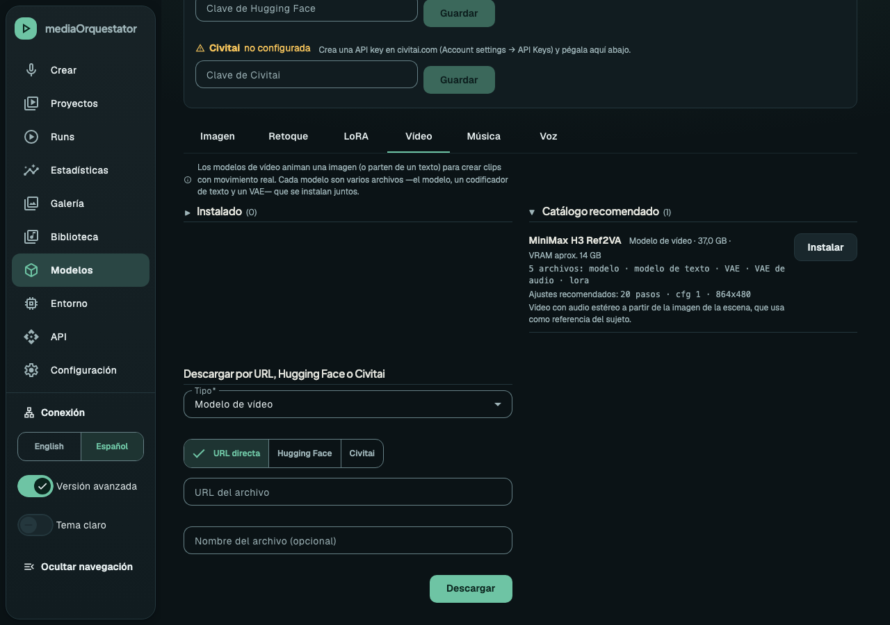

2. **Elígelo en el editor**: **Animación > Motor de animación > MiniMax H3**. De una vez rellena los cuatro archivos del paquete y los ajustes recomendados (864x480, 20 pasos, cfg 1), y el botón «Deshacer» devuelve lo que tenías. Si luego vuelves a Wan, elige sus archivos otra vez (Deshacer, justo después de cambiar, te los devuelve).

   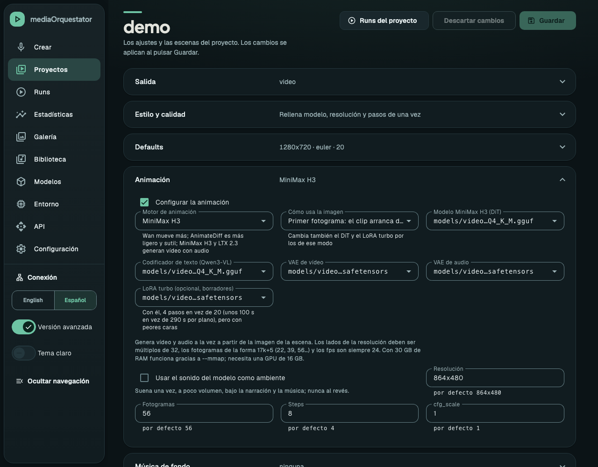

3. **Cuidado con la rejilla**: los lados de la resolución deben ser múltiplos de 32, los fotogramas de la forma 17k+5 (22, 39, **56**…) y los fps son siempre 24. Lo predeterminado, 864x480 y 56 fotogramas, da 2,3 s de vídeo con audio. Por defecto el audio que genera sd no se usa en el vídeo final: se usa el propio del proyecto (narración, música). Para conservar el sonido del modelo como ambiente suave, marca **Animación > Usar el sonido del modelo como ambiente**: suena una vez, a poco volumen, bajo la narración y la música, y nunca al revés.

**Primer fotograma o referencia.** En el catálogo hay dos paquetes de H3. **MiniMax H3 Primer fotograma (FL2VA)** usa la imagen de la escena como **primer fotograma** del clip: el plano arranca exactamente de tu imagen y los sujetos se quedan donde ella los pone. **MiniMax H3 Ref2VA** la toma solo como *referencia* del sujeto, así que la composición puede derivar (en nuestra prueba una de las dos chicas se salió de cuadro). Comparten el codificador y los VAE (no se descargan dos veces); solo cambian el modelo de vídeo y el LoRA turbo. El selector de motor del editor y **Soy un vago** eligen el de primer fotograma cuando está instalado, y *Animación > Cómo usa la imagen* cambia entre los dos (también cambia el modelo de vídeo y el LoRA). Medido con la misma imagen y semilla (dos chicas riendo patinando, 864x480, 56 fotogramas): **290 s a 20 pasos** con las caras limpias hasta el final, y **168 s con el LoRA de 8 pasos** con una calidad muy parecida, donde el de 4 pasos de referencia (96 s) deformaba las caras. Los planos de cintura para arriba (caras grandes) también se leen mejor que los generales, donde las caras son de unos pocos píxeles.

**En una tarjeta de 12 GB.** El paquete de primer fotograma también cabe en una RTX 4070 (12 GB) **a 768x416**: medido con el LoRA de 8 pasos, **108 s por plano** y un pico de 11,2 GB de VRAM, con la misma calidad que a 864x480 (las dos chicas dentro de cuadro, caras limpias). **Soy un vago** lo hace solo en una tarjeta así (escribe 768x416 y te lo dice); a mano, pon `resolution: 768x416` en la animación. Con una imagen mayor no cabe (864x480 pide 13,5 GB).

Lo que necesita y lo que cuesta (medido aquí, RTX 5060 Ti de 16 GB, 30 GB de RAM):

- **RAM**: funciona con 30 GB. Los archivos se leen directamente del disco (`--mmap`, el motor lo activa solo) en vez de copiarse a memoria, así que los 35 GB de los modelos no tienen que caber; la RAM disponible nunca bajó de 28 GB. Se recomienda un SSD.
- **GPU**: unos 13,5 GB de VRAM a 864x480 y 56 fotogramas, así que hace falta una tarjeta de 16 GB. En una de 12 GB no cabe.
- **Tiempo**: unos **260-290 s por plano** con 20 pasos, frente a unos 85 s de Wan 5B.

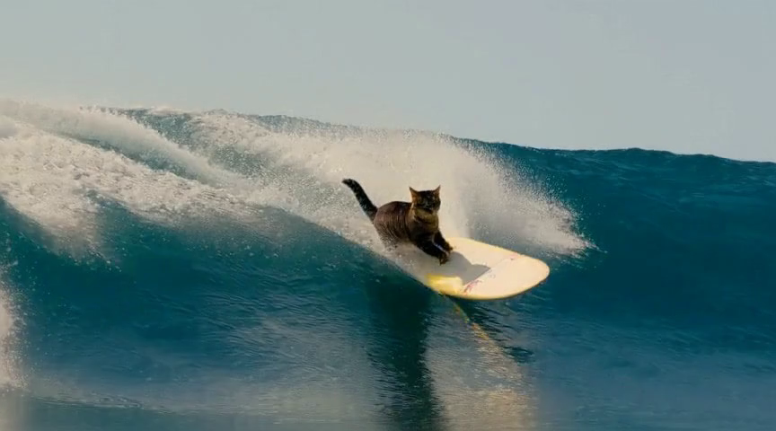

**El LoRA turbo es para borradores.** En el editor es el selector opcional «LoRA turbo» (viene en «ninguno»). Con él los pasos por defecto bajan a 4 y un plano tarda **unos 100 s** en vez de 260-290 s, pero con personas las caras se deforman y el fondo se emborrona en el último medio segundo, claramente más que con 20 pasos y sin LoRA (medido en tres planos de dos chicas). Úsalo para probar prompts y déjalo fuera del render final. En el YAML es `defaults.animate.lora` (ver [SCENES_YAML.md](../../mediaOrquestator/docs/SCENES_YAML.md)).

### Escenas

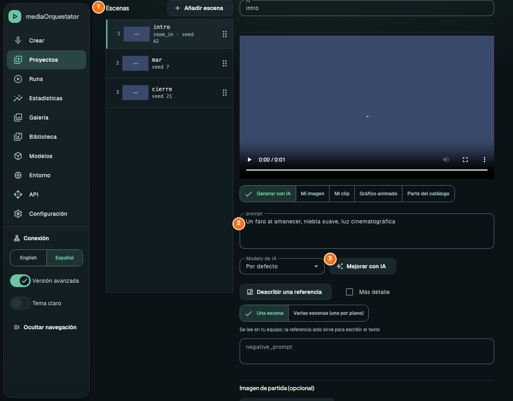

1. **Rejilla de escenas**: la lista de escenas con su miniatura (cuando hay una imagen ya generada). Se arrastran para cambiar el orden y con «Añadir escena» creas otra. En un proyecto de imágenes, el formulario de cada escena enseña **todas las imágenes que un run hizo para ella** (una miniatura por variante; al pulsar una se ve más grande), igual que una escena de vídeo enseña su clip.
2. **prompt**: la descripción de la imagen.
3. **Mejorar con IA**: pide a un modelo local (Ollama, en CPU) que reescriba tu prompt con más detalle. Es una sugerencia: tú aceptas o no. Junto al botón está el **Modelo de IA** (por omisión el del servidor): al abrirlo ves los modelos instalados en Ollama con su tamaño, y los que no caben en la memoria libre o son muy lentos en CPU (más de unos 14 GB) llevan un aviso. Tu elección se recuerda en este navegador y se usa también en el estudio de música. Si el modelo **se niega** a escribir (pasa con descripciones para adultos: es el propio modelo, la aplicación no filtra nada), el aviso lo dice con el nombre del modelo<!--[private]-->; elige otro instalado y vuelve a pedirlo. Para instalar otro: `ollama pull <modelo>` (por ejemplo `huihui_ai/qwen3-abliterated:8b`, de 5 GB, que no se niega)<!--[/private]-->.

Más abajo en la misma escena:

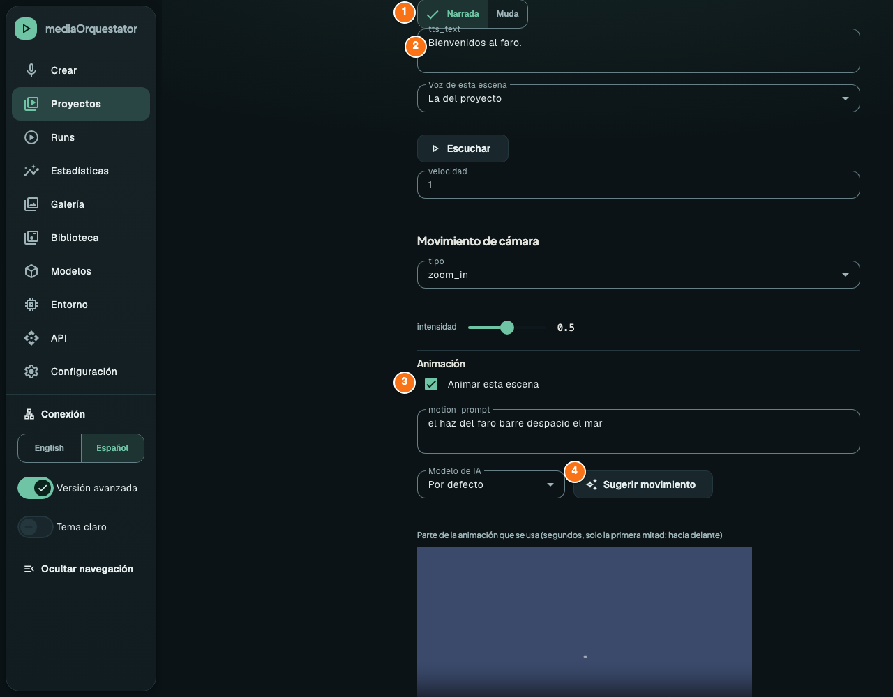

1. **Narrada / Muda**: con narración, el vídeo dura lo que dure el audio; en muda, lo que tú indiques en segundos.
2. **tts_text**: lo que dirá la voz. Debajo, **Voz de esta escena** elige quién lo dice (por defecto, la voz del proyecto de Defaults) y, si esa voz trae varios hablantes (`es_ES-sharvard` tiene un hombre y una mujer), **Hablante** elige uno (Defaults tiene el mismo selector para la voz del proyecto); **Escuchar** lee el texto en voz alta con esa voz y la velocidad de la escena, en segundos y sin lanzar nada, para oírlo antes de generar (hasta 600 caracteres; vuelve a pulsar para parar).
3. **Animar esta escena**: activa la animación solo para esta escena (necesita que antes hayas configurado la animación, con Wan o AnimateDiff, en Defaults).
4. **Sugerir movimiento**: la IA propone el `motion_prompt`, es decir, qué debe hacer la imagen al moverse («she slowly turns a page»).

Y **Acabado**: grano de película y balance de blancos.

## 7. Lanzar un run y seguirlo

Pantalla **Runs**:

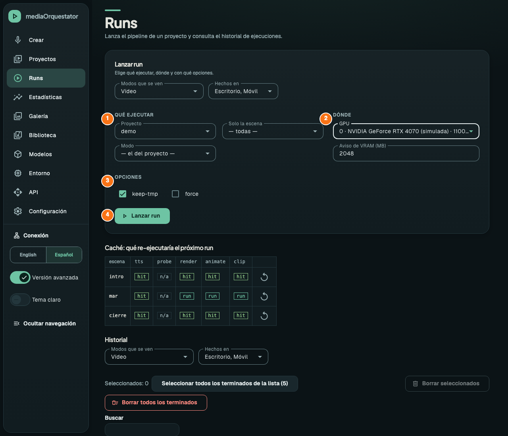

1. **Qué ejecutar**: el **Proyecto**, **Solo la escena** (para probar una sola sin rehacer el resto) y **Modo** (para forzar `images`, `video` o `music` sin tocar el proyecto).
2. **Dónde**: la **GPU** (puedes marcar las dos para repartir escenas) y el **Aviso de VRAM**: si la GPU tiene menos memoria libre que ese valor, te avisa, no cancela.
3. **Opciones**: **keep-tmp** conserva la caché entre runs (déjalo activo, si no, cada run empieza de cero) y **force** ignora la caché y rehace todo.
4. **Lanzar run**.

Debajo, la tabla **Caché** te dice qué haría el próximo run: `hit` = se reutiliza, `always` = siempre se ejecuta, lo demás se rehace.

### El monitor de un run

Al lanzarlo entras en el monitor, que también se abre desde el historial:

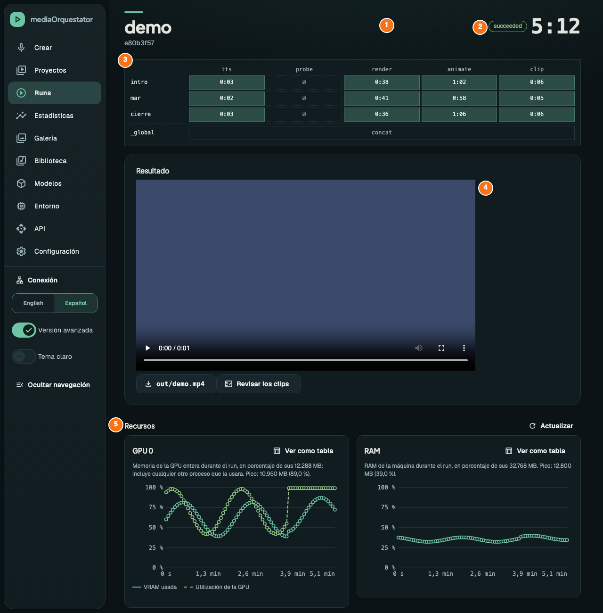

1. Nombre del proyecto y del run.
2. **Estado** (`running`, `succeeded`, `failed`, `cancelled`) y el tiempo total.
3. **Fases por escena**: cada celda es una fase de una escena, con lo que tardó. Mientras trabaja ves cuál está activa.
4. **Resultado**: el vídeo final, que puedes reproducir ahí mismo, y el enlace de descarga.
5. **Recursos**: VRAM y utilización de cada GPU, y RAM de la máquina, durante el run. Sirven para saber si te quedas justo de memoria. Con **Ver como tabla** ves los mismos números. Abajo, el **Log de eventos**.

### Desde el móvil: la pantalla Crear

**Crear** es la primera pantalla del menú y la que abre un móvil en la dirección raíz. Está hecha para pedir cosas desde el teléfono, fuera de casa, sin pasar por el editor. Solo enseña las peticiones hechas en esta pestaña del navegador (recargar las conserva): las anteriores no se listan y quedan en la Galería y en los proyectos, marcadas como **móvil** (ver *Hechos en* más arriba):

1. **Elige qué quieres crear.** Lo primero que ves son tres botones, **Vídeo**, **Imagen** y **Música**, y debajo **Que lo decida la IA**. Elegir el tipo ahorra una llamada al asistente (la que adivinaba si era un vídeo, una imagen o una canción), así que la petición se entiende antes. Una imagen terminada tiene el botón **Editar**: la pone como adjunto de una petición nueva de imagen, y lo que escribas a continuación es la instrucción de retoque («ponle una gorra roja»); se puede encadenar cuantas veces quieras. Con la caja de texto abierta, **Cambiar tipo** vuelve a la elección sin perder lo escrito ni los adjuntos; al enviar, la página vuelve a pedirte el tipo.
2. **Di o escribe lo que quieres** («un gato en una azotea al atardecer», «una canción triste de piano en español»). Toca el micrófono para empezar y vuelve a tocar para parar: tu propio servidor lee la voz (Whisper, en CPU; nada sale a internet) y deja el texto en el campo, donde puedes corregirlo. El micrófono solo aparece en una página segura: sirve el dashboard por HTTPS (mira `docs/SERVER.md`, «HTTPS for the microphone»). Escribir siempre funciona. El clip adjunta una imagen o un vídeo (la generación parte de él) o una canción (de referencia).
3. **Comprueba lo que se ha entendido.** El asistente de prompts decide si es un **vídeo**, una **imagen** o **música**, escribe un título y los textos para el generador; puedes cambiar el tipo con un toque, elegir la duración de una canción o quitar la voz, y abrir el texto que se enviará. Si el asistente no puede responder (espera mientras algo se genera, o no está disponible)<!--[private]--> o su modelo **se niega** a escribir el texto<!--[/private]-->, la tarjeta se rellena con tus palabras, lo dice, y eso es lo que se envía al generador. En imágenes y vídeos también puedes elegir el **aspecto** (automático, fotorrealista, anime o general), limitado a los que tienes modelo.
4. **Una imagen tuya: Retoque, o partir de ella.** Cuando adjuntas una imagen a una petición de imagen, el selector de aspecto gana **Retoque** (solo si instalaste FLUX.1 Kontext o Qwen-Image-Edit desde **Modelos**; con los dos eliges el motor, **Rápida** o **Precisa**, cada uno con una línea que dice en qué se distingue): el texto es entonces una instrucción como «ponle una gorra roja» y solo cambia eso (el asistente reescribe tus palabras, en cualquier idioma, como una instrucción corta en inglés, que puedes leer y corregir en **Instrucción de retoque**; di a quién por dónde está, por ejemplo «el chico de la izquierda», y evita nombrar otros colores) (unos 42 s con Rápida y 2 min con Precisa en una tarjeta de 12 GB, y la imagen conserva su forma). No se retoca nada salvo que lo elijas: con **Automático** (o cualquier otro aspecto) la imagen solo **inicia** una generación, y **Cuánto cambia** marca hasta dónde (poco se parece al original, mucho deja que el texto la reinterprete). Cada aspecto tiene una línea bajo el selector que dice qué es.
5. **En un vídeo, elige el motor y las palabras.** La tarjeta lista los motores que puede correr tu equipo, cada uno con lo que tardaría (MiniMax H3, LTX 2.3, Wan…); **Automático** es el de por defecto y dice cuál usaría. **Lo que dice** guarda las palabras que el vídeo tiene que decir: el asistente las rellena si las pones entre comillas («una mujer en la playa que dice «hola, bienvenidos»») o las escribes tú. Con palabras, Automático elige **LTX 2.3**, que dice la frase él mismo (probado en español y en inglés, unos 130 s para un clip de 3 s); con cualquier otro motor las lee la voz de locución.
6. **En una canción, elige el generador.** Cuando el equipo puede usar más de uno (ACE-Step y, si los instalas desde **Modelos**, HeartMuLa y DiffRhythm2), la tarjeta ofrece **Automático** (ACE-Step, que lo tiene todo) y cada generador con una línea de lo que hace y lo que no. No leen las mismas palabras, así que al elegir otro se **vuelve a pedir al asistente** desde tu petición: ACE-Step recibe una frase de estilo y la letra con `[verse]` y `[chorus]`; HeartMuLa recibe **etiquetas** elegidas de un vocabulario de 109 palabras en siete categorías (primero el género, luego ánimo, instrumentos, tempo, voz, época y producción), que salen como fichas que quitas con un toque y añades desde una lista por categorías; DiffRhythm2 recibe etiquetas cortas en inglés y la letra en inglés, y no puede hacer una canción sin voz. La letra viene en estrofas de cuatro versos con el estribillo repetido igual, y crece con la duración que elijas (corta: dos versos; normal: con puente; larga: tres versos). Sobre el estilo hay diez **combinaciones populares** (Chill Lo-fi, Epic Cinematic, Upbeat Pop, Hip-Hop Beat…) que rellenan las etiquetas con un toque (o la frase de estilo, en ACE-Step). La sugerencia está abierta y se puede editar. **Regenerar sugerencia** escribe otra y, si habías editado el texto, pregunta antes, para que no pierdas lo escrito sin querer. Una canción adjunta como referencia deja solo ACE-Step, el único que la sigue.
7. **Reconocer una canción que suena (opcional).** Junto al micrófono hay un botón con una **oreja**: tócalo, acerca el móvil a un altavoz, deja sonar de 20 a 30 segundos de la canción y vuelve a tocar. Tu servidor mide su tempo y su tonalidad, lee unas palabras de la letra con Whisper y el asistente dice de qué tipo de canción se trata y de qué habla; después la pantalla Crear empieza una petición de **una canción nueva y original de ese tipo** (te dice lo que oyó: tempo, tonalidad, tema). La letra que se oyó y la grabación **no se guardan ni se copian**: la canción nueva tiene letra nueva. Las cifras son estimaciones y el género es la mejor suposición del asistente, que puede fallar con ruido o si la canción no tiene palabras; cuando no sabe, lo dice y tú revisas el estilo. Una canción sin palabras reconocidas no se da por instrumental. Necesita el asistente y el micrófono (página segura, HTTPS).
8. **Pulsa «Hazlo».** Se crea un proyecto llamado `mobile-<fecha>-<título>` con el nivel de resolución elegido en la tarjeta (en el móvil, Borrador; si es Automática, la mejor calidad que admite tu equipo, la misma elección que «Soy un vago») y la tarjeta enseña lo elegido y cuánto tardará más o menos.
9. **Síguelo y mira el resultado.** La tarjeta muestra la cola y el progreso y, al terminar, reproduces el vídeo, ves la imagen o escuchas la canción ahí mismo, con descarga y **Otra variación**. Si cierras la página, al volver se listan de nuevo las últimas peticiones. **Quitar** pregunta antes y luego borra la petición del todo: su proyecto, sus ejecuciones y todo lo que generó.

**Resolución, calidad y gráficos animados.** Cada tarjeta tiene un selector de **resolución** (en una canción, de **calidad**): **Borrador** (la mitad de tamaño, rápido), **Normal**, **Alta** (lo mayor que cabe en tu equipo) y, en vídeo e imagen, **Automática**. En una pantalla estrecha, como el móvil, parte de **Borrador** para no gastar tiempo; en el ordenador, de **Automática**. Una canción siempre parte de **Borrador** y se hace **una sola versión**. Si tienes el modelo de gráficos animados, un vídeo ofrece **Animar una imagen** (con el motor elegido) o **Gráfico animado** (una página que escribe el asistente y dibuja Chrome, sin modelo de imágenes). **Mejorar con IA** (el botón de la varita junto al micrófono) reescribe con el asistente lo que has escrito, con más detalle y en tu idioma, antes de enviarlo; **Deshacer** devuelve tu texto. **Limpiar pantalla** (arriba de la lista) vacía la lista sin borrar nada: los proyectos siguen en la galería y lo que corre sigue corriendo.

**Versión simple y avanzada.** El interruptor **Versión avanzada** del menú elige qué pantallas ves. En una pantalla estrecha parte en **simple**: el menú solo tiene **Crear** y **Galería** (que enseña solo lo hecho desde Crear, en todos los modos) y cualquier otra dirección te lleva a Crear. En el ordenador parte en avanzada. La elección se recuerda en el navegador. En una pantalla estrecha, **API** y **Configuración** no se abren nunca, tampoco en avanzada (llevan a Crear). Oculta pantallas; no protege nada (para eso, mira el acceso con token en `docs/SERVER.md`).

**Claves.** Si adjuntas una foto y escribes una clave, se lanza al momento, sin tarjeta que revisar, un **retoque Preciso** de esa foto con una instrucción fija. Sin foto te pide una. Cada clave se puede escribir en español o en inglés:

- **Código platino** (`code platinum`): peluca rubia platino larga.
- **Código luminoso** (`code bright`): la persona calva, con la cabeza brillante y sin cejas.
- **Código rojo** (`code red`): un payaso, con peluca y maquillaje de payaso.
- **Código militar** (`code military`): maquillaje de camuflaje en la cara.
- **Código total** (`code total`): los cuatro sobre la misma foto, una tarjeta con su variante por cada uno.

El resto del dashboard no está hecho para el móvil: las tablas se desplazan de lado dentro de su recuadro y el editor de escenas y el estudio de música son para una pantalla más grande.

## 8. Historial y borrado

En **Lanzar run**, el **selector de modos** (vídeo, imágenes, música) sobre la lista de proyectos recorta una lista larga al tipo que quieres; el proyecto ya elegido se queda en la lista. Sobre el historial está el mismo **selector de modos** que en Proyectos y en la Galería (vídeo por defecto): muestra solo los runs de los proyectos de los modos elegidos, y la elección se comparte con esas pantallas. Seleccionar y borrar los runs terminados solo alcanza a los que ves; los runs cuyo proyecto ya no existe se listan siempre.

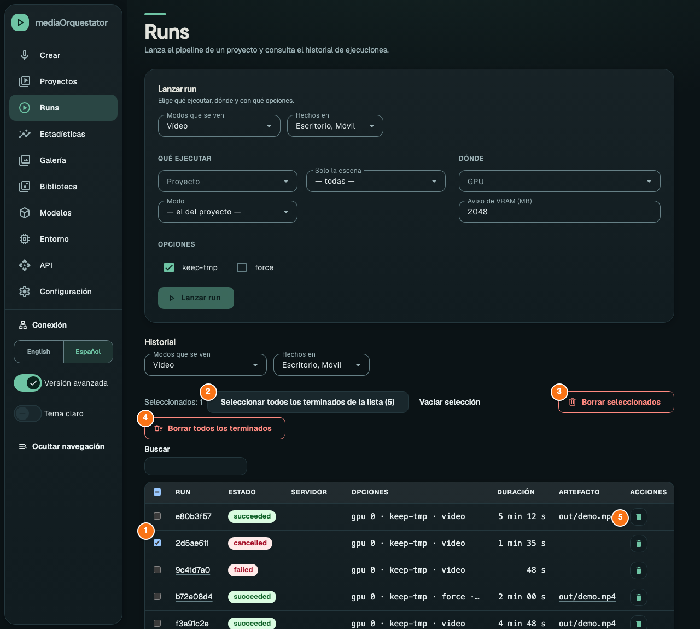

1. Casilla para seleccionar un run.
2. **Seleccionar todos los terminados de la lista**.
3. **Borrar seleccionados**.
4. **Borrar todos los terminados** (respeta el filtro de proyecto).
5. La papelera de la fila borra solo ese run.

Haz clic en la cabecera de una columna (Run, Estado, Opciones, Duración, Artefacto) para **ordenar** todo el historial por ella: una vez de menor a mayor, dos de mayor a menor y una tercera vuelve al orden original. La lista de proyectos y la tabla *Runs más lentos* de las estadísticas se ordenan igual.

**Buscar y elegir los modos.** La lista de proyectos, el historial de runs y la tabla *Runs más lentos* tienen una caja de **Buscar** sobre las filas: escribe una o más palabras (no importan las mayúsculas ni las tildes, y deben aparecer todas) y solo quedan las filas que coinciden, con cuántas de cuántas; *Limpiar la búsqueda* la deshace, y el texto se recuerda mientras sigas en el panel. Cuando los proyectos crecen, el selector **Modos que se ven** (sobre la tabla de proyectos, y también en la Galería) deja elegir qué modos quieres ver: vídeo, imágenes, música, cualquier combinación. La primera vez solo está elegido **vídeo**, por eso la lista no tiene columna *Modo*; los proyectos de los demás modos aparecen cuando eliges su modo. La elección es la misma en la lista de proyectos y en la Galería (cuyo selector de proyecto solo lista los modos elegidos) y se recuerda en el navegador. Junto a él, **Hechos en** distingue los proyectos hechos en el **escritorio** de los **móviles**: son las peticiones de la página Crear, de nombre `mobile-…`, las haya hecho el aparato que sea. Se ven los dos por defecto; la elección es la misma en la lista de proyectos, la Galería, el historial de runs, las Estadísticas y la biblioteca de canciones, y se recuerda en el navegador. Un proyecto que creas o importas se muestra aunque su modo estuviera oculto, y uno cuyo `scenes.yaml` no se puede leer (no tiene modo) sale siempre para que puedas arreglarlo.

Antes de borrar siempre te pide confirmación:

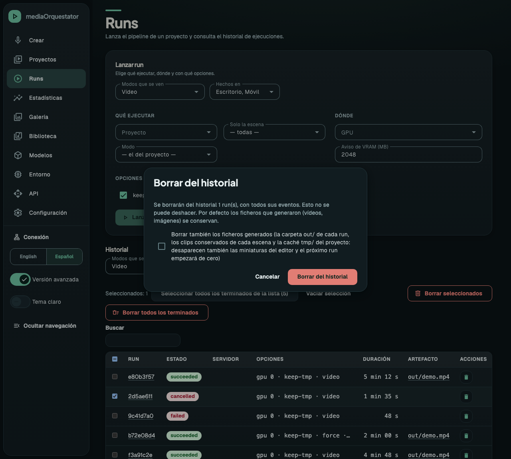

El diálogo dice cuántos runs se borran, que **no se puede deshacer** y que **por defecto los ficheros que generaron (vídeos, imágenes) se conservan**: solo se borra la entrada del historial. La casilla sin marcar **Borrar también los ficheros generados** quita además la carpeta `out/` de cada run, los clips conservados de cada escena y la caché `tmp/` del proyecto (desaparecen las miniaturas del editor y el próximo run empieza de cero). **Cancelar** lo deja todo como estaba. Los runs en cola o en marcha nunca se borran: cancélalos primero.

## 9. Estadísticas

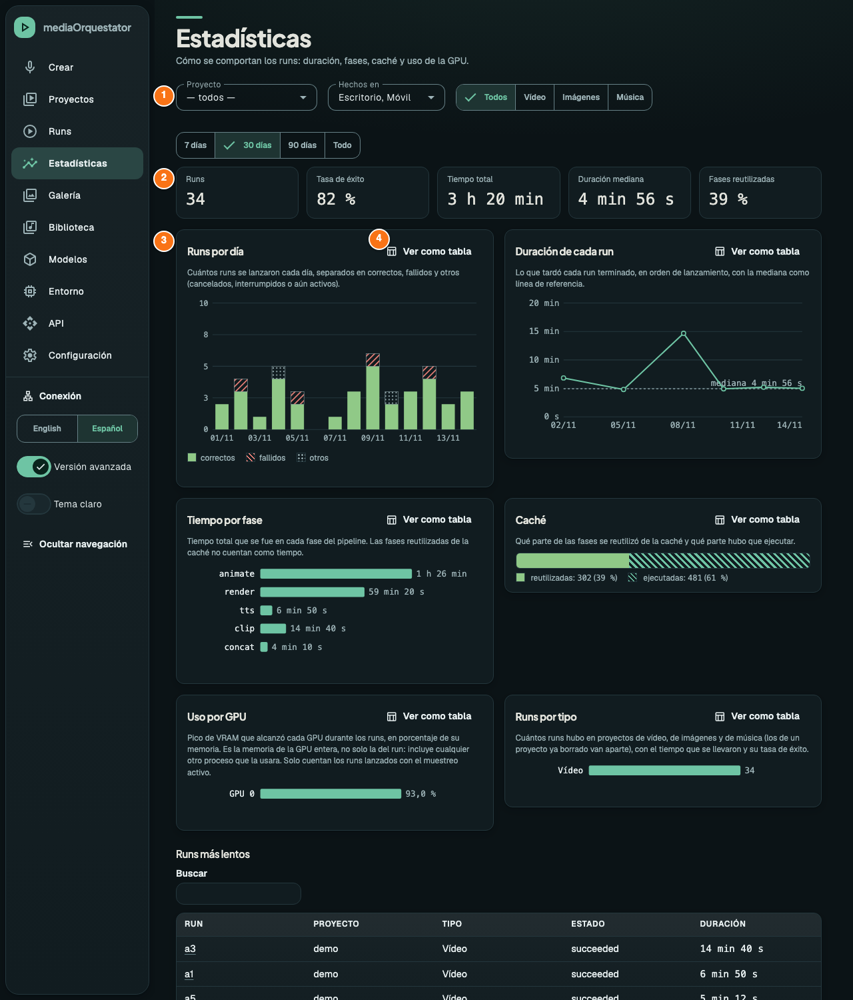

1. **Filtros**: proyecto, **tipo** (todos, vídeo, imágenes o música: solo los runs de proyectos de ese tipo) y periodo (7 días, 30 días, 90 días o todo).
2. **Resumen**: cuántos runs, tasa de éxito, tiempo total, duración mediana y qué porcentaje del trabajo se reutilizó de la caché.
3. **Gráficas**: runs por día, duración de cada run, tiempo por fase, caché, uso de VRAM por GPU y **runs por tipo** (cuántos runs, cuánto tiempo y con qué éxito en proyectos de vídeo, de imágenes y de música). La tabla *Runs más lentos* también dice el tipo de cada proyecto. Si guardaste la dirección de Grafana en **Configuración**, arriba a la derecha aparece **Abrir Grafana**.
4. **Ver como tabla**: cada gráfica se puede cambiar a tabla con los mismos números.

Sirve para saber, por ejemplo, qué fase te lleva más tiempo, o si la caché te está ahorrando trabajo.

## 10. Receta rápida: tu primer vídeo en 10 pasos

1. Arranca el servidor (sección 3) y abre el dashboard.
2. **Entorno**: comprueba que los cuatro binarios están en verde.
3. **Modelos**: instala **Stable Diffusion 1.5** (la entrada «Para empezar») y una voz.
4. **Proyectos → Crear proyecto**.
5. Abre el proyecto. En **Defaults**, deja *Checkpoint único* y elige SD 1.5 y la voz.
6. En **Escenas**, escribe un prompt y un texto de narración.
7. (Opcional) Pulsa **Mejorar con IA** y revisa lo que propone.
8. **Runs**: elige el proyecto, **GPU**, deja *keep-tmp* marcado y **Lanzar run**.
9. Mira cómo avanza en el monitor.
10. Cuando termine, reproduce el vídeo y, si algo no te gusta, cambia **solo esa escena** y vuelve a lanzar: la caché hará que sea rápido.

Cuando funcione: prueba los modelos realistas (Krea 2 / IntoRealism, con «Usar ajustes recomendados» o el estilo **Fotorrealismo** de [Estilo y calidad](#estilo-y-calidad-elegir-sin-perderse)) y, después, la animación con Wan. Si quieres más calidad solo donde importa, dale **Alta** a una escena desde su sección «Calidad de esta escena» y deja el resto como está.

## Móvil y tema claro

El dashboard se adapta a una pantalla de teléfono: en la versión avanzada el menú pasa a un botón de hamburguesa, como en la imagen (la versión simple, que es la de por defecto en un teléfono, usa una barra de pestañas; ver [Versión simple y avanzada](#desde-el-móvil-la-pantalla-crear)). También tiene tema claro, con el interruptor en la parte baja del menú (marcado **1** en la segunda imagen):

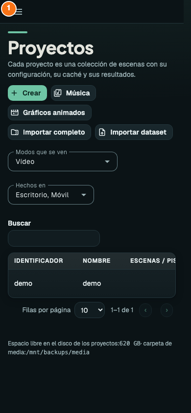

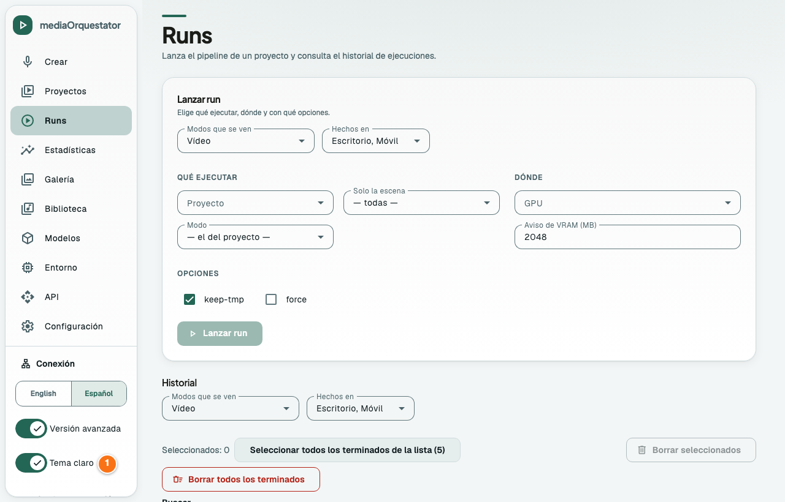

## Música: crear canciones

La música es una función **independiente** del vídeo: no se mezcla con la narración ni con las imágenes. Describes el estilo, escribes tu letra si quieres, y se genera una canción completa (con voz o instrumental) con [acestep.cpp](https://github.com/ServeurpersoCom/acestep.cpp), en tu máquina y sin nube.

### Qué hace falta

1. **El motor**: `bash scripts/build-acestep.sh` (ver [Entorno](#pantalla-entorno-lo-primero-que-hay-que-mirar): `ace-lm` y `ace-synth` deben aparecer en verde).
2. **Los modelos**: en **Modelos**, pestaña **Música**, instala un paquete. Son cuatro archivos (modelo de lenguaje, codificador de texto, modelo de síntesis y VAE) y se bajan igual que los demás, desde ese mismo sitio; se guardan aparte, en `models/music/`.

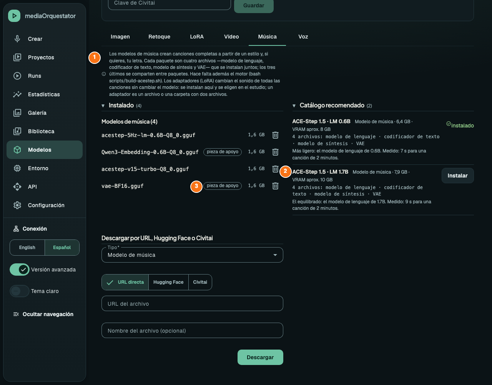

1. **La nota de la pestaña**: explica que cada paquete son cuatro archivos y que hace falta el motor.
2. **El paquete del catálogo**: con su tamaño, la VRAM aproximada, lo que se midió y la licencia. El de 1,7B es el equilibrado; el de 0,6B es más ligero.
3. **Piezas de apoyo**: el codificador de texto y el VAE se comparten entre paquetes, así que instalar el segundo solo baja su modelo de lenguaje.

### El estudio

En **Proyectos**, **Proyecto de música** crea un proyecto y abre el estudio:

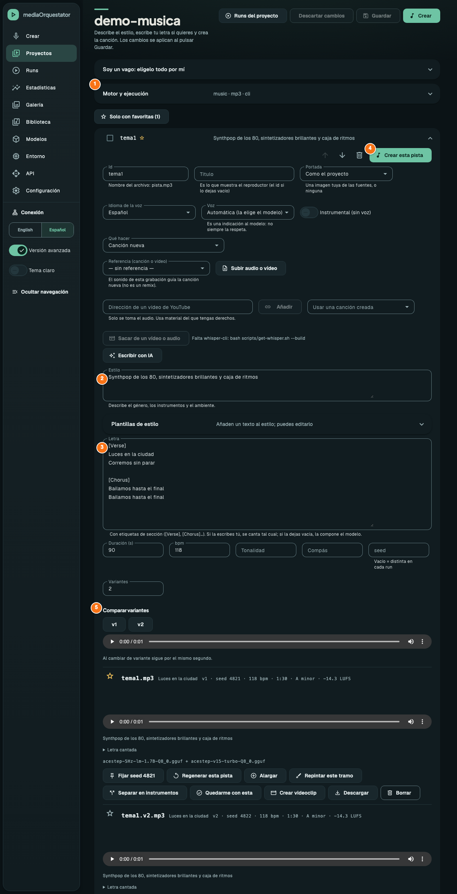

1. **Motor y ejecución** (tarjeta plegable, cerrada al empezar: su cabecera resume modo, formato y motor): el modo del proyecto (cambiarlo es una acción pendiente hasta que guardas: avisa de lo que dejará de usarse y «Descartar cambios» lo deshace), el formato (mp3 o wav), los modelos (si no eliges, se usan los de por defecto), el **motor** (programas o servidor), los pasos, el estilo común y el adaptador, la GPU y **force**.
2. **Estilo**: describe el género, los instrumentos y el ambiente (las [plantillas](#plantillas-de-estilo) de debajo ayudan a empezar).
3. **Letra**: con etiquetas de sección (`[Verse]`, `[Chorus]`…). **Si la escribes tú, se canta tal cual** y es más rápido; si la dejas vacía, la compone el modelo (el modelo canta en el idioma que le pidas). Con **Instrumental** no hay voz y la letra se desactiva. El **Idioma de la voz** va en «Automático»: se deduce de tu letra y, si no hay letra, es inglés; elige un idioma concreto si quieres otro (por ejemplo, español con una descripción en español y sin letra).
4. **Crear esta pista**: genera solo esa canción. **Crear** (arriba) genera todas. Las ediciones sin guardar se guardan antes. Mientras trabaja ves las fases `compose` (el modelo de lenguaje; no aparece si traes tu letra) y `synth`, y puedes cancelar.
5. **Resultado**: un reproductor por cada variante, con su semilla, bpm, duración y tonalidad, lo que se cantó de verdad y, si el modelo cambió tu letra, lo que pediste. Desde ahí: **Fijar seed** (guarda la semilla en la pista para reproducir esa variante), **Regenerar esta pista** y **Descargar**.

Las canciones son **tarjetas plegables**: cerradas muestran su nombre y el principio del estilo (con una marca roja si algo necesita corregirse). Con una sola canción se abre sola; al **añadir** otra se cierra la anterior y se abre la nueva, para que siempre tengas delante la que estás escribiendo.

Notas útiles:

- Una pista **sin seed** sale distinta en cada ejecución; cuando una variante te guste, fíjala.
- Con **Variantes** pides varias versiones de la misma pista.
- La duración real puede no coincidir con la pedida: sale lo que dura la música que compone el modelo.
- Los archivos acaban en `out/<proyecto>/` (`pista.mp3`, o `pista_v2.mp3` con variantes) junto a un `manifest.json` con todo lo necesario para reproducirlos. La referencia completa está en `docs/MUSIC_MODE.md`.
- Una canción de 3 minutos tarda unos 20 segundos en total en una GPU de las del ejemplo (11 s en componer y 9 s en sintetizar).

### Voz y calidad

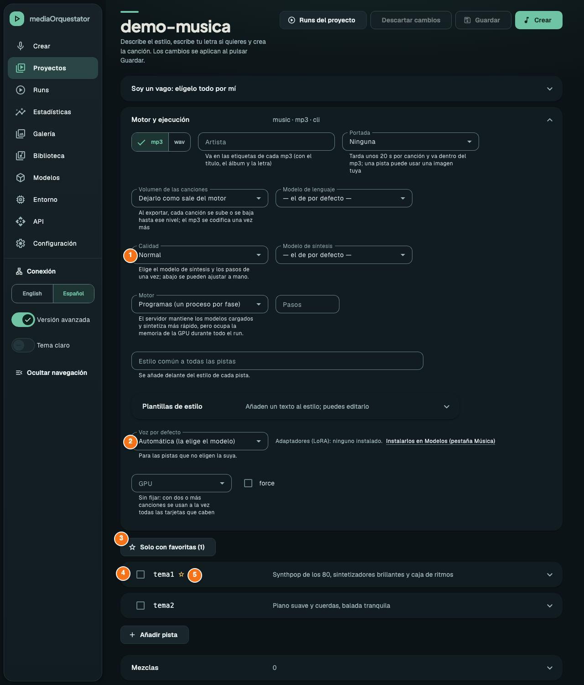

**Soy un vago**, arriba del estudio, lo hace todo por ti: solo dices **cuánto estás dispuesto a esperar** y elige el nivel de calidad, el modelo de lenguaje que escribe la letra de las canciones que no la traen (el mayor que tengas instalado) y **cuántas versiones hacer de cada canción** (hasta 4: más versiones, más donde elegir). Te enseña lo que escribiría y **cuánto tardaría**; no cambia nada hasta que pulsas **Aplicar esto**, y **Deshacer** lo deja todo como estaba.

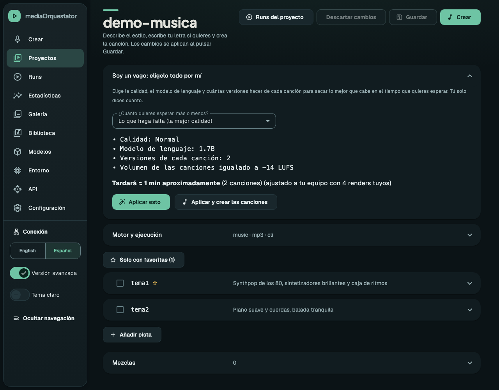

Una canción es rápida (segundos), así que lo que tarda es muchas canciones por muchas versiones: con 3 canciones y 4 versiones cada una estimó unos 3 minutos y tardó 2 min 40 s. La estimación usa lo medido aquí (una RTX 5060 Ti) escalado por duración y tarjeta; si la tarjeta no está en la tabla, avisa de que la cifra es a ojo.

**Etiquetas y portada.** Todo mp3 sale **etiquetado** (título, artista, álbum, número de pista, el estilo y la **letra cantada**), así que cualquier reproductor muestra la canción. Dale a una pista un **Título** (si no, usa su id) y al proyecto un **Artista** (si no, usa el nombre del proyecto). Y con **Portada > Automática** cada canción tiene además una **portada**: una imagen cuadrada hecha con el modelo de imagen a partir de su estilo (unos 20 s por canción), que va dentro del mp3 y se guarda a su lado. Una pista puede usar una imagen tuya de sus fuentes, o ninguna. Si la imagen no se puede hacer, la canción se crea igualmente, sin portada. **Soy un vago** trae una casilla para ello.

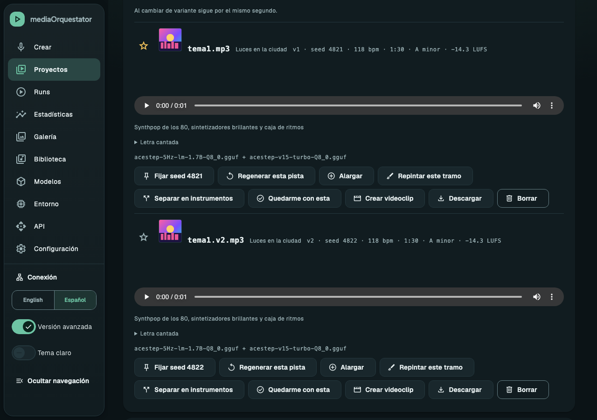

**Biblioteca.** La pantalla **Biblioteca** junta las canciones de **todos tus proyectos de música** en una lista. **Búscalas** (título, proyecto, estilo o letra; da igual acentos y mayúsculas), filtra por proyecto o por estrellas mínimas, ponle a cada canción de **1 a 5 estrellas** (pulsa la misma otra vez para quitarlas) y agrúpalas en **listas de reproducción** con el botón de lista de cada canción; una lista conserva su orden (las flechas suben o bajan una canción). La lista está paginada (5, 10, 20 o 100 canciones por página, 10 por defecto). **Reproducir todo** recorre todo lo que muestre la lista, en todas las páginas, canción tras canción. Las estrellas y las listas se guardan en `projects/.library.json`, no dentro de los proyectos.

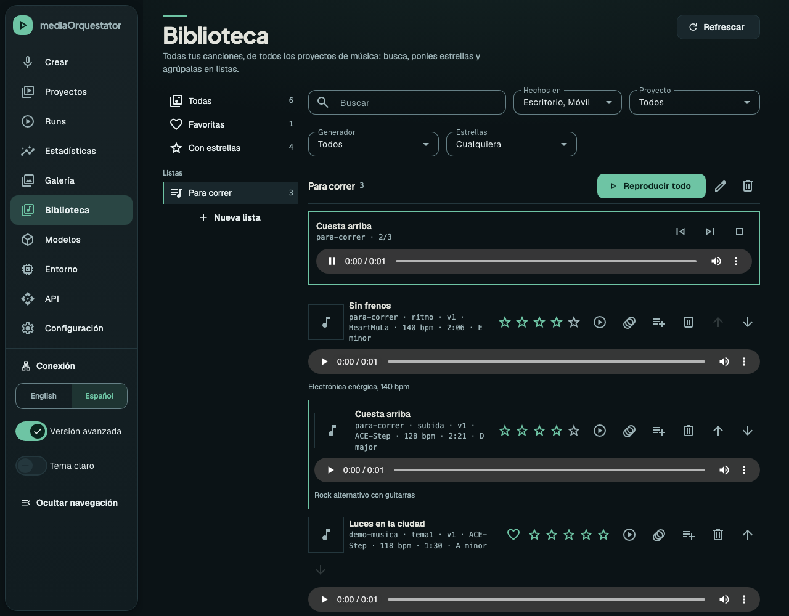

**Dos tarjetas, dos canciones a la vez.** Si tu equipo tiene dos tarjetas gráficas que pueden hacer una canción cada una (9 GB o más), al crear varias canciones se usan las dos a la vez sin que elijas nada: con 4 canciones de un minuto tardó 43 s en una tarjeta y 20 s en las dos. Una sola canción no se puede partir, así que una canción con varias versiones sigue haciéndolas una tras otra. Elegir la GPU a mano en *Motor y ejecución* lo anula.

**Volumen parejo.** En el panel *Motor y ejecución* del estudio, **Volumen de las canciones** iguala todas las canciones a −14 LUFS (el nivel al que suenan las plataformas de música) o −16 LUFS (algo más suave), para que suenen al mismo volumen una detrás de otra. Se hace al exportar, así que cambiarlo no regenera nada. **Soy un vago** lo pone a −14.

**Revisión automática.** Cada canción terminada se mide (menos de un segundo) y el estudio muestra su sonoridad a su lado. Si algo va mal te lo dice: suena **saturada** (el pico llega al máximo), tiene un **silencio largo** (4 s o más), suena **muy baja o muy fuerte**, o **dura distinto** de lo que pediste (más de un 15 %). Es solo un aviso: la canción se conserva.

**Videoclip.** Cada canción de los resultados tiene un botón **Crear videoclip**. Parte la canción en planos según su letra (el tiempo de cada sección sigue al texto que canta; unos 6 segundos por plano, a tu elección), **escribe la imagen de cada plano con la IA** (el asistente mantiene el mismo personaje y el mismo aspecto en todos; si no está disponible, las imágenes salen del estilo y de la letra), deja que **Soy un vago** elija los modelos para el tiempo que quieras esperar, y crea un **proyecto de vídeo** con la canción de banda sonora, una escena por plano, un movimiento de cámara en cada una y un fundido entre ellas: **Crear proyecto** lo abre en el editor y **Crear y generar** lo lanza. Los cortes entre secciones siguen a la canción: el texto da una primera idea de dónde empieza cada sección y el plan mueve después cada corte al cambio de volumen más claro que haya cerca (el estribillo entra donde la canción sube); el diálogo te dice cuántos cortes ajustó. El vídeo dura exactamente lo que la canción. Con una canción de 1 minuto hizo 10 planos y, estimado en 7 minutos, tardó 5 min 30 s. Los planos son imágenes fijas con movimiento de cámara; **Animar los planos** los mueve, bastante más despacio (cada animación dura unos segundos y se repite). Puedes animar **solo los planos del estribillo** (las secciones con etiqueta Chorus, Hook, Estribillo o Coro): las estrofas se quedan como imágenes con movimiento de cámara, el estribillo cobra vida y el tiempo de espera queda a medio camino.

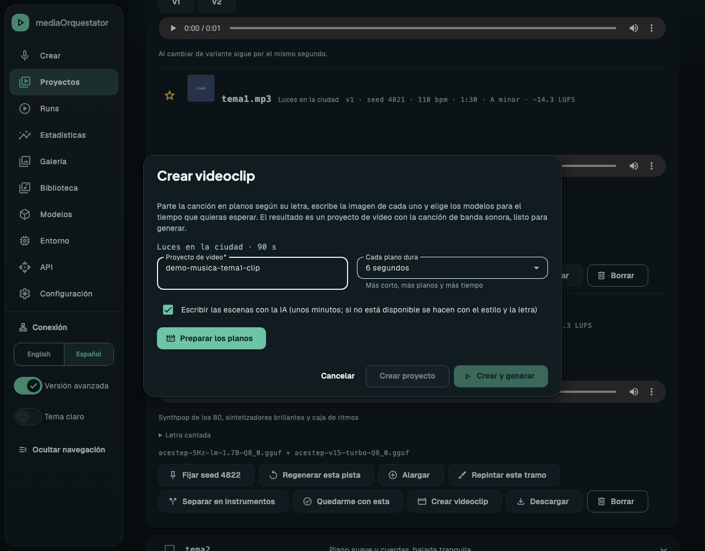

1. **Calidad** (en *Motor y ejecución*): elige de una vez el modelo de síntesis y sus pasos. **Rápida** usa el modelo turbo (unos 6 s para una canción de dos minutos), **Normal** el XL turbo de por defecto (7 a 9 s; no escribe nada en el archivo) y **Máxima** el modelo SFT con 50 pasos y shift 1 (10 a 11 s), el que hace falta para **Extraer**. Un nivel cuyo modelo no está instalado sale marcado; si cambias el modelo, los pasos o el shift a mano, el selector dice **Personalizada**.
2. **Voz por defecto**: la voz de las pistas que no eligen la suya. Cada pista tiene su propio selector **Voz**, junto al idioma: mujer, hombre, dúo (hombre y mujer), niño o niña, coro o voz grave; **Automática** lo deja al modelo. El motor no tiene un parámetro de voz: la elección añade una frase en inglés al final del estilo (por ejemplo *female vocals*), así que es una indicación que el modelo sigue con mayor o menor fidelidad. Probamos más (ardilla, un anciano rasposo, un robot) y **no** salieron como se pedía, por eso no se ofrecen. Siempre puedes escribir la voz tú en el estilo.
3. **Solo con favoritas**: aparece cuando tienes canciones con estrella (ver abajo) y deja en la lista solo las pistas que tienen una.
4. **Casilla de cada pista**: marca las pistas para convertirlas en una mezcla ([ver Mezclas](#mezclas-juntar-canciones-y-audios)). Marcar no despliega la tarjeta.
5. **Estrella** junto al nombre: la pista tiene una canción favorita.

### Variantes: comparar, quedarte con una, favoritas y alargar

Con **Variantes** una pista hace varias versiones de la misma canción. Cuando ya existen, la tarjeta de la pista te ayuda a elegir:

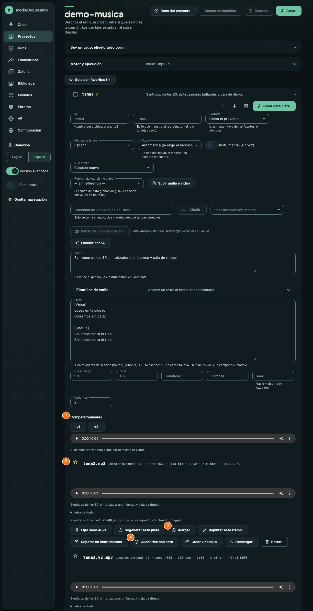

1. **Comparar variantes**: un solo reproductor con un botón por variante. Al pasar de una a otra **sigue por el mismo segundo** (y sigue sonando si sonaba), así oyes la diferencia sin buscarla.
2. **Estrella**: marca esa canción como **favorita**. La marca se guarda con el proyecto (`favorites` en `scenes.yaml`) y se identifica por la pista y su **semilla**, así que sobrevive a cambiar cuántas variantes hace la pista. Si renombras la pista, sus favoritas la siguen; si la quitas, se van con ella. En el menú *Añadir pista* del mezclador las favoritas salen primero.
3. **Alargar**: pide los segundos a añadir (de 5 a 180) y añade una pista nueva que **repinta los últimos 4 segundos y sigue** más allá del final de la canción, con el mismo estilo y la letra que se cantó. Todavía no se guarda ni se crea nada: añade los versos que continúan y pulsa *Crear*. Medido: una canción de 30 s pasó a 60 s. Lo que se pinta lo decide el modelo, así que la continuación puede no mantener el estribillo ni la melodía: prueba más de una semilla. Para rehacer un tramo del medio de una canción, mira [La onda](#la-onda-elegir-un-tramo-para-repintar-y-separar-instrumentos).
4. **Quedarme con esta**: tras preguntarte, la pista se queda con esa variante (recibe su semilla y una sola variante), las pistas de mezclas que la tocaban pasan a ser la única canción de la pista y las que usaban otra variante se quitan, se guarda y se vuelve a crear la pista. Es instantáneo, porque no se genera nada: el run reutiliza de la caché la canción hecha con exactamente las mismas entradas, así que **la que oíste es la que te quedas** (el motor no siempre da dos veces la misma canción). Los ficheros de las otras variantes se **borran** del proyecto.

### La onda: elegir un tramo para repintar y separar instrumentos

Cada canción de los resultados de una pista se dibuja como una **onda** con una línea que sigue al reproductor y la parte ya oída más brillante. **Haz clic** en cualquier punto para seguir desde ese segundo. Si el servidor no puede leer el audio, la canción conserva su reproductor y no muestra la onda. Vale para canciones de cualquier generador (solo lee el fichero).

Cuando la tarea de una pista es **Repaint**, el origen se dibuja igual y eliges el tramo que quieres rehacer **arrastrando** sobre él:

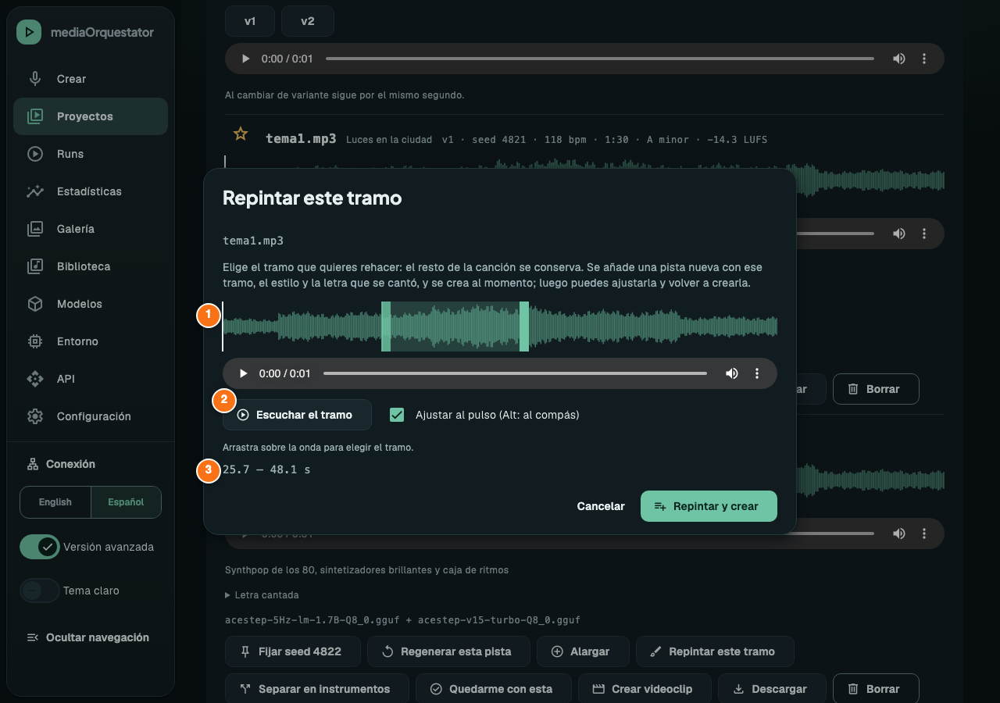

1. **La onda y el tramo**: arrastra para elegir el tramo (las dos barras son sus extremos: arrástralas para ajustar, o enfoca una con el teclado y muévela con las flechas, de una décima en una décima, un segundo entero con Mayús; Inicio y Fin van a los extremos). Arrastrar rellena **Desde** y **Hasta**, redondeados a una décima de segundo. Escribir en ellos mueve el tramo, y un final pasado del final de la canción se queda como lo escribiste (así se alarga una canción) y se dibuja llegando al final.
2. **Escuchar el tramo**: reproduce el origen desde el inicio del tramo y se para en su final, para oír lo que vas a rehacer antes de gastar una generación. Si la pista tiene **bpm** aparece una casilla para **ajustar al pulso** (con Alt, al compás).
3. **Los números**: siguen ahí; la onda es solo otra forma de rellenarlos.

Junto a **Repintar este tramo** la canción tiene **Separar en instrumentos**: más abajo.

**Repintar este tramo** es además un botón de cada canción creada: abre la misma onda, eliges el tramo, lo oyes y pulsas *Repintar y crear*; la canción se copia a las fuentes del proyecto (como hace *Alargar*), se añade una pista `<nombre>_repintado` con ese tramo, el estilo y la letra que se cantó y se **crea al momento**, ella sola (el resto del proyecto no se toca); luego puedes ajustarla y volver a crearla. Si la canción es una de varias variantes de su pista, el nombre dice cuál (`ballad_v3_repintado`). Si la hizo HeartMuLa o DiffRhythm2, el tramo repintado sonará a ACE-Step, que es quien repinta.

**Separar en instrumentos** (en cada canción creada y en el origen elegido de una pista) lista las doce partes que conoce el motor: voz, coros, batería, bajo, guitarra, teclados, percusión, cuerdas, sintetizador, efectos, metales y maderas. Marca una o varias (al principio no hay ninguna marcada) y pulsa **Crear N pistas**: el estudio añade **una pista *Extraer* por cada una**, todas desde la misma canción, y las crea **una tras otra** (el panel del run dice *Pista 2 de 4*). Se llaman `<canción>_<parte>` y, si la canción es una de varias variantes de su pista, con la variante: `ballad_v3_vocals`. Cada una sale en los resultados como una canción con su onda y la línea *Extraer: Voz ← origen*, y la canción original no cambia. Cada parte tarda unos 10 s, así que con más de 3 una línea te dice cuántas generaciones pides. Extraer necesita un modelo de síntesis que **no sea el turbo** (el SFT del catálogo de Música): la ventana lo dice; si el modelo del propio proyecto es turbo, ofrece (marcado) **pasar el proyecto al nivel de calidad *Máxima*** (ojo: las demás canciones del proyecto usarán también ese nivel, más lento, la próxima vez que las crees; sin marcarlo, el motor rechaza las pistas) y, si no hay ninguno instalado, dice dónde conseguirlo y no añade nada. Cuando las pistas ya tienen su canción, **Quitar estas pistas** las quita del proyecto con sus canciones (tras preguntar) y deja la original como estaba; desaparece en cuanto editas la lista de pistas de otra forma.

Con **HeartMuLa** o **DiffRhythm2** como generador el estudio no ofrece ninguna de las dos acciones (esos generadores solo hacen canciones nuevas) y una línea sobre los resultados dice que lo hace ACE-Step y cómo: sube la canción como fuente a un proyecto que use ACE-Step. La onda se queda.

### Plantillas de estilo

Escribir el género a mano en el estilo es fácil de liar. Bajo el cuadro de **Estilo** de cada pista (y bajo el «Estilo común» del proyecto) hay una lista plegada de **plantillas**, agrupadas por familia: Rock y pop, Electrónica, Acústico y folk, Urbano, Jazz y blues, Cine y orquesta, Del mundo.

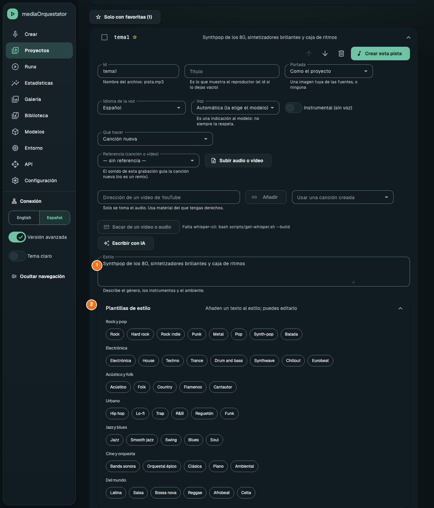

1. **El estilo**: aquí se añade el texto de cada plantilla que eliges.
2. **Las plantillas**: elegir **Banda sonora** añade al final del estilo, tras una coma, un texto en inglés (el idioma que mejor entiende el modelo) que describe ese género: *cinematic film score with sweeping strings, a slowly building emotional arc and a spacious mix*. Pasa el ratón por encima de una plantilla para verlo entero. Puedes combinar varias, y elegirla otra vez la quita.

Una plantilla aparece marcada mientras su texto esté tal cual en el estilo; si lo editas, se suelta sola. No es un campo nuevo: el estilo sigue siendo un único texto que puedes retocar.

### Remix: una canción que ya existe

En el selector **Qué hacer** de una pista puedes elegir **Remix** en lugar de «Canción nueva»: parte de una canción que ya tienes y la reinterpreta en otro estilo. **Remix fiel** se mantiene más cerca de la melodía y la estructura originales, **Repaint** rehace solo un tramo (de tal segundo a tal segundo) y conserva el resto, y **Extraer** aísla la voz o un instrumento (necesita el modelo SFT, no el turbo).

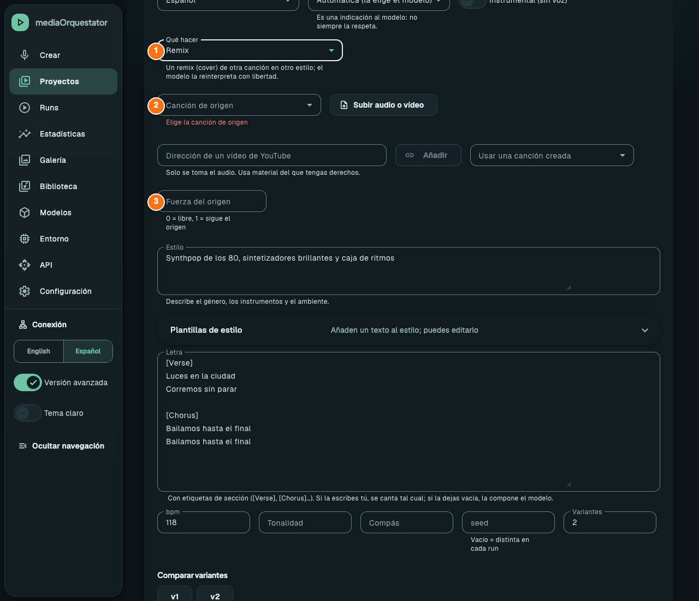

1. **Qué hacer**: el tipo de pista, con una explicación debajo.
2. **Canción de origen**: la que se va a transformar. Puedes elegir una de las del proyecto, **subir un audio o un vídeo** (de un vídeo se extrae el sonido y se guarda como mp3; el vídeo no se conserva) o **usar una canción creada** aquí mismo (se copia, así que el remix sigue funcionando aunque regeneres o borres la original). Suena en un reproductor para que compruebes que es la correcta.
3. **Fuerza del origen**: 0 es libre y 1 sigue el origen. En Repaint se pide el segundo de inicio y el de final; en Extraer, qué extraer.

Con un remix la duración la decide el origen, y no se usa el modelo de lenguaje. El resultado indica de qué canción viene.

### Referencia: el sonido de otra grabación

Una **canción nueva** también puede tener una **referencia**: una grabación (o el audio de un vídeo) cuyo sonido guía la canción. No es un remix: la estructura, la letra y la duración siguen saliendo de tu estilo; la referencia solo orienta cómo suena.

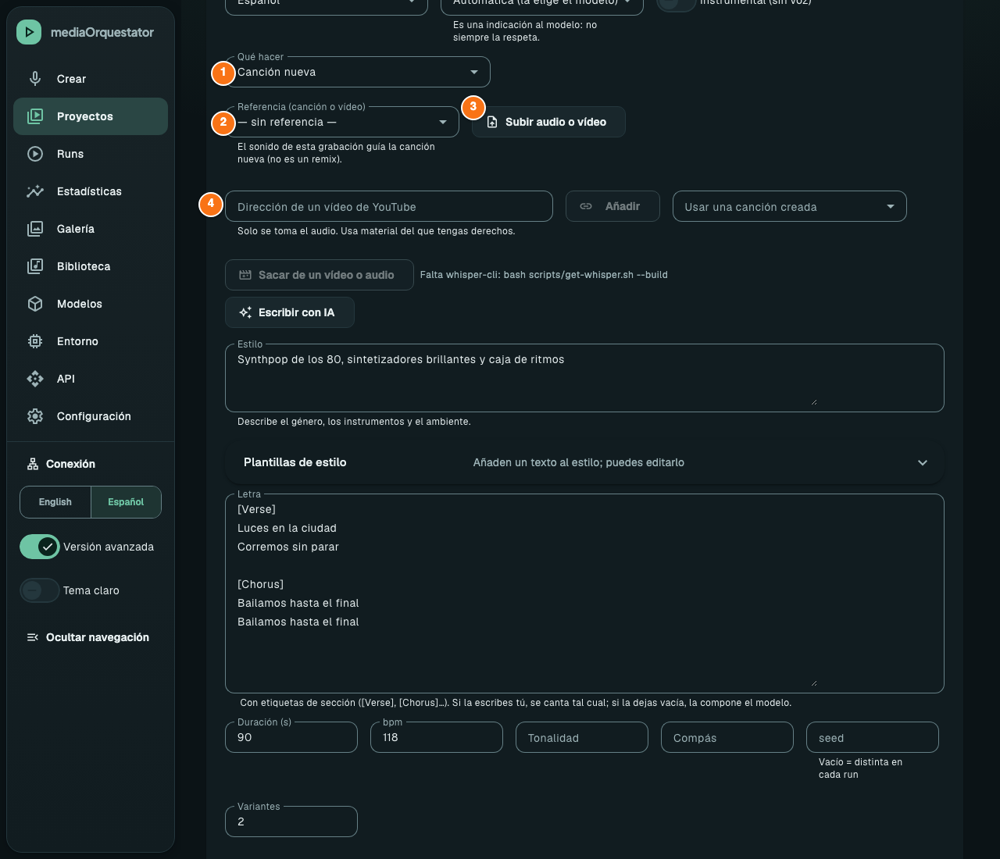

1. **Qué hacer**: déjalo en «Canción nueva».
2. **Referencia (canción o vídeo)**: el audio que sirve de modelo de sonido; opcional.
3. **Subir audio o vídeo**: sube una grabación o un vídeo (se convierte a mp3). Lo subido queda en los orígenes del proyecto y se puede reutilizar en otras pistas.
4. **Dirección de un vídeo de YouTube**: pega la dirección y pulsa **Añadir**; se toma solo el audio y queda elegido como referencia. Hace falta `yt-dlp` (`bash scripts/get-ytdlp.sh`, una vez; aparece en Entorno como opcional). Solo vídeos sueltos de hasta 20 minutos, sin cuentas ni cookies: uno privado o que pida iniciar sesión se rechaza con el motivo. Usa solo material del que tengas derechos.

Es una tendencia, no una copia: no esperes que reproduzca la grabación.

### Mezclas: juntar canciones y audios

Cuando ya tienes pistas creadas (o audios en los orígenes), la tarjeta **Mezclas**, bajo las canciones, las junta en una sola canción: una encima de otra (una voz sobre una base) o una detrás de otra (verso y estribillo).

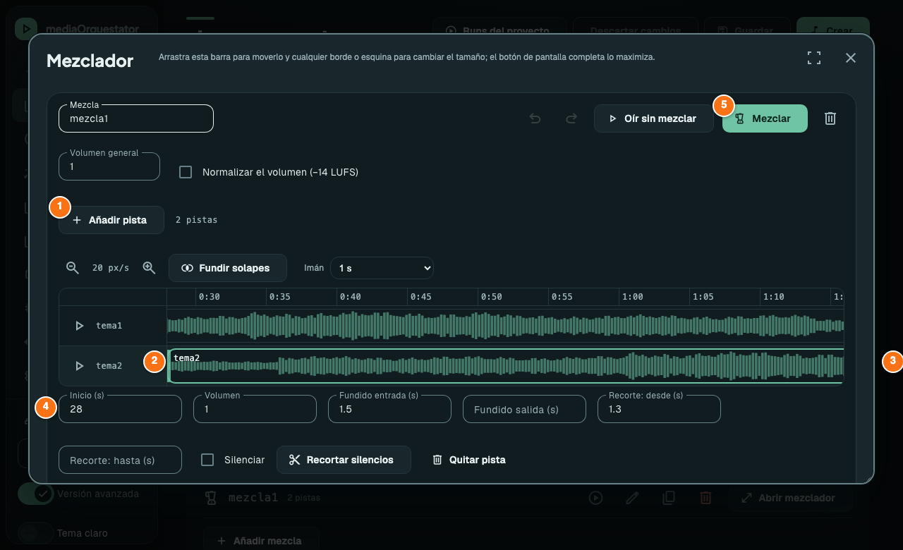

1. **Añadir mezcla**: el **mezclador se abre en una ventana** (cada mezcla tiene su fila con **Abrir mezclador** y botones para **escucharla**, **renombrarla**, **duplicarla** y **quitarla** sin abrirlo; marca la casilla de varias pistas y pulsa **Mezclar estas** para crear una mezcla con ellas una detrás de otra; el mezclador tiene botones de deshacer y rehacer, también Ctrl+Z / Ctrl+Mayús+Z) que puedes **mover** arrastrando su título, **redimensionar** desde cualquier borde o esquina (puede llegar hasta los dos bordes de la pantalla), **maximizar** con el botón de pantalla completa (o con doble clic en la barra) y **cerrar** con la X (o con Esc), y dentro **Añadir pista** (en su propia fila sobre la línea de tiempo): eliges una de las canciones ya creadas o un audio de los orígenes. Cada pista es una barra con su onda y, a su izquierda, un botón ▶ para **escucharla sola** (la parte que usa, a su volumen y sin fundidos); al pulsar otra, la primera se para. Mientras suena, un **marcador pequeño** se mueve solo dentro de esa pista; y cuando oyes la **mezcla** ya hecha, una **barra vertical** cruza todas las pistas para que veas por dónde va. **Puedes mover esa barra (o el marcador) arrastrándola** a donde quieras y se oye desde ahí; también con un clic en la **regla** de tiempo, o con las flechas del teclado (1 s; con Mayús, 10 s). La pista que suena sola no se sale de la parte que usa. Y no hace falta mezclar para oír el resultado: **«Oír sin mezclar»** (junto a Mezclar) toca **todas las pistas juntas** en el navegador, cada una en su sitio, con sus recortes, volumen y fundidos; es una aproximación (el archivo lo genera **Mezclar**), pero **cualquier cambio —mover una pista, subir el volumen, silenciarla…— se oye al instante**, sin pararlo. Se pausa, se para, y puedes arrastrar la barra o hacer clic en la regla para saltar a cualquier punto aunque no hayas mezclado nunca. Mientras suena una pista sola, **los cambios de volumen, fundidos y recorte se oyen al momento**, sin parar (hasta volumen 2 si el navegador lo permite; la mezcla ya hecha no cambia hasta que vuelvas a pulsar Mezclar).
2. **Arrastra** una barra en horizontal para decidir cuándo entra; con el **imán** (1 s por omisión) cae en la cuadrícula, y con las flechas del teclado se mueve de un paso en un paso. El **zoom** cambia la escala del tiempo.
3. **Recorta** los extremos arrastrando los tiradores, o pulsa **Recortar silencios**: cada canción generada trae casi 2 segundos de silencio al empezar y varios al acabar, y sin recortarlos queda un hueco al unir dos.
4. **Panel del clip**: inicio, volumen (de 0 a 2), fundidos de entrada y salida, recorte y **Silenciar**. Para que suenen bien juntas, usa el mismo bpm y la misma tonalidad en las pistas.
5. **Mezclar** guarda y renderiza solo esa mezcla (es rápido, unos segundos). Cuando termina aparece el reproductor; si cambias algo, avisa de que hay cambios sin mezclar.

Una pista aún sin crear sale con aviso: hay que crearla antes. Los detalles (campos del fichero, caché, `--only`) están en `docs/MUSIC_MODE.md`.

El mezclador tiene más herramientas:

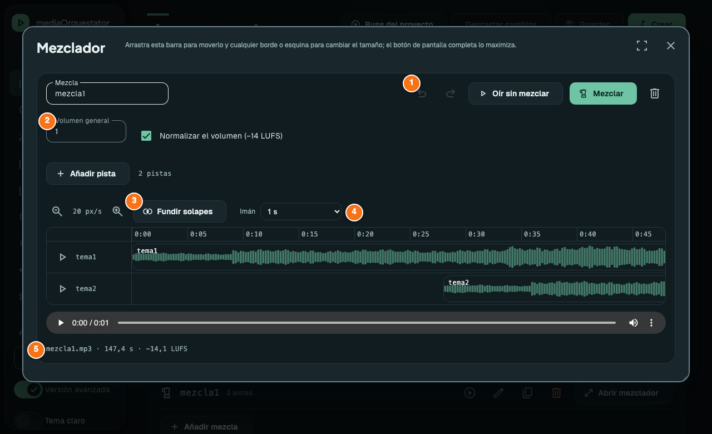

1. **Deshacer / rehacer** (también Ctrl+Z y Ctrl+Mayús+Z): deshacen el último cambio del proyecto, hasta 100 pasos; arrastrar un clip cuenta como uno. No actúan mientras escribes en un campo, donde el navegador deshace el texto.
2. **Volumen general y Normalizar**: el volumen escala toda la mezcla tras sumar los clips (de 0 a 2) y **Normalizar** la lleva a **−14 LUFS**, el nivel de las plataformas de música, sea cual sea la suma de tus clips. En *Oír sin mezclar* se oye el volumen general y la normalización se **aproxima** a partir de la sonoridad de cada pista (un par de dB como mucho); el archivo que escribe *Mezclar* es el exacto.
3. **Fundir solapes**: donde una pista empieza antes de que acabe la anterior, pone un fundido de salida en la primera y uno de entrada en la segunda con la duración del solape. Se escribe como fundidos normales (los ves en el panel y puedes retocarlos) y se deshace de una vez.
4. **Imán**: además de segundos ofrece el **pulso** y el **compás** de la primera canción que tenga tempo, y dibuja esas líneas. Al soltar una pista, el **primer golpe** de su canción (que halla el servidor en sus primeros 30 segundos) cae en la línea, no el principio del archivo, así que una canción que empieza con una intro suave encaja igualmente.
5. **Sonoridad de la mezcla**: una vez mezclada, junto al fichero y su duración lees su sonoridad en LUFS (por ejemplo −14,1).

En la lista de mezclas, cada fila permite **escucharla**, **cambiarle el nombre**, **duplicarla** y **quitarla** sin abrir el mezclador, y dice **Desactualizada: una pista cambió** (con un botón **Volver a mezclar**) cuando volviste a crear una canción que la mezcla usa.

### HeartMuLa: canciones de más calidad (opcional)

> **Actualización (2026-10-22):** HeartMuLa, DiffRhythm2 y LAION-CLAP corren ahora como servicios .NET y no en Docker: `bash scripts/get-services.sh` (o el instalador, `bash scripts/install.sh`) los deja en `bin/services`, y los botones **Arrancar** / **Parar** de la pantalla Entorno los lanzan y terminan igual que antes. Las capturas y los pasos de Docker que siguen valen si arrancas el servidor con `MO_MUSIC_BACKEND=docker`. Ver [INSTALL.md](../../mediaOrquestator/docs/INSTALL.md#music-services-net).

ACE-Step es rápido, pero si quieres la mejor calidad hay un segundo generador, **HeartMuLa**: tarda unas diez veces más (una canción de 2 minutos, unos 2 minutos) y las canciones suenan mucho mejor. Corre como un servicio .NET (`bash scripts/get-services.sh` lo instala en `bin/services` y los botones **Arrancar** / **Parar** de Entorno lo lanzan; antes era un contenedor Docker, que sigue disponible con `MO_MUSIC_BACKEND=docker`; ver [INSTALL.md](../../mediaOrquestator/docs/INSTALL.md#music-services-net)) y **solo aparece si tu equipo puede ejecutarlo** (o si le indicas otro equipo que lo tenga); si no, la opción simplemente no está.

Para tenerlo en esta máquina hace falta Docker funcionando con tu tarjeta NVIDIA, la imagen del contenedor y los pesos (unos 21 GB):

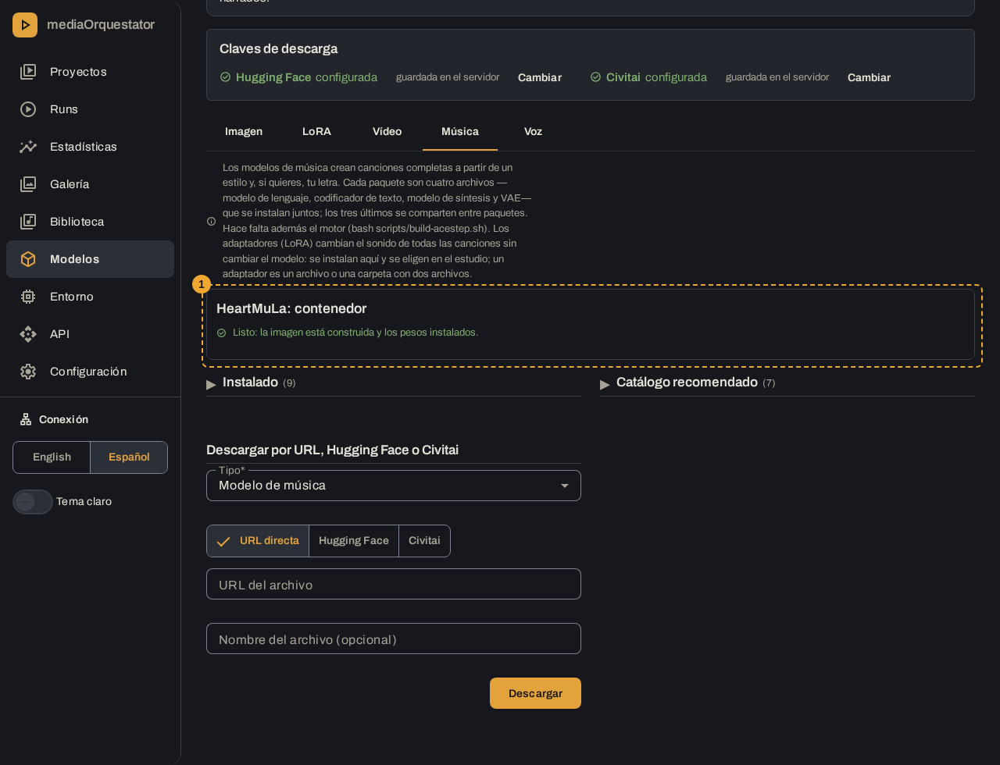

1. **Modelos, pestaña Música**: el recuadro *HeartMuLa: contenedor* dice si la imagen está construida y, si no, ofrece **Construir el contenedor** (unos minutos y unos 6 GB de descarga). Los pesos son la entrada *HeartMuLa* del catálogo que hay debajo. (`bash scripts/install.sh` también construye la imagen.)
1. **Entorno, panel Contenedores de música**: elige la tarjeta (por defecto la de más memoria libre) y pulsa **Arrancar**. El contenedor se queda levantado entre canciones hasta que pulses **Parar**, y HeartMuLa y DiffRhythm2 pueden estar levantados a la vez (HeartMuLa en la tarjeta de 16 GB y DiffRhythm2 en la de 12 GB, si tienes las dos). Si está parado, el proyecto de música lo dice, con un enlace a Entorno, y los botones de crear quedan desactivados.

Si aquí no hay Docker, o la tarjeta se queda corta (necesita unos 10,5 GB libres), ejecuta el contenedor en otro equipo y pon su dirección en **Configuración**:

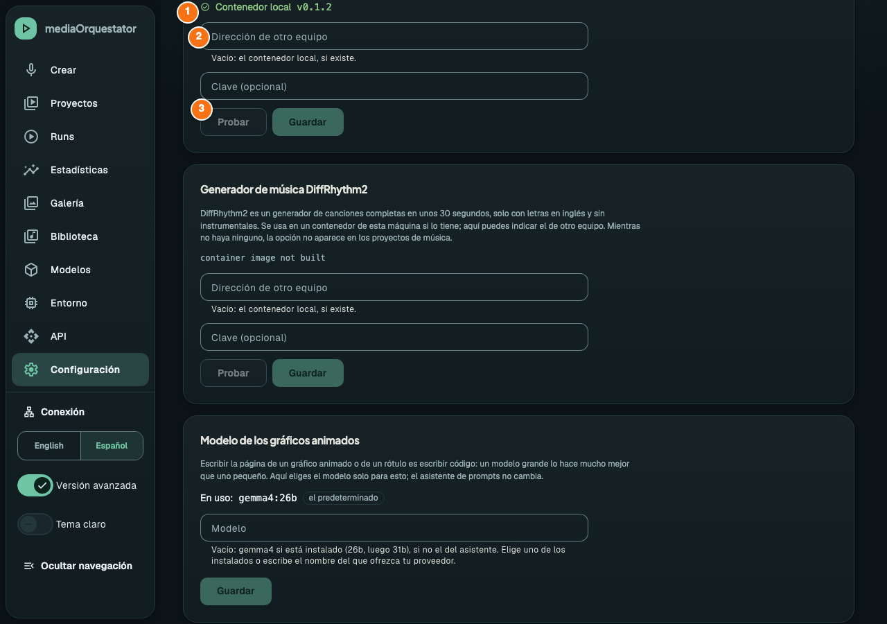

1. **Qué se usa**: el contenedor de esta máquina, o el servicio externo.
2. **Dirección de otro equipo** (y una clave, si la pusiste allí). Un equipo que no es este recibe tu letra y tus etiquetas, así que antes de guardar tienes que marcar que lo aceptas.
3. **Probar** le pregunta al servicio si está listo, sin enviarle nada tuyo.

Cuando está disponible, el panel **Motor y ejecución** de un proyecto de música muestra el selector **Generador**:

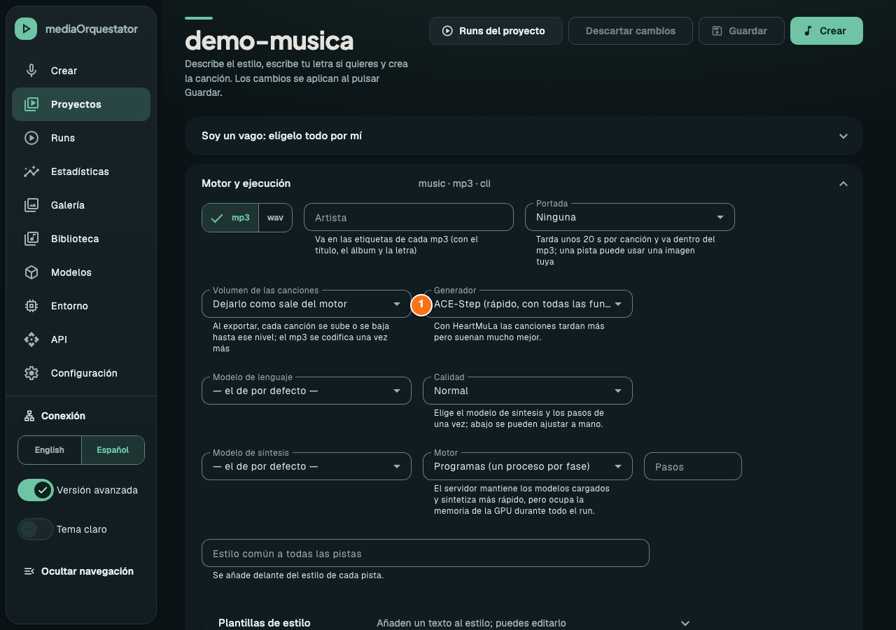

1. Elige **HeartMuLa**: lo que solo entiende ACE-Step (modelo de lenguaje, calidad, tonalidad, compás, bpm, referencia y las tareas de remix) desaparece.

Cada pista pide entonces **etiquetas**:

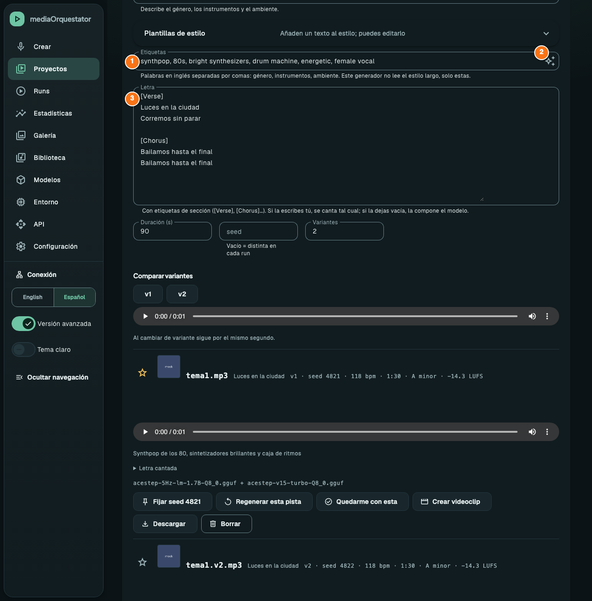

1. **Etiquetas**: unas pocas palabras en inglés separadas por comas (género, instrumentos, ambiente). HeartMuLa no lee el estilo largo: lee estas y la letra.
2. El botón de las **chispas** las escribe a partir del estilo de la pista con el asistente (si está disponible); puedes editarlas.
3. **Letra** con marcas `[Verse]` y `[Chorus]`: HeartMuLa la necesita (no hay pistas instrumentales) y la canción dura lo que la letra.

El contenedor solo existe mientras un run hace canciones: arranca al empezar y se para al terminar, así que no ocupa la memoria de tu GPU entre medias. La referencia completa está en [docs/MUSIC_MODE.md](../../mediaOrquestator/docs/MUSIC_MODE.md#generador-heartmula-opcional).

### DiffRhythm2: canciones completas en medio minuto (opcional)

Un tercer generador, **DiffRhythm2**, hace una canción completa de unos dos minutos y medio en unos treinta segundos, con la letra alineada. Tiene un límite grande: **solo lee letras en inglés** (una letra en español sale mal pronunciada), y no hace instrumentales, remixes, covers, referencias ni alargar canciones. Corre en un contenedor como HeartMuLa y solo aparece en el selector de **Generador** cuando puede ejecutarse.

Para tenerlo en esta máquina hace falta Docker con tu tarjeta NVIDIA (unos 8 GB de GPU libres):

1. **Modelos, pestaña Música**: el recuadro *DiffRhythm2: contenedor y pesos* tiene un solo botón, **Construir el contenedor y descargar los pesos**. Construye la imagen (unos 6 GB) y después baja los pesos (unos 9,5 GB) con una barra de progreso; los pesos no van dentro de la imagen y el servicio nunca descarga nada por su cuenta.
2. Si esta máquina no puede ejecutarlo, ejecuta el contenedor en otra y pon su dirección en **Configuración › Generador de música DiffRhythm2**; funciona como la tarjeta de HeartMuLa (dirección, clave, **Probar** y la casilla para aceptar que la letra y el estilo se envían allí).

Al elegir **DiffRhythm2** en el selector de generador aparece un aviso con los límites de arriba y desaparece lo que no puede usar: el idioma de la voz que no sea inglés, el interruptor de instrumental, el estilo de voz, las tareas (remix, cover, repaint, extract), la referencia, el bpm, la tonalidad, el compás, **Alargar**, **Repintar este tramo** y **Separar en instrumentos** (una línea sobre los resultados dice que eso lo hace ACE-Step; la onda de cada canción se queda). Cada pista pide **etiquetas** (palabras en inglés separadas por comas) y la letra en inglés con marcas `[verse]`, `[chorus]`… Las pistas que ya tenías y que no puede hacer (en español, instrumentales, con una tarea) no se tocan: el estudio las lista para que decidas. Las variantes, las favoritas, las mezclas, el videoclip y la biblioteca funcionan como siempre. La referencia completa está en [docs/MUSIC_MODE.md](../../mediaOrquestator/docs/MUSIC_MODE.md#generador-diffrhythm2-opcional).

### Importar canciones

Si tienes muchas canciones en un fichero, **Importar dataset** también las crea. Elige **Canciones** en lugar de «Escenas de vídeo» (la tercera opción, **Gráficos animados**, es el mismo asistente para gráficos; mira [los ejemplos](../../mediaOrquestator/docs/IMPORT.md#worked-examples)) y sube el JSON o el HTML (el mismo formato que para escenas):


1. **Qué se importa**: escenas de vídeo, gráficos animados o canciones.
2. **Cómo se lee cada entrada**: el texto del prompt es el estilo; una línea `Lyrics:` empieza la letra, una línea `Instrumental` la deja sin voz, y `BPM:`, `Duration:`, `Key:`, `Language:`, `Seed:`, `Variants:` fijan sus campos. Verás el informe de lo que se aplicó y lo que se descartó antes de crear nada, y al terminar se abre el estudio de música.

### Exportar un proyecto e importarlo en otro sitio

En la lista de **Proyectos**, el botón de **descarga** de cada fila exporta el proyecto de dos maneras:

- **Proyecto completo (.zip: ajustes, modelos usados y receta)**: el que hay que usar para repetir un proyecto en otro sitio. Lleva todo lo que dice el proyecto (`scenes.yaml`: modelos, resolución, pasos, muestreador, voz, motor de animación, LoRA, cámara, look…), tus ficheros propios (`sources/`) y **la receta** (`RECIPE.md` para leer, `recipe.json` para el programa): qué modelos, voz y LoRA usa, con los **ajustes con los que genera**, si son los **recomendados del catálogo** (o cuáles cambiaste, p. ej. «pasos 20 → 4») y de dónde se descarga cada archivo. No lleva los modelos en sí (son decenas de GB y son de cada equipo) ni lo generado.
- **Solo las escenas (JSON, sin ajustes ni modelos)**: las escenas (o las canciones) en el formato que lee **Importar dataset**, para editarlas como texto o llevarlas a un proyecto que ya tiene sus propios ajustes. Cada entrada lleva su texto más `Dialogue:`, `Negative:`, `Motion:`, `Seed:`, `Speed:`, `Silence:` y `Variants:`, con el prompt de sujeto delante de cada escena. Los modelos, la resolución, los pasos y lo demás no van: el mensaje de después de exportar lista lo que se quedó fuera.

Para traer un proyecto completo, usa **Importar proyecto completo** (junto a «Importar dataset»):


1. Elige el `.zip`. El diálogo todavía no crea nada: te enseña el nombre del proyecto, cuántas escenas tiene, **con qué ajustes genera**, **los ajustes recomendados del catálogo** (en verde si el proyecto los usa, en naranja con la diferencia si no) y **una tabla con cada archivo que usa** con «lo tienes» o «falta».
2. Cuando todo está en verde lees «al crearlo solo tendrás que lanzar la generación». **Crear proyecto** lo abre en el editor y de ahí es **Runs > Lanzar**. También puedes crearlo con algo pendiente e instalarlo después.

Si falta algo, te lo dice y ofrece **Instalar todo lo que falta** (marca **1** en la imagen siguiente; o uno a uno): descarga del catálogo, con su barra de progreso, y al terminar la tabla se actualiza sola. Un archivo que no esté en el catálogo sale por su nombre para que lo busques. Si el proyecto usa una imagen o un clip propios que el `.zip` no lleva, lo dice en «Qué hay que arreglar en el proyecto».


Lo mismo desde la terminal: `bin/orchestrator export projects/demo/scenes.yaml -o demo.dataset.json` (añade `-format zip -lang es` para el proyecto completo; los flags van antes del fichero). En un dataset escrito a mano, `Motion: leaves move in the wind, static camera` basta para animar una escena.

### El asistente de IA para canciones

Cada pista tiene un botón **Escribir con IA**: describes la canción con tus palabras (en el idioma que quieras) y un modelo local (Ollama, en CPU, como en las imágenes) propone el estilo, en inglés, y la letra, en tu idioma. Es una sugerencia: la ves y **aplicas o descartas**. Con «Instrumental» solo propone el estilo. Con HeartMuLa o DiffRhythm2 propone además las **etiquetas** y escribe las etiquetas de estructura que esos generadores leen, así que la pista se puede crear enseguida. No funciona mientras haya un run en marcha (necesita varios GB de memoria). Tiene el mismo selector de **Modelo de IA** que el editor (y comparte su elección): si el modelo se niega a escribir la letra, el aviso lo dice y puedes elegir otro.

### Sacar de un vídeo o audio

El botón **Sacar de un vídeo o audio** de una pista nueva lee una canción que ya tienes: eliges un mp3 o wav (tuyo, una de las fuentes del proyecto o el audio de un vídeo de YouTube) o un vídeo, y te da una **propuesta para revisar** con su letra, su idioma, su tempo y su tonalidad, un estilo y (con HeartMuLa y DiffRhythm2) las etiquetas. No se escribe nada en la pista hasta que pulsas **Aplicar**, y todo se puede editar antes. La letra la lee Whisper en la CPU de este equipo (se instala una vez con `bash scripts/get-whisper.sh`): es una **transcripción** (en una prueba de 3 minutos con letra conocida falló una palabra de cada cuatro más o menos), así que revísala. El tempo y la tonalidad son **estimaciones** (acertados en unas 7 canciones de cada 8 y 7 de cada 10 respectivamente en nuestras pruebas; el tempo puede salir a la mitad o al doble y los botones de al lado cambian a esos valores). Con un vídeo puedes pedir además la descripción de su imagen. Existe *Separar la voz antes*, pero en nuestra prueba casi no cambió nada, así que va apagado. Los detalles y las medidas están en `docs/MUSIC_MODE.md`.

### Otras opciones de música

- **Estilo común** (en el panel del proyecto): un texto que se antepone al estilo de todas las pistas, para que compartan sonido.
- **Adaptador (LoRA)**: si has instalado adaptadores (pestaña Música de Modelos), puedes elegir uno para todo el proyecto y otro, con su fuerza, para una pista.
- **Motor**: por omisión cada fase arranca su programa. Con **Servidor** el run usa un único `ace-server` con los modelos cargados, algo más rápido con muchas pistas, a cambio de ocupar la memoria de la GPU durante todo el run.
- Todo esto, con los detalles y los límites, está en `docs/MUSIC_MODE.md`.

## Tus propias imágenes y música de fondo

Hasta aquí cada imagen la dibuja el modelo a partir de un prompt. Si ya tienes la imagen, hay tres formas de usarla, y el vídeo puede llevar música de fondo.

### Una escena con tu imagen (vídeo)

En el editor, cada escena de vídeo tiene un selector **Generar con IA / Mi imagen**. Con **Mi imagen** eliges una imagen del proyecto o **subes una** (`.png`, `.jpg`, `.jpeg` o `.webp`), y ya no hace falta prompt: no se llama al modelo de dibujo.


1. **Generar con IA / Mi imagen**: el origen de la imagen de esta escena.
2. **La imagen**: se ajusta a la resolución del proyecto (se escala para cubrirla y se recorta por el centro, así que lo que sobre se pierde) y aquí la ves tal como la subiste. Si todas las escenas traen su imagen, ni siquiera hace falta `sd`.
3. **Movimiento de cámara**: además de zoom, paneo y temblor de mano, hay **rotate_cw** y **rotate_ccw**, que **giran** la imagen despacio a lo largo del clip (en el sentido de las agujas del reloj o al contrario). La intensidad manda cuánto gira, de 5° a 45°, y la imagen se amplía lo justo para que no asomen esquinas vacías (con 16:9 y mucha intensidad la ampliación es notable: baja la intensidad para un giro más suave).

Lo demás es como en cualquier escena: narración, grano, balance de blancos y, si quieres, animarla con Wan (en ese caso escribe el **motion_prompt**, porque no hay prompt de imagen en el que apoyarse).

### Partir de una imagen tuya para generar otra (img2img)

En una escena **generada** (en modo imágenes, o en vídeo con «Generar con IA») puedes pulsar **Partir de una imagen mía**: la generación arranca de tu imagen en vez de desde ruido, y el prompt dice qué hacer con ella («pásala a acuarela», «de día a noche»…).


1. **Imagen de partida (opcional)**: la sección. Para quitarla, «Quitar la imagen de partida».
2. **La imagen**: del proyecto o subida, ajustada a la resolución como en el caso anterior.
3. **Fuerza**: cuánto puede alejarse el resultado de tu imagen. **Baja** (por ejemplo 0,3): se parece al original y solo cambia un poco. **Alta** (0,9): el prompt la reinterpreta casi por completo. Por omisión 0,6.

**Si la imagen ya trae su receta.** Al subirla («Subir imagen, GIF o vídeo») se buscan en el fichero los datos con los que se generó: prompt, prompt negativo, semilla, pasos, cfg y modelo. Si hay alguno, aparece un diálogo con casillas para aplicarlos a la escena: el prompt, el negativo y la semilla vienen marcados; los pasos y el cfg no (se guardan como ajustes propios de la escena); si la escena ya tenía un prompt, el nuevo viene sin marcar y el diálogo avisa de que lo sustituiría. El modelo solo se muestra, diciendo si lo tienes instalado. Tras aplicar, el aviso trae «Deshacer». Si la imagen no trae nada, no se pregunta nada. Se leen los PNG de `sd`, A1111 y ComfyUI, los vídeos que hace `sd`, y WebP con EXIF o XMP; un GIF casi nunca los lleva, y una imagen que pasó por una web o un chat suele haberlos perdido. Si subes un **GIF o un vídeo**, su primer fotograma es la imagen de partida (el vídeo no se guarda).

Con varias **variantes**, todas parten de la misma imagen, cada una con su semilla: es una buena forma de ver el rango de interpretaciones. Funciona con checkpoints como Stable Diffusion 1.5 o XL; también con los conjuntos de modelos (Krea 2 e IntoRealism se comportan igual), pero ahí la fuerza actúa de forma más brusca: con 0,3 la imagen casi no cambia, con 0,6 conserva la composición pero un cambio de estilo («como un óleo») apenas se aplica, y desde 0,75 se pierde la composición (a 0,9 llegó a salir duplicada en dos paneles). Prueba valores entre 0,5 y 0,7.

### Describir una imagen o un vídeo: un prompt a partir de una referencia

Si tienes una imagen o un vídeo que muestra lo que quieres, no hace falta ponerlo en palabras: bajo el prompt de una escena **generada**, pulsa **Describir una referencia** y elige un archivo (`.png`, `.jpg`, `.jpeg`, `.webp`, o un vídeo `.mp4`, `.mov`, `.webm`, `.mkv`). Un modelo de visión local lo lee y el editor muestra una **Propuesta** con el prompt y, al lado, **el modelo que lo escribió**; **Usar** lo pone en el prompt de la escena (que sigues pudiendo editar) y **Descartar** lo tira. La escena se genera después solo con ese texto: el archivo nunca llega al modelo que dibuja, así que no es img2img y no se copia la cara de nadie.


1. **Una escena / Varias escenas (una por plano)**: cómo se describe un vídeo; se elige antes de escoger el archivo.
2. **Quién lo escribió**: siempre se muestra el modelo (y el proveedor, si no es el Ollama integrado).
3. **Un plano**: su tiempo, su prompt (editable) y una casilla para quitarlo.
4. **Crear N escenas**: inserta los planos marcados después de la escena actual; no cambia nada hasta que lo pulsas.

- **Qué modelo.** `gemma4:26b` por defecto (unos 12 s)<!--[private]-->; marca **Más detalle** para `muse-glimmer:30b` (más lento, más preciso con la ropa y los cuerpos)<!--[/private]-->. Son modelos que instalas en Ollama (`ollama pull gemma4:26b`); nada se descarga solo y nada sale de tu equipo.
- **Un vídeo**, por defecto, es una escena: se leen de 4 a 8 fotogramas clave y se funden en **un** prompt, más un prompt corto de **movimiento** que va al `motion_prompt` de la escena si está animada. Un vídeo puede durar hasta 5 minutos.
- **Una escena o una por plano.** Por defecto un vídeo es **una** escena. Elige **Varias escenas (una por plano)** antes de escoger el archivo y el vídeo se corta en sus cambios de plano (como mucho 12; los planos de menos de 1,5 s se funden con el anterior): la propuesta lista **una entrada por plano** con su tiempo, un prompt editable y una casilla para quitarlo. **Crear N escenas** inserta las marcadas justo después de la escena actual, en orden, sin tocar ninguna existente; cada una anota el modelo (`described_by`) y, en un proyecto de vídeo, dura lo que el plano (como silencio, para que el proyecto valide; cámbialo por narración si quieres). Si el proyecto anima, las escenas nuevas se animan con el movimiento de ese plano. Un vídeo sin cortes se queda en una escena y el editor lo dice.
- **Si el modelo se niega** (o responde algo que no es una descripción) el editor lo dice y ofrece **Probar con** los otros modelos de visión instalados; no se inventa nada. La negativa es del propio modelo, la aplicación no añade ningún filtro de contenido. En nuestras pruebas describió literalmente material adulto con bañadores y lencería; para algo más fuerte, prueba con tus archivos.
- **Comprobación de edad.** Antes de describir nada se comprueba a cada persona o personaje del archivo (cada fotograma, en un vídeo). Si alguien es o parece menor de 18 años (fotografía, dibujo o anime), o no se puede confirmar su edad, no se describe nada y el archivo se borra. Los prompts que escribe siempre dan una edad adulta. Es una salvaguarda hecha por un modelo, no una garantía, y lo que subes sigue siendo responsabilidad tuya.
- **Mientras hay una ejecución en marcha** espera (necesita la memoria), y el archivo subido se borra en cuanto usas o descartas la propuesta. Desde el terminal: `bin/orchestrator describe foto.png`.

### Música de fondo bajo la voz

Un **vídeo** puede llevar una banda sonora bajo la narración. Está en la sección plegada **Música de fondo** del editor:


1. **Ninguna / Generarla / Un archivo**: genera una pista instrumental a partir de una descripción, o usa un audio tuyo (que puedes subir; si subes un vídeo se toma su sonido, o pegar la dirección de un vídeo de YouTube para tomar su audio, con `yt-dlp` instalado).
2. **Estilo de la música**: siempre instrumental. Se genera con el motor de música (los mismos modelos de la pestaña Música de Modelos), dura lo que el vídeo (redondeado hacia arriba a múltiplos de 10 s) y se guarda en caché: el mismo estilo y la misma duración no se vuelven a generar.
3. **Volumen, fundido y bajada bajo la voz**: el volumen va de 0 a 1 (0,25 por omisión), la música entra y sale con un fundido (2 s) y, mientras habla la voz, se baja sola. Sin semilla, el mismo estilo da siempre la misma música.

Al terminar de unir las escenas se mezcla todo en una sola pasada de ffmpeg: el vídeo no se recodifica y el audio queda normalizado de volumen. En el monitor del run verás dos fases nuevas, `bgm` y `mix`. La referencia completa, con los eventos y los límites, está en `docs/MUSIC_MODE.md`.
