# mediaOrquestator dashboard tutorial

[← Back to the README](../README.md) · [Spanish version](TUTORIAL.es.md)

A guide to the dashboard for anyone arriving for the first time who does not know where to start.

In the screenshots, the **numbered orange circles** point at what the text below each one explains.

> **The dashboard starts in English and can be switched to Spanish** with the *English / Español* switch at the bottom of the side menu (the choice is remembered in the browser and the page reloads on the same route; the switch is marked **1** in the picture).

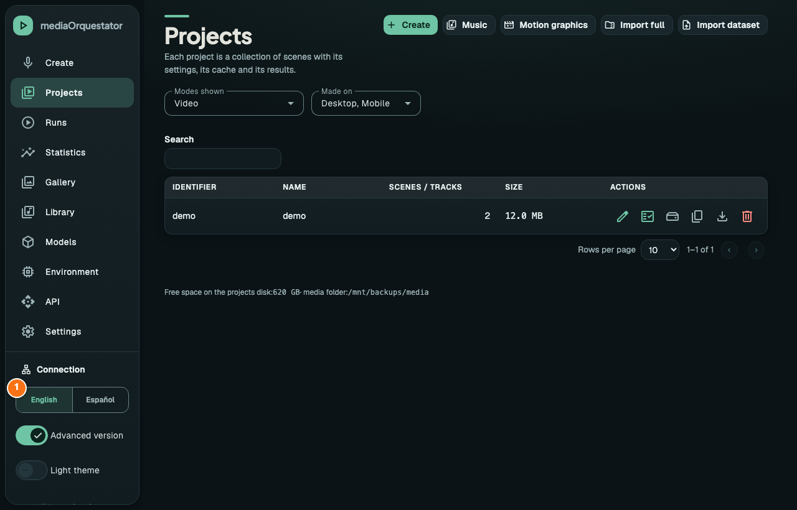

> The screenshots come from a few example projects (`live`, `acuarelas`, `cancion-demo`, `chicas-patines`) made for this guide, with the dashboard in English. Your screen will show your own projects and models. The Spanish version of this guide ([TUTORIAL.es.md](TUTORIAL.es.md)) has the same figures with the Spanish labels.

> This is the screen-by-screen half of the guide. The concepts (1 and 2), when something fails (11), the terminal (12), the glossary (13), the API screen and the worked example with its `scenes.yaml` stay with the server, in [its TUTORIAL.md](../../mediaOrquestator/docs/TUTORIAL.md), and the links to them point there.

## Contents

- [3. Before you start: launch and check the environment](#3-before-you-start-launch-and-check-the-environment)
    - [The "Environment" screen: the first thing to look at](#the-environment-screen-the-first-thing-to-look-at)
    - [The "Settings" screen: where Ollama is](#the-settings-screen-where-ollama-is)
    - [Providers and API keys](#providers-and-api-keys)
    - [Tasks: choosing where each thing runs](#tasks-choosing-where-each-thing-runs)
- [4. Models: downloading what you need](#4-models-downloading-what-you-need)
    - [Installed and catalog](#installed-and-catalog)
    - [Downloading by URL, Hugging Face or Civitai](#downloading-by-url-hugging-face-or-civitai)
- [5. Creating a project](#5-creating-a-project)
    - [Keeping the space under control](#keeping-the-space-under-control)
- [6. The editor, section by section](#6-the-editor-section-by-section)
    - [Output](#output)
    - [Style and quality: choosing without getting lost](#style-and-quality-choosing-without-getting-lost)
    - [I'm lazy: choose everything for me](#im-lazy-choose-everything-for-me)
    - [Defaults: the model and the common settings](#defaults-the-model-and-the-common-settings)
    - [Animation (Wan or AnimateDiff)](#animation-wan-or-animatediff)
    - [Video with audio: MiniMax H3](#video-with-audio-minimax-h3)
    - [Scenes](#scenes)
- [7. Launching a run and following it](#7-launching-a-run-and-following-it)
    - [The run monitor](#the-run-monitor)
    - [From your phone: the Create page](#from-your-phone-the-create-page)
- [8. History and deletion](#8-history-and-deletion)
- [9. Statistics](#9-statistics)
- [10. Quick recipe: your first video in 10 steps](#10-quick-recipe-your-first-video-in-10-steps)
- [Mobile and light theme](#mobile-and-light-theme)
- [Music: creating songs](#music-creating-songs)
    - [What you need](#what-you-need)
    - [The studio](#the-studio)
    - [Voice and quality](#voice-and-quality)
    - [Variants: compare, keep one, favorites and lengthen](#variants-compare-keep-one-favorites-and-lengthen)
    - [The waveform: pick a part to repaint and separate instruments](#the-waveform-pick-a-part-to-repaint-and-separate-instruments)
    - [Style templates](#style-templates)
    - [Remix: a song that already exists](#remix-a-song-that-already-exists)
    - [Reference: the sound of another recording](#reference-the-sound-of-another-recording)
    - [Mixes: joining songs and audio](#mixes-joining-songs-and-audio)
    - [HeartMuLa: better songs (optional)](#heartmula-better-songs-optional)
    - [DiffRhythm2: full songs in half a minute (optional)](#diffrhythm2-full-songs-in-half-a-minute-optional)
    - [Importing songs](#importing-songs)
    - [Exporting a project, and importing it elsewhere](#exporting-a-project-and-importing-it-elsewhere)
    - [The AI assistant for songs](#the-ai-assistant-for-songs)
    - [Take it from a video or audio](#take-it-from-a-video-or-audio)
    - [Other music options](#other-music-options)
- [Your own images and background music](#your-own-images-and-background-music)
    - [A scene with your image (video)](#a-scene-with-your-image-video)
    - [Starting from your own image to generate another (img2img)](#starting-from-your-own-image-to-generate-another-img2img)
    - [Describing a picture or a clip: a prompt from a reference](#describing-a-picture-or-a-clip-a-prompt-from-a-reference)
    - [Background music under the voice](#background-music-under-the-voice)

---

## 3. Before you start: launch and check the environment

From the project folder:

```bash
go build -o bin/orchestrator ./cmd/orchestrator   # once
bin/orchestrator serve --addr 127.0.0.1:4666 --projects-dir projects
```

If you are going to use it from another machine, better start it with the script, which creates a token, prints it and reuses it on every start (you paste it in the side menu, under "Connection"):

```bash
./serve.sh                  # the server, reachable over the network (0.0.0.0:4666)
./serve.sh --local          # 127.0.0.1 only; reach it through an SSH tunnel
./serve.sh --stop           # stops it (clean shutdown; interrupts the run in progress)
MEM_MAX=40G ./serve.sh      # changes the RAM limit (24G by default; MEM_MAX=0 removes it)
```

Open <http://127.0.0.1:4666> in the browser. The first time, the project list will be empty:

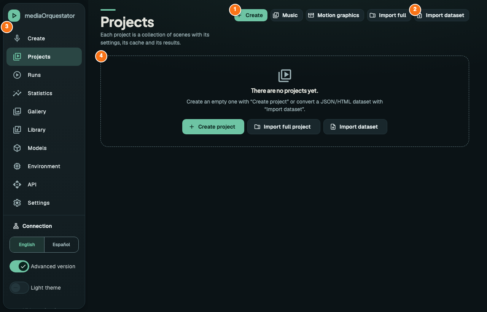

1. **Create**: start one from scratch (the box in the middle of the screen has the same button, **Create project**). Next to it, **Music** starts a songs project and **Motion graphics** one of animated graphics.
2. **Import dataset**: turns a list you already have (JSON or HTML) into a project. You choose the type: **video scenes**, **animated graphics** (each entry is a graphic described in words, with its length and, if you want, a title over it) or **songs**. A sample file and a worked example of each is in [docs/IMPORT.md](../../mediaOrquestator/docs/IMPORT.md#worked-examples). Next to it, **Import full project** reads the `.zip` that another installation exported and tells you which models you have and which are missing.
3. **Side menu**: the screens: Create, Projects, Runs, Statistics, Gallery (with a **Refresh** button at the top right that reads the project again; the images of an images project, the final video and the clip of each scene of a video one, and the songs of a music one, each with its player), Library (the songs of the music projects), Models, Environment, API and Settings. It also has the **language switch** (English / Español) and the light/dark theme switch.
4. **Empty state**: when there is nothing, the screen tells you what to do instead of staying blank.

### The "Environment" screen: the first thing to look at

Here you see whether your machine has everything it needs **before** you launch anything:

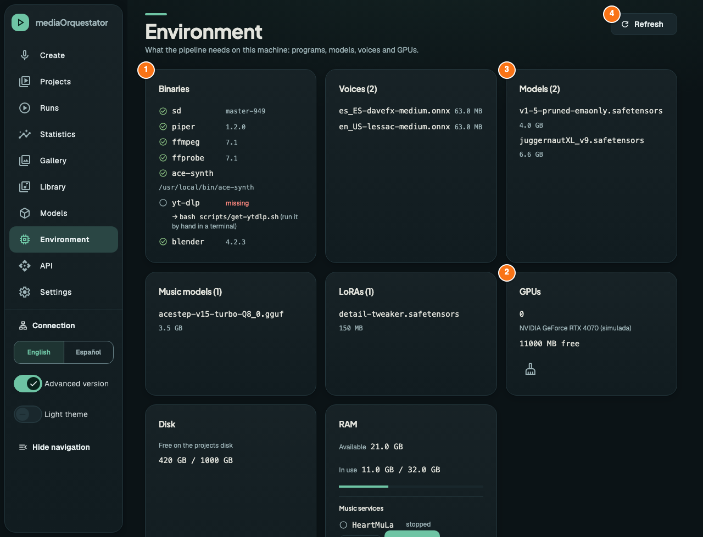

1. **Binaries**: `piper`, `sd`, `ffmpeg`, `ffprobe` (the four are required) and `nvidia-smi` (optional, only to warn about VRAM). Also `yt-dlp`, optional, only to add the audio of a YouTube video as a source (`bash scripts/get-ytdlp.sh`). `ace-lm`, `ace-synth` and `ace-server` also appear: the music engine. They are optional and only needed for music projects and for generated background music (install them with `bash scripts/build-acestep.sh`; `ace-server` only if you choose the server engine). If one shows as "falta" (missing), the command that fixes it appears below (for example `bash scripts/get-piper.sh`).
2. **GPUs**: your cards, with the index (0, 1…) you will use later to choose them, and the memory free right now. If the desktop or Ollama uses a GPU, you will see less free memory here. If Ollama keeps a model loaded in a GPU (it holds it a few minutes after use) or little VRAM is free (under 6 GB), the card carries a warning, the same one that shows in the launch form of Runs; the **Free Ollama's VRAM** button there drops the loaded models so the render has the memory. Every card has a **Free memory** button: it unloads those models, stops those containers and says what it let go of (a container that a run is using is not stopped, and the row says why). The last panel, **RAM**, shows the memory available and in use (`ram` in the report). Below them, **Disk** shows the free space of the disk that holds the projects and warns when it is low (under 20 GB; change it with `ORCHESTRATOR_MIN_FREE_GB`, or `0` to turn the warning off). The same warning appears under the table of projects and in the launch form of Runs; it never stops a run.
3. **Models**: what is already installed in `models/`. The music ones (`models/music/`) and the retouch ones (FLUX.1 Kontext and Qwen-Image-Edit, with their text encoders and VAE) have their own box each, so they are not mistaken for image models.
4. **Refresh**: checks again (useful after installing something).

> If something required is missing, install it with the scripts in `scripts/` (see the [installation guide](../../mediaOrquestator/docs/INSTALL.md); you can also run `bash scripts/install.sh`, which detects what is missing and asks whether to install it) and press **Refresh**.

### The "Settings" screen: where Ollama is

The prompt assistant, **Describe a reference** and the clip check all use an Ollama. **Settings** (last in the side menu) shows the address in use and where it comes from: the one **saved there**, the `OLLAMA_HOST` variable of the server, or the default (`http://127.0.0.1:11434`, this computer). To use an Ollama on another machine of your network, type its address (for example `192.0.2.50:11434`), press **Test connection** (it tells you whether it answers, its version and its models, marking those that **read pictures**) and **Save**: it applies right away, without restarting. **Use the environment's** removes what you saved. An address with a user, a path or another scheme is refused with the reason.

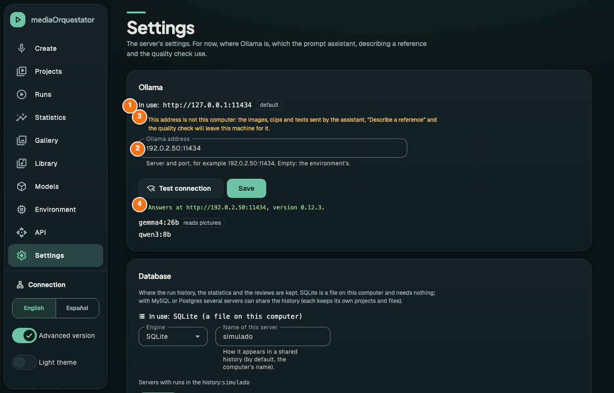

1. **In use**: the address Ollama is reached at and where it comes from (here the default, this computer).
2. **The address**: type another one (a machine of your network, for example `192.0.2.50:11434`).
3. **The warning**: it appears whenever the address is not this computer; what the assistant, Describe a reference and the quality check send leaves your machine.
4. **Test connection**: whether it answers, its version and its models, marking the ones that **read pictures**. **Save** makes it the one in use, with no restart.

**Privacy.** When the address is not this computer, the screen shows a warning: the pictures, clips and texts that the assistant, Describe a reference and the quality check send will **leave your machine** for that address. Use only an Ollama you trust.

### Providers and API keys

Under the Ollama card, **Providers** lists the built-in Ollama (read only) and the ones you add: another **Ollama**, or any **OpenAI-compatible** server (OpenAI, OpenRouter, Together, Groq, vLLM, LM Studio…). **Add provider**: a name, the type, the address (for OpenAI-compatible ones with `https://`, ending in `/v1` if it has a path, such as `https://openrouter.ai/api/v1`), the model for text and the one for vision, and the API key. **Test** lists the models the provider offers and tells you if the key is rejected.

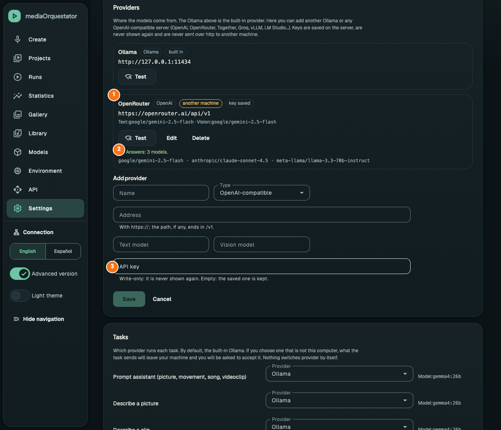

1. **A provider**: its type, the marks *another machine* and *key saved*, its address and the models for text and for vision, with **Test**, **Edit** and **Delete**.
2. **The test result**: whether it answered and the models it offers (or the reason if not).
3. **The key**: write-only; it is never shown again.

- **The key is write-only.** It is saved on the server, in its own file, and is never shown again: when you edit a provider the field is empty and a mark says a key is saved; leave it empty to keep it, or use **Remove the key**. It is never sent over plain `http` to another machine (use `https`; `http` is allowed only to this computer), and it never appears in the API, in exports, in `scenes.yaml` or in logs.
- **Another machine.** A provider that is not this computer is marked "another machine".
- These providers are registered and tested here; **Tasks**, below, chooses which one runs each task.

### Tasks: choosing where each thing runs

Under Providers, **Tasks** has a row per task (the prompt assistant, describing a picture, describing a clip, the clip check) with a provider selector. Everything starts on the built-in Ollama. If you choose a provider that is **not this computer**, a dialog says what that task sends (texts, pictures and clips, or frames of your clips) and to which address, and the choice is saved only if you accept; change the provider's address later and you must accept again. A **☁ external · name** badge then appears next to the buttons that use it (Improve with AI, Describe a reference, the quality check…), and Describe a reference shows "up to N calls to name" before you start (a job on a remote provider makes at most 60 calls; change it in the card).

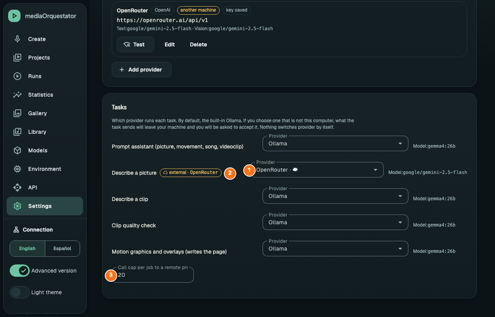

1. **The provider** of a task; the ones without the model the task needs are disabled, with the reason. Choosing one that is not this computer opens the consent dialog.
2. **The badge** "☁ external · name", also shown next to the buttons that use that task.
3. **The cap** of calls one job may make to a remote provider.

If a cloud model **refuses** to describe something, the editor offers **Try with** the other providers, the local Ollama among them: one click, and only then is anything sent. Nothing switches provider by itself.

If you have no connection to a model, the buttons that need one are **not shown** (Improve with AI, Suggest motion, Write with AI for songs, the videoclip plan's AI, Describe a reference). If Ollama (or the provider you chose) **answers but lacks the right model**, a short notice appears where the buttons would be, saying what to install (for example `ollama pull gemma4:26b` for a model that reads pictures) with a link to **Settings**. When the model is there and you come back to the window, the buttons return by themselves. The quality check's *Analyze* is always shown: it measures colour and sharpness without a model.

## 4. Models: downloading what you need

Everything is done from the **Models** screen, without touching the terminal.

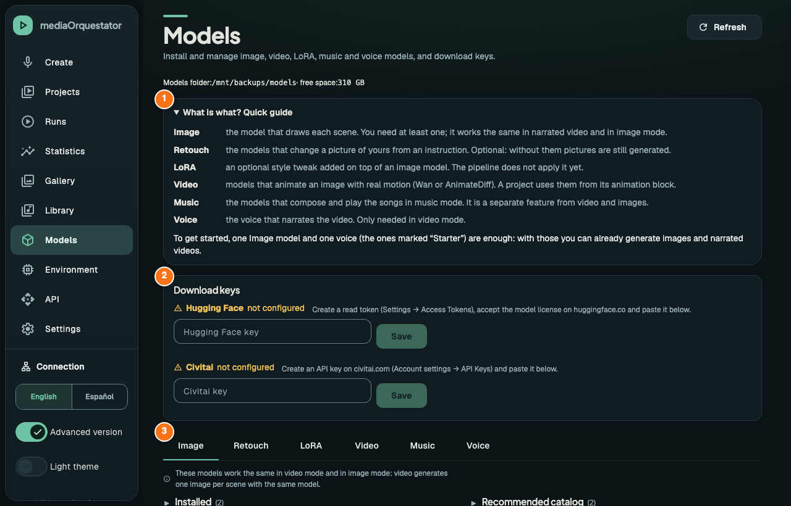

1. **Guide**: a short drop-down explaining what each type of file is for and which one to start with.
2. **Download keys**: Hugging Face<!--[private]--> and Civitai<!--[/private]-->. Some downloads require an account (paste the key here and it is stored on your machine). You will see a lock/warning only on the models that need it.
3. **Tabs**: they separate Image, Retouch (the models that edit a picture by instruction), LoRA, Video, Music and Voice (the music one is explained [below](#music-creating-songs)).

### Installed and catalog

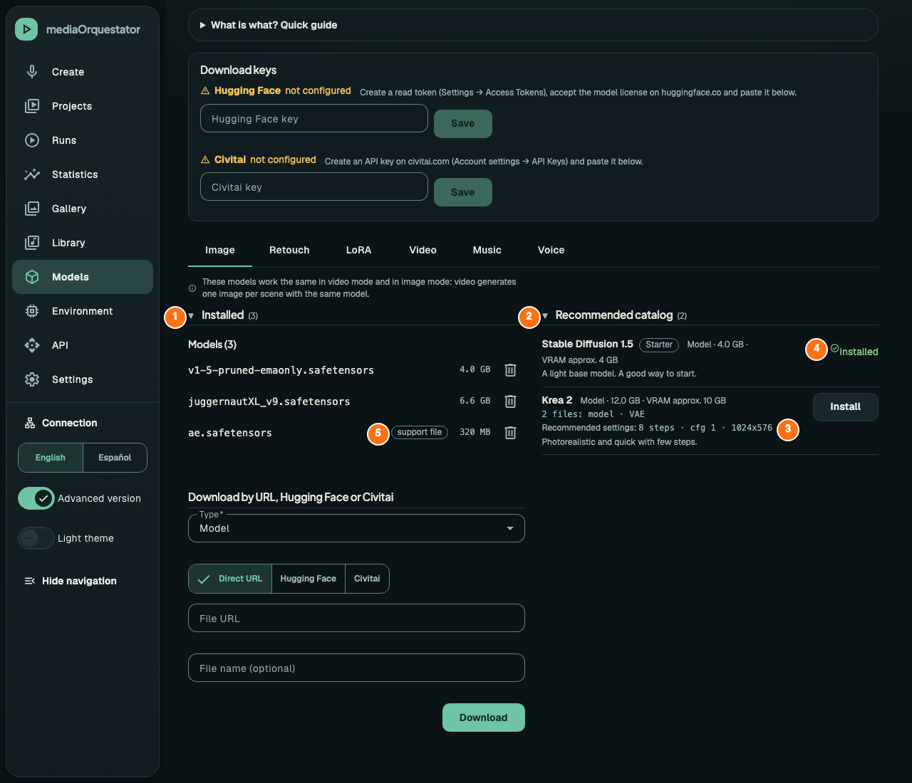

1. **Installed**: what you already have. You can delete it with the trash can.
2. **Recommended catalog**: models tested with this project. The ones you already have show as "installed"; the rest have an **Install** button, and the progress shows right there.
3. **Recommended settings**: what that model needs to give a good image (for example, Krea 2 and IntoRealism: **8 steps, cfg 1, 1024x576**). The editor can then apply them with a button.
4. **installed**: no need to download it again.
5. **support piece**: files such as the text encoder or the VAE. They are part of a set and are **not** chosen as a model on their own.

Both lists **fold** and start **folded**: click the title of **Installed** or of **Recommended catalog** (the number in brackets says how many entries it has) to open or close it. It works the same in every tab (Image, LoRA, Video, Music and Voice), the browser remembers how you left each one, and a closed list loses nothing: it is only hidden.

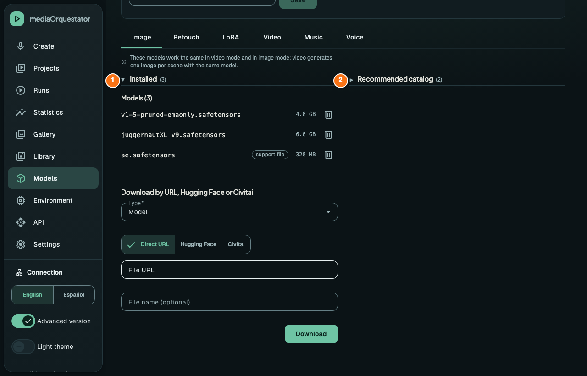

1. **Installed (3)**: open, with its files.
2. **Recommended catalog (2)**: folded; click it to open it.

### Downloading by URL, Hugging Face<!--[private]--> or Civitai<!--[/private]-->

For something that is not in the catalog:

<!-- private:start -->
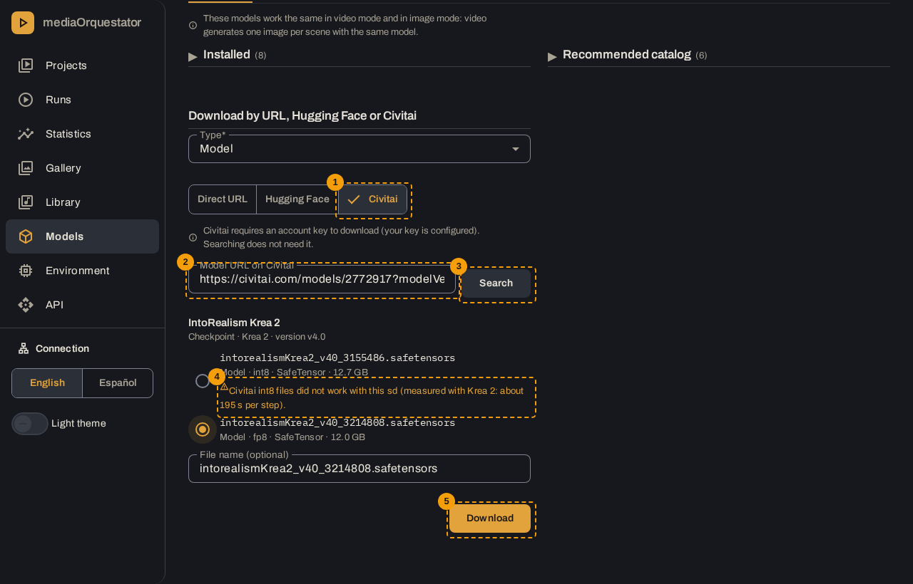
<!-- private:end -->

1. Choose the source: **Direct URL**, **Hugging Face**<!--[private]--> or **Civitai**<!--[/private]-->.
2. Paste the address of the model's page.
3. **Search** looks up the available files (it needs no key).
4. If there are several versions, pick one.<!--[private]--> You will see warnings when a variant is known not to work well here: for example, **the int8 versions from Civitai do not work** with this `sd` as they are (they run on the CPU, about 26 minutes per picture); choose fp8 or GGUF. The catalog's **IntoRealism v5.0**, which Civitai only publishes as int8, is converted to GGUF when you install it, so it does work.<!--[/private]-->
5. **Download**.<!--[private]--> The Civitai key is needed at this step.<!--[/private]-->

Models are saved in `models/`, and show up in the editor on their own.

## 5. Creating a project

On **Projects**, **Create project**, give it an identifier (no spaces) and that is it. If you want, pick a **style** and a **quality** right away (see [Style and quality](#style-and-quality-choosing-without-getting-lost)); otherwise the project starts with the usual values.

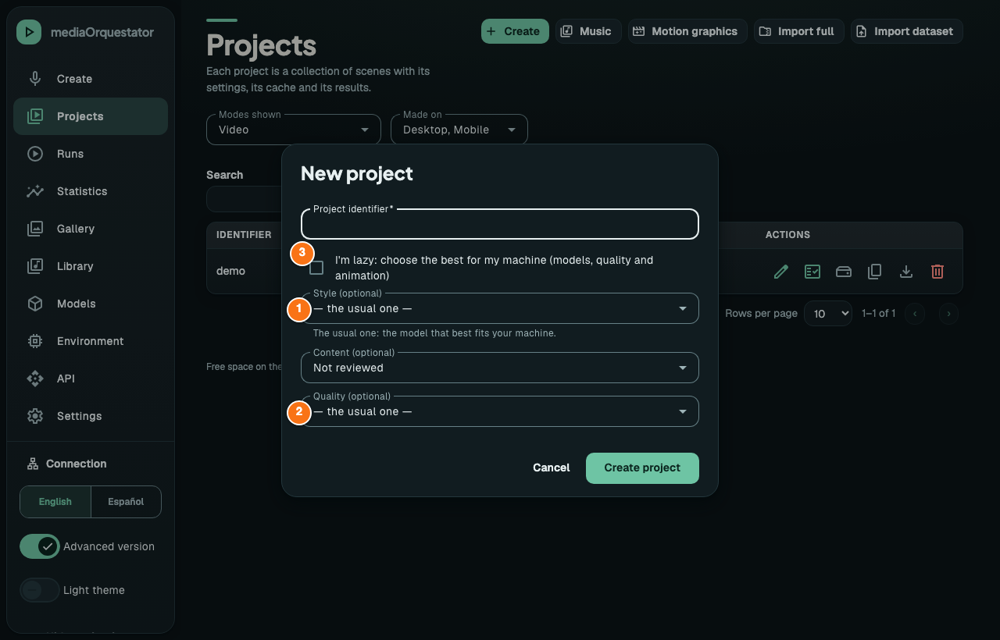

Then you will see the list:

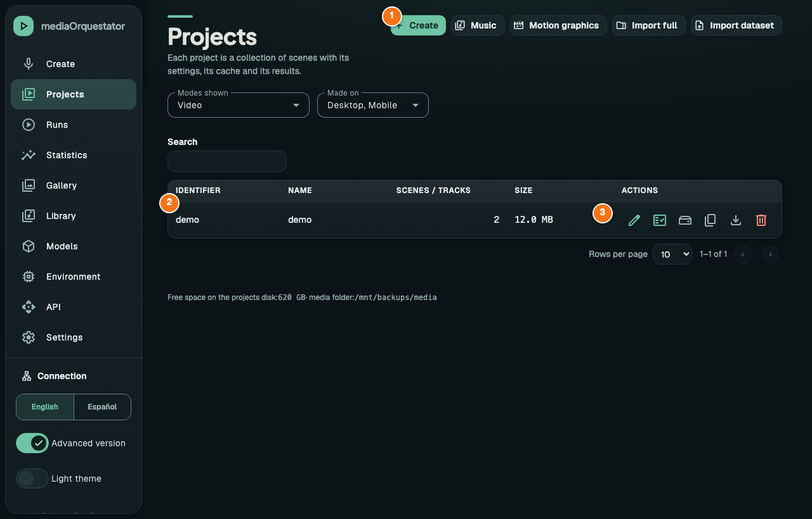

1. **Create** (the highlighted button is always the screen's main action). Next to it, **Music** creates one for songs.
2. The project row: identifier, name, number of scenes (or tracks, for a music project) and size. The **Modes shown** selector above the table says which kinds of project are listed (only video the first time, so there is no mode column; see [Searching and choosing the modes](#8-history-and-deletion)).
3. Row actions: **edit** (the scene editor, or the music studio if the project is a music one), **review the clips**, **storage**, **duplicate**, **export** and **delete**.

### Keeping the space under control

The list has a **Size** column (you can sort by it) and, under the table, the **free space** of the disk. The **storage** button of a row opens the breakdown of that project, part by part, with what each part is and what cleaning it costs:

- **Scene cache** (`tmp/`): usually the biggest part (70 % of a video project). It is what avoids repeating minutes of GPU; if you empty it, the next run makes every scene again.
- **Leftovers of scenes that no longer exist**: files of scenes you removed or renamed. After every run they are removed by themselves; the button is there for projects from before.
- **Clip of each scene** and **Complete animations** (`out/clips/`): what the Gallery shows and other projects can copy.
- **Reviews** (the frames the reviews show) and **Copies of scenes.yaml** (`scenes.yaml.bak` and the like).
- **Final video and exports** and **Sources** are your results and your inputs: they are shown but not cleaned from here.

Each button asks for confirmation saying what it costs, and a project with a run in progress cannot be cleaned.

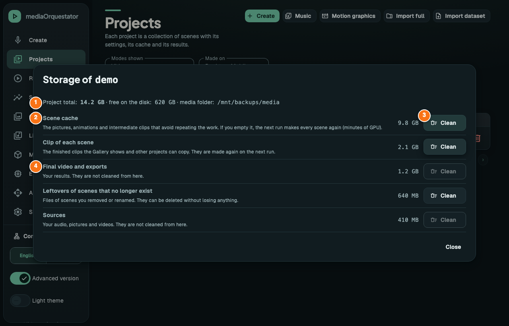

1. The **total** of the project and the **free space** of the disk.
2. Each part says **what it is and what cleaning it costs**; the biggest first.
3. **Clean** removes only that part, after asking.
4. **Final video and exports** and **Sources** are shown but their button is disabled: they are yours.

## 6. The editor, section by section

The editor has several stacked cards, folded when you open it: Output, Style and quality, Defaults, Animation, Background music, Scenes drawn by a part of the catalog (see [Scenes drawn by a part of the catalog](../apps/dashboard-full/README.md#scenes-drawn-by-a-part-of-the-catalog)) and the list of Scenes. Everything you change is saved in the project's `scenes.yaml`.

### Output

Choose the **mode**: `video` (the whole pipeline), `images` (images only, no narration) or `music` (songs; see [Music](#music-creating-songs)) and the output file (`out/live.mp4` in the example).

**Content.** Below the mode you can say whether the project is for adults: **Not reviewed** (the default), **Reviewed: fine for everyone** or **For people over 18**. The server starts *censored*: projects marked for people over 18 do not appear anywhere (list, gallery, runs, statistics) and cannot be opened. Starting it with `--strict` also hides the ones that are not marked as reviewed. The Environment screen says which mode the server is in.

### Style and quality: choosing without getting lost

With so many models and settings, this card fills the form in one go from what you **already have installed**:

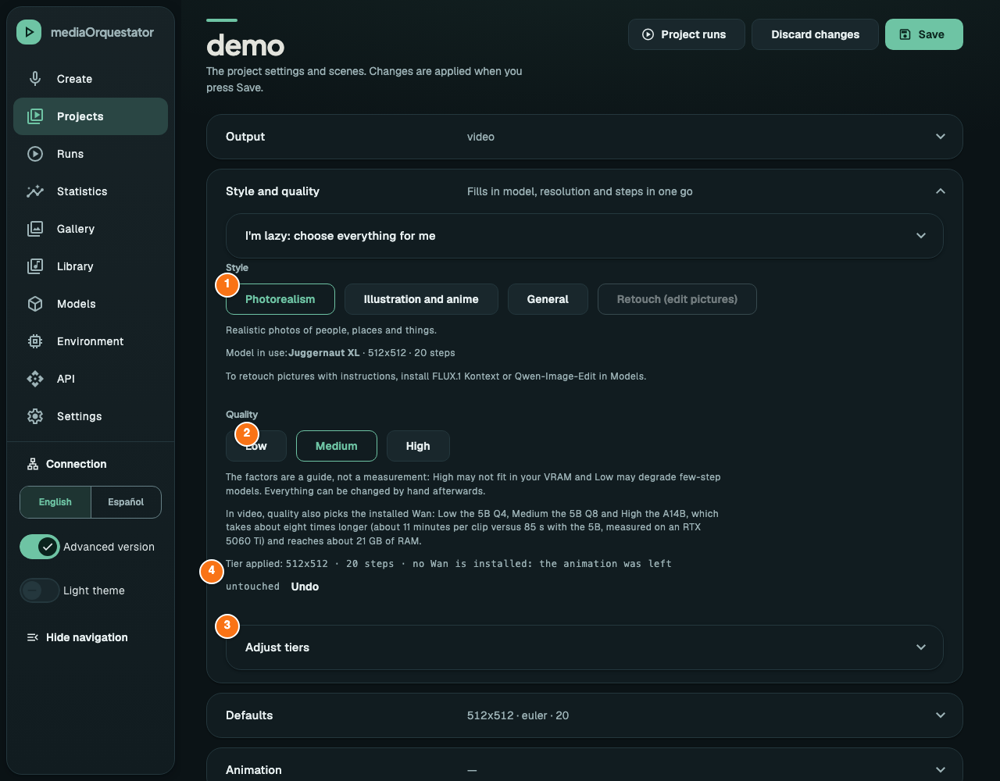

1. **Style** (Photorealism, Illustration and anime, General, **Retouch**): picks the best installed model for that style and its recommended settings. A style with no installed model appears disabled. The current one is highlighted and a line under the buttons says what it is. **Retouch (edit pictures)** switches the project to the editing model (FLUX.1 Kontext or Qwen-Image-Edit, installed from Models; with both installed you choose **Fast**, about 40 s with a non-commercial licence, or **Precise**, about 2 min and free for commercial use): each scene then needs its starting picture, and its prompt is the instruction ("put a red cap on him"). It is also a choice in the style list of **Create project**, and picking another style gives the project its image model back.
2. **Quality** (Low, Medium, High): writes resolution and steps (the resolution is **never more than your card can hold** with that model: High with IntoRealism on a 16 GB card asks for 1216x640, not 1280x704, which ran out of memory in a real run) (Medium is the model's preset; Low uses less resolution and half the steps; High, more resolution and 1.5 times the steps). In images mode it also sets the **variants** (1, 2 or 4 different seeds per scene) and, if you define one, a **LoRA**. In video mode it also chooses the installed **Wan**: Low the 5B Q4, Medium the 5B Q8 and High the A14B (much slower).
3. **Adjust tiers**: changes the values of each level (resolution, steps, variants, LoRA, Wan settings). They are saved in your browser; **Restore** goes back to the computed ones.
4. After applying a level, a note says what it wrote and offers **Undo**. Nothing is applied when you open a project, and the style and level are not saved in the project: only the values they write, which you can still change by hand.

The factors are a guide, not a measurement: High may not fit in your VRAM and Low may fall short for a model built for few steps.

**Quality per scene.** The above sets the project's common quality.

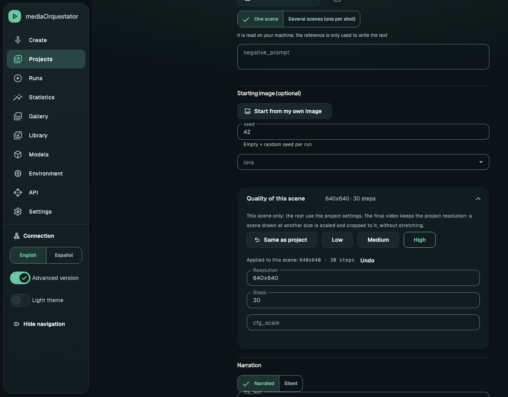

Each scene also has its own collapsible section **"Quality of this scene"** (in the scene's form): there you give **Low, Medium or High to that scene only**, or edit by hand its resolution, steps and cfg_scale (and, if the scene animates, Wan's resolution, frames and steps). **"Like the project"** removes its own settings and **"Undo"** brings back what it had. This way you can draw a key scene at higher resolution and with more steps (and animate it with more frames) and keep the rest fast and cheap. Notes: the **model** (and the Wan model) is still the project's; the **final video keeps the project's resolution** (a scene drawn at another size is cropped down to it, not stretched); and each scene has its own cache, so changing one scene's settings regenerates only that scene.

### I'm lazy: choose everything for me

If you do not want to choose anything, at the top of the **Style and quality** card there is **I'm lazy**. You only say **how long you are willing to wait** (from 15 minutes to "all night", or "whatever it takes", which is the best quality there is) and it chooses the rest:

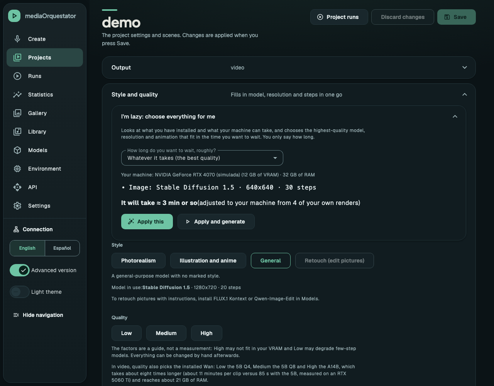

- It looks at **what you have installed** (image models, Wan, AnimateDiff, MiniMax H3, LTX 2.3) and at **your machine**: the memory of the graphics card and the RAM. What does not fit is left out and it tells you why ("MiniMax H3 is installed but does not fit this machine").
- It chooses the **best animation that fits in the time** you gave, from best to worst: MiniMax H3, Wan A14B, LTX 2.3, MiniMax H3 as a draft (with the turbo LoRA), Wan 5B Q8, Wan 5B Q4 and AnimateDiff; and the best image model for the style the project already has. If the best animation does not fit, it first makes the pictures cheaper before dropping to a worse animation.
- It **animates the scenes**: the **Animate the scenes** box (checked by default, shown when something installed can animate on your machine) switches animation on in every scene that does not bring its own clip, so the video moves; untick it to leave the scenes as they are. A scene you add later to a project that has animation configured also comes animated.
- It **limits the resolution of the pictures to what your card can do**: a model that uses almost all the memory (IntoRealism on 16 GB) does not take the highest level, because at 1280x704 it was out of memory in a real run; it tells you "the resolution is limited to 1216x640" when it does.
- It shows **what it would write** (image model, resolution, steps, animation) and **how long it would take**. Nothing changes until you press **Apply this**, and **Undo** puts the project back exactly as it was.
- If not even the fastest way fits the wait, it says so and offers that fastest one. If a better model is not installed but would fit your machine, it suggests installing it from Models.
- **Apply and generate** does it all in one click: it applies the plan, saves the project and launches the run, and takes you to watch it. The music studio has the same (**Apply and create the songs**). And when you create a project, tick **I'm lazy** in the new-project window: the project is born with the best image model, its highest level and the best animation your machine can do, with no scenes yet.

The times are **an estimate**: each model carries how long it took on the machine where it was measured (an RTX 5060 Ti with 16 GB). Until you have generated a few pictures, it scales them to your card with a table of families (if your card is not in the table, it says the figure is a guess). **After your first runs it learns from them**: it compares every picture and animation your machine makes with what it expected and uses the median of the latest ones, and the panel says "adjusted to your machine from N of your own renders". It is a good guide to decide, not a promise.

### Defaults: the model and the common settings

What you put here applies to **all** scenes (each one can override it).

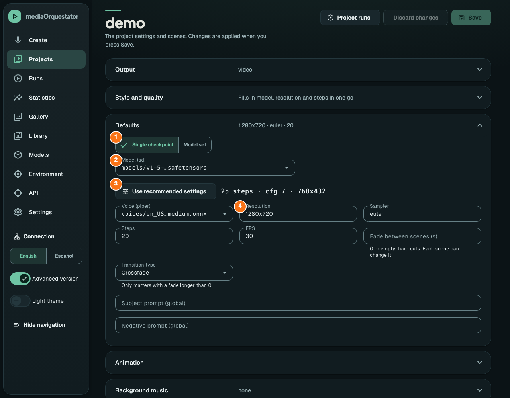

1. **Single checkpoint / Model set**: choose how you will configure the model (see [concepts](../../mediaOrquestator/docs/TUTORIAL.md#2-minimum-concepts)).
2. **Diffusion model** (and, for a set, also text encoder and VAE). The lists are filled with what you have installed.
3. **Use recommended settings**: appears when the chosen model has a preset. It writes steps, resolution and cfg_scale in one go. **It is never applied on its own**: you decide.
4. **Resolution, Steps, Sampler, FPS…**: the values the button has just filled in. `Steps` are the drawing steps: more steps = more time; "Turbo" models are built for few (8).

You also have **Voice (piper)** for the narration and the global prompts: **subject** (prepended to all scenes, useful to keep the character the same) and **negative** (what you do not want to see).

### Animation (Wan or AnimateDiff)

If you tick nothing, each scene stays as an image with a gentle zoom or pan (decided by the "camera movement" field). If you want the image to **really move**, turn on animation (with Wan, or with AnimateDiff if you prefer something lighter and subtler):

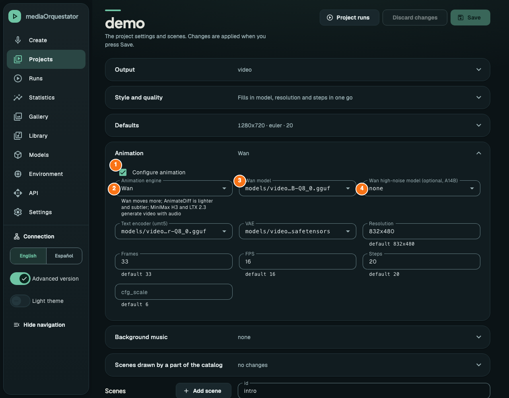

1. **Configure animation**: turns the section on. It needs files from the Video tab of Models.
2. **Animation engine**: Wan (moves more) or AnimateDiff (lighter, subtle motion: waves, wind, a portrait that breathes). Choosing AnimateDiff fills in by itself the installed motion module and SD 1.5 model, with the recommended settings and an "Undo". There are two more, **MiniMax H3** (video with audio, explained below) and **LTX 2.3** (video with audio, faster, with a bundle of five files from Models > Video: choosing it fills in its files and settings, the picture is the first frame of the clip and it fits a 12 GB card).
3. **Wan model**: the video model (the 5B one is the fast one).
4. **High-noise Wan model (optional)**: only for the A14B version, higher quality but much slower and with more RAM. Leave it at "none" if you are starting.

With AnimateDiff, instead of the Wan models you see the **SD 1.5 image model** (an SDXL one does not work), the **motion module** and the **strength** field (how far it moves away from the image: higher, more motion). Use a resolution with your video's aspect ratio, for example 640x352 for 1280x704.

Empty fields use their default values, shown in small print below ("default 832x480", 33 frames, 16 fps…).

> **Video with audio:** MiniMax H3 is a third engine, explained in [its own section](#video-with-audio-minimax-h3) right after this one.

> Times measured here (5060 Ti GPU): Wan 5B ≈ 85 s per scene; A14B ≈ 680 s per scene and ~21 GiB of RAM; AnimateDiff ≈ 60-80 s per 2 s clip; MiniMax H3 ≈ 260-290 s per shot (≈ 100 s with the turbo LoRA); LTX 2.3 ≈ 145 s per 2 s shot at 768x416 (116 s on a 12 GB RTX 4070).

> **If the movement does not come out right**: each scene is **one picture animated for 2 to 4 seconds**, saved forward and then in reverse so that it loops; it is not a continuous clip. Ask for **one action per scene**, make the scene last **as long as the forward part** (frames ÷ fps: 33 frames at 16 fps = 2.06 s) so it never reaches the reversed half, and cut between scenes instead of expecting one to flow into the next. A complete worked example, with its `scenes.yaml`, is [at the end of this tutorial](../../mediaOrquestator/docs/TUTORIAL.md#a-worked-example-two-friends-on-a-bench-who-skate-away).

### Video with audio: MiniMax H3

MiniMax H3 is a third animation engine that generates **video and stereo audio together** from the scene's picture (the picture is used as a reference, so the subject and the style are kept). It is heavier than Wan: use it when you want a short, high-quality shot with its own sound.

1. **Install it**: in **Models > Video > Recommended catalog**, "MiniMax H3 Ref2VA". It is one bundle of five files (about 37 GB): the video model, the text encoder, the two VAEs and a turbo LoRA. The card shows the recommended settings.

   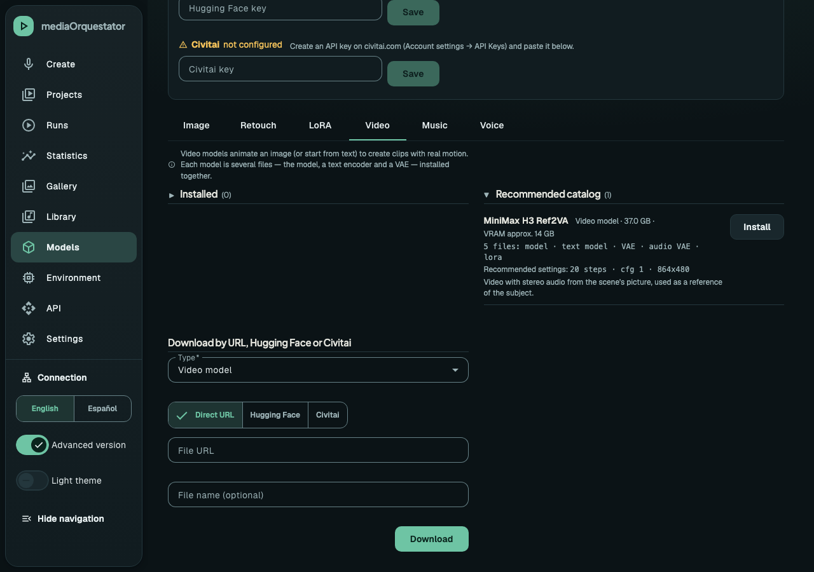

2. **Choose it in the editor**: **Animation > Animation engine > MiniMax H3**. In one go it fills the four files of the bundle and the recommended settings (864x480, 20 steps, cfg 1), and the "Undo" button brings back what you had. If you go back to Wan afterwards, choose its files again (Undo, right after changing, gives them back).

   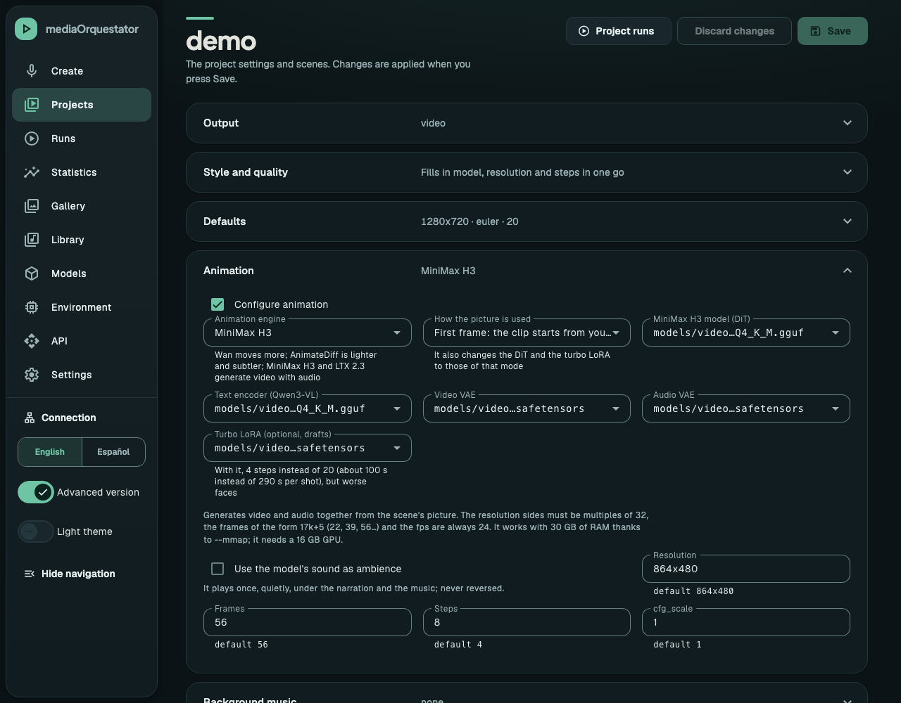

3. **Mind the grid**: the resolution sides must be multiples of 32, the frames of the form 17k+5 (22, 39, **56**…) and the frame rate is always 24. The default, 864x480 and 56 frames, gives 2.3 s of video with audio. By default the audio sd generates is not used in the final video: the project's own audio (narration, music) is. To keep the model's sound as quiet ambience, tick **Animation > Use the model's sound as ambience**: it plays once, at low volume, under the narration and the music, and never reversed.

**First frame or reference.** There are two H3 bundles in the catalog. **MiniMax H3 First frame (FL2VA)** uses the scene's picture as the **first frame** of the clip: the shot starts exactly from your picture and the subjects stay where it puts them. **MiniMax H3 Ref2VA** only takes it as a *reference* of the subject, so the composition may drift (in our test one of the two girls left the frame). They share the encoder and the VAEs (not downloaded twice); only the video model and the turbo LoRA change. The editor's engine selector and **I'm lazy** choose the first-frame one when it is installed, and *Animation > How the picture is used* switches between the two (it also swaps the video model and the LoRA). Measured with the same picture and seed (two girls laughing while skating, 864x480, 56 frames): **290 s at 20 steps** with clean faces to the end, and **168 s with the 8-step LoRA** with very similar quality, where the reference one's 4-step LoRA (96 s) deformed the faces. Waist-up shots (faces large) also read better than wide ones, where the faces are only a few pixels.

**On a 12 GB card.** The first-frame bundle also fits an RTX 4070 (12 GB) **at 768x416**: measured with the 8-step LoRA, **108 s per shot** and a peak of 11.2 GB of VRAM, with the same quality as at 864x480 (both girls in frame, clean faces). **I'm lazy** does it by itself on a card like that (it writes 768x416 and says so); by hand, set `resolution: 768x416` in the animation. With a bigger picture it does not fit (864x480 needs 13.5 GB).

What you need and what it costs (measured here, RTX 5060 Ti with 16 GB, 30 GB of RAM):

- **RAM**: it works with 30 GB. The files are read straight from disk (`--mmap`, the engine turns it on by itself) instead of being copied into memory, so the 35 GB of the models do not have to fit; available RAM never fell under 28 GB. An SSD is advised.
- **GPU**: about 13.5 GB of VRAM at 864x480 and 56 frames, so it needs a 16 GB card. It does not fit on a 12 GB one.
- **Time**: about **260-290 s per shot** with 20 steps, against about 85 s for Wan 5B.

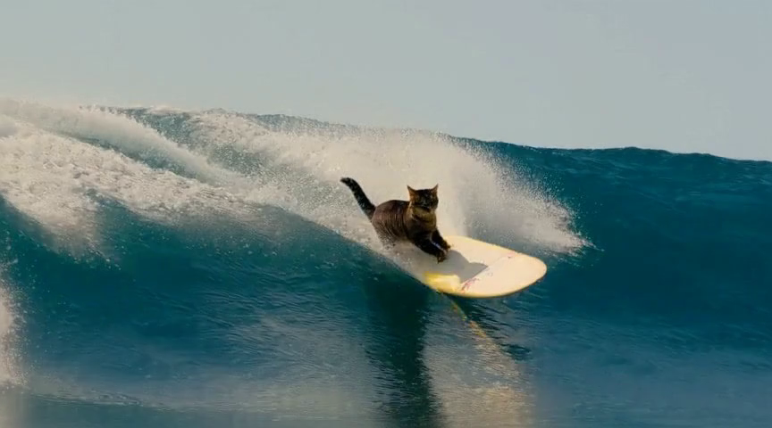

**The turbo LoRA is for drafts.** In the editor it is the optional "Turbo LoRA" selector (it comes as "none"). With it the default steps go down to 4 and a shot takes **about 100 s** instead of 260-290 s, but with people the faces deform and the background blurs in the last half second, clearly more than with 20 steps and no LoRA (measured on three shots of two women). Use it to try prompts and leave it out of the final render. In the YAML it is `defaults.animate.lora` (see [SCENES_YAML.md](../../mediaOrquestator/docs/SCENES_YAML.md)).

### Scenes

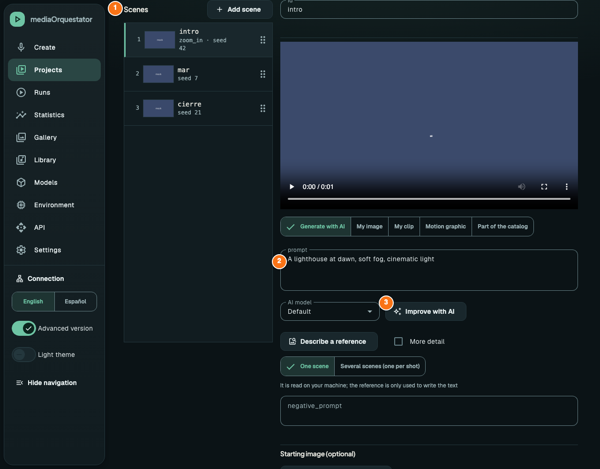

1. **Scene grid**: the list of scenes with their thumbnail (when an image has been generated). Drag them to reorder, and "Add scene" creates another. In a project of images, the form of each scene shows **every picture a run made for it** (one thumbnail per variant; click one to see it larger), as a video scene shows its clip.
2. **prompt**: the description of the image.
3. **Improve with AI**: asks a local model (Ollama, on CPU) to rewrite your prompt with more detail. It is a suggestion: you accept it or not. Next to the button is the **AI model** (by default the server's): when you open it you see the models installed in Ollama with their size, and those that do not fit in the free memory or are very slow on CPU (over about 14 GB) carry a warning. Your choice is remembered in this browser and is also used in the music studio. If the model **refuses** to write (it happens with adult descriptions: it is the model itself, the application filters nothing), the warning says so with the model's name<!--[private]-->; choose another installed one and ask again. To install another: `ollama pull <model>` (for example `huihui_ai/qwen3-abliterated:8b`, 5 GB, which does not refuse)<!--[/private]-->.

Further down in the same scene:

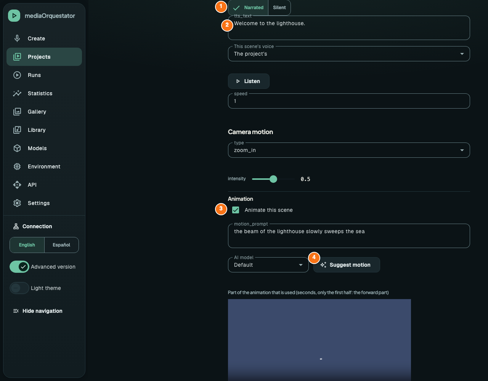

1. **Narrated / Silent**: with narration, the video lasts as long as the audio; silent, as many seconds as you say.
2. **tts_text**: what the voice will say. Under it, **Voice for this scene** picks who says it (by default, the project's voice from Defaults), and, when that voice holds several speakers (`es_ES-sharvard` has a man and a woman), **Speaker** picks one (Defaults has the same selector for the project's voice); **Listen** reads the text aloud with that voice and the scene's speed, in seconds and without running anything, so you can hear it before you generate (up to 600 characters; press again to stop).
3. **Animate this scene**: turns on animation for this scene only (it needs animation to be configured first, with Wan or AnimateDiff, in Defaults).
4. **Suggest motion**: the AI proposes the `motion_prompt`, that is, what the image should do as it moves ("she slowly turns a page").

And **Finish**: film grain and white balance.

## 7. Launching a run and following it

The **Runs** screen:

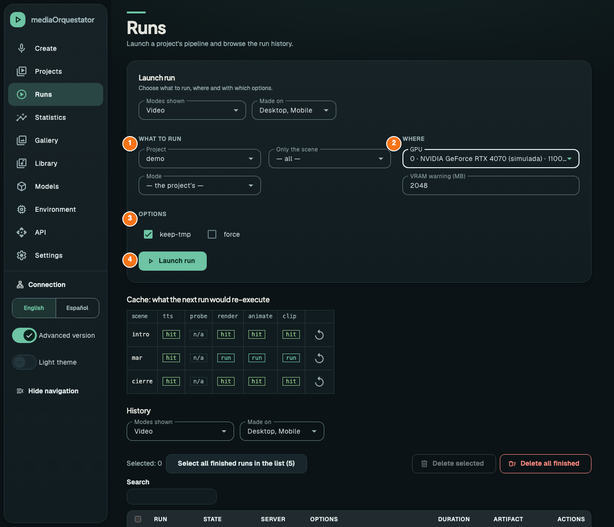

1. **What to run**: the **Project**, **Only the scene** (to test just one without redoing the rest) and **Mode** (to force `images`, `video` or `music` without touching the project).
2. **Where**: the **GPU** (you can tick both to split scenes) and the **VRAM warning**: if the GPU has less free memory than that value, it warns you; it does not cancel.
3. **Options**: **keep-tmp** keeps the cache between runs (leave it on, otherwise every run starts from zero) and **force** ignores the cache and redoes everything.
4. **Launch run**.

Below, the **Cache** table tells you what the next run would do: `hit` = reused, `always` = always executed, anything else is redone.

### The run monitor

When you launch it you enter the monitor, which also opens from the history:

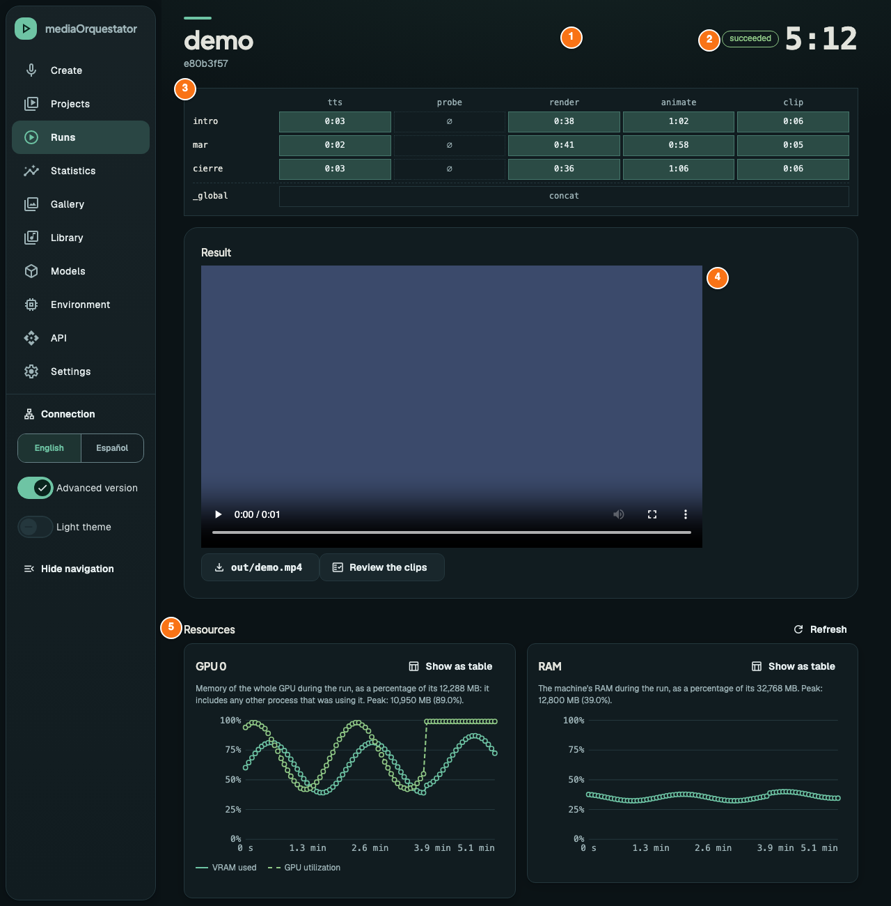

1. Project and run name.
2. **Status** (`running`, `succeeded`, `failed`, `cancelled`) and the total time.
3. **Phases per scene**: each cell is a phase of a scene, with how long it took. While it works you see which one is active.
4. **Result**: the final video, which you can play right there, and the download link.
5. **Resources**: VRAM and utilization of each GPU, and the machine's RAM, during the run. They tell you whether you are running short of memory. With **View as table** you see the same numbers. Below, the **Event log**.

### From your phone: the Create page

**Create** is the first screen of the menu and the one a phone opens at the root address. It is made for asking from a phone, away from home, without going through the editor. It shows only the requests made in this browser tab (a reload keeps them): the earlier ones are not listed, and stay in the Gallery and the projects, marked as **mobile** (see *Made on* above):

1. **Choose what you want to make.** The first thing you see is three buttons, **Video**, **Image** and **Music**, and below them **Let the AI decide**. Choosing the kind saves one call to the assistant (the one that guessed whether it was a video, a picture or a song), so the request is understood sooner. A finished picture has an **Edit** button: it attaches the picture to a new picture request, and what you write next is the retouch instruction ("put a red cap on him"); you can chain it as many times as you like. With the text box open, **Change type** goes back to the choice without losing what you wrote or the attachments; after sending, the page asks for the kind again.
2. **Say or write what you want** ("a cat on a rooftop at sunset", "a sad piano song in Spanish"). Tap the microphone to start and tap again to stop: your own server reads the voice (Whisper, on the CPU; nothing goes to the internet) and puts the text in the field, where you can correct it. The microphone only appears on a secure page: serve the dashboard over HTTPS (see `docs/SERVER.md`, "HTTPS for the microphone"). Writing always works. The clip button attaches a picture or a video (the generation starts from it) or a song (a reference).
3. **Check what was understood.** The prompt assistant works out whether it is a **video**, an **image** or **music**, writes a title and the texts for the generator; you can change the kind with one tap, set the length of a song or turn off the vocals, and open the text that will be sent. If the assistant cannot answer (it waits while something is being generated, or it is not available)<!--[private]--> or its model **declines** to write the text<!--[/private]-->, the card is filled with your own words, says so, and that is what is sent to the generator. For pictures and videos you can also pick the **look** (automatic, photorealistic, anime or general), limited to the ones you have a model for.
4. **A picture of yours: Retouch, or start from it.** When you attach a picture to an image request, the look selector gains **Retouch** (only if you installed FLUX.1 Kontext or Qwen-Image-Edit from **Models**; with both you pick the engine, **Fast** or **Precise**, each with a line saying what sets it apart): the text is then an instruction like "put a red cap on him" and only that changes (the assistant rewrites your words, in any language, as a short English instruction, which you can read and correct in **Retouch instruction**; say who by where they are, for example "the man on the left", and avoid naming other colours) (about 42 s with Fast and 2 min with Precise on a 12 GB card, and the picture keeps its own shape). Nothing is retouched unless you pick it: with **Automatic** (or any other look) the picture only **starts** a generation, and **How much it changes** sets how far (little looks like the original, a lot lets the text reinterpret it). Each look has a line under the selector saying what it is.
5. **For a video, choose the engine and the words.** The card lists the engines your machine can run, each with how long it would take (MiniMax H3, LTX 2.3, Wan…); **Automatic** is the default and says which one it would use. **What it says** holds the words the video has to say: the assistant fills it when you quote them ("a woman on the beach who says «hello, welcome»") or you write them yourself. With words, Automatic takes **LTX 2.3**, which says the line itself (tried in Spanish and in English, about 130 s for a 3 s clip); with any other engine the narration voice reads them.
6. **For a song, choose the generator.** When the machine can use more than one (ACE-Step, and optionally HeartMuLa and DiffRhythm2 from **Models**), the song card offers **Automatic** (ACE-Step, which has every feature) and each generator with a line about what it does and does not do. They do not read the same words, so choosing another **asks the assistant again** from your own request: ACE-Step gets a style sentence and lyrics with `[verse]` and `[chorus]`; HeartMuLa gets **tags** chosen from a vocabulary of 109 words in seven categories (genre first, then mood, instruments, tempo, vocals, era and production), shown as chips you remove with a tap and add from a list by category; DiffRhythm2 gets short English tags and English lyrics, and cannot make a song without a voice. The lyrics come in stanzas of four lines with the chorus repeated word for word, and grow with the length you pick (short: two verses; normal: with a bridge; long: three verses). Above the style there are ten **popular combinations** (Chill Lo-fi, Epic Cinematic, Upbeat Pop, Hip-Hop Beat…) that fill the tags with one tap (or the style sentence, for ACE-Step). The suggestion is open and editable. **Regenerate suggestion** writes a new one, and if you had edited the text it asks first, so nothing you wrote is lost by accident. A song attached as a reference leaves only ACE-Step, the one that follows it.
7. **Recognise a song that is playing (optional).** Next to the microphone there is an **ear** button: tap it, bring the phone close to a speaker, let 20 to 30 seconds of the song play and tap again. Your own server measures its tempo and key, reads a few words of the lyrics with Whisper and the assistant says what kind of song it is and what it is about; then the Create page starts a request for **a new original song of that kind** (it says what it heard: tempo, key, theme). The lyrics that were heard and the recording are **not kept or copied**: the new song gets new lyrics. The figures are estimates and the genre is the assistant's best guess, which can fail with noise or when the song has no words; when it cannot tell, it says so and you check the style. A song with no words recognised is not assumed to be instrumental. It needs the assistant and the microphone (a secure page, HTTPS).
8. **Press "Do it".** A project named `mobile-<date>-<title>` is created at the resolution level chosen on the card (Draft on a phone; with Automatic, the best quality your machine allows, the same choice as "I'm lazy"), and the card shows what was chosen and about how long it takes.
9. **Watch it and see it.** The card shows the queue and the progress, and when it finishes you play the video, see the image or listen to the song there, with a download and **Another variation**. If you close the page, the latest requests are listed again when you come back. **Remove** asks first and then deletes the request for good: its project, its runs and everything it generated.

**Resolution, quality and animated graphics.** Every card has a **resolution** selector (a **quality** one for a song): **Draft** (half the size, quick), **Normal**, **High** (the largest this machine can do) and, for a video or a picture, **Automatic**. On a narrow screen, such as a phone, it starts at **Draft** so no time is wasted; on a desktop, at **Automatic**. A song always starts at **Draft** and makes **one version only**. If the motion-graphics model is available, a video offers **Animate a picture** (with the engine chosen) or **Animated graphic** (a page the assistant writes and Chrome draws, with no picture model). **Improve with AI** (the wand button next to the microphone) rewrites what you typed with the assistant, with more detail and in your language, before you send it; **Undo** brings your text back. **Clear screen** (above the list) empties the list without deleting anything: the projects stay in the gallery and what is running goes on.

**Simple and advanced version.** The **Advanced version** switch in the menu chooses which screens you see. On a narrow screen it starts as **simple**: the menu has only **Create** and **Gallery** (which shows only what was made from Create, in every mode) and any other address takes you to Create. On a desktop it starts as advanced. The choice is remembered in the browser. On a narrow screen, **API** and **Settings** never open, not even in the advanced version (they lead to Create). It hides screens; it protects nothing (for that, see the token access in `docs/SERVER.md`).

**Code words.** If you attach a photo and write a code word, a **Precise retouch** of that photo is launched at once, with no card to review, using a fixed instruction. Without a photo it asks for one. Each code has its Spanish and English spelling:

- **Platinum code** (`código platino`): a long platinum blonde wig.
- **Bright code** (`código luminoso`): the person bald, with a shiny scalp and no eyebrows.
- **Red code** (`código rojo`): a clown, with clown wig and makeup.
- **Military code** (`código militar`): camouflage makeup on the face.
- **Total code** (`código total`): all four on the same photo, one card with its variant for each.

The rest of the dashboard is not made for a phone: tables scroll sideways inside their frame and the scene editor and the music studio are meant for a larger screen.

## 8. History and deletion

In **Launch run**, the **mode selector** (video, images, music) above the project list cuts a long list of projects down to the kind you want; the project already picked stays in the list. Above the history there is the same **mode selector** as in Projects and the Gallery (video by default): it shows only the runs of the projects of the chosen modes, and the choice is shared with those screens. Selecting and deleting finished runs only reaches the runs you can see; the runs whose project no longer exists are always listed.

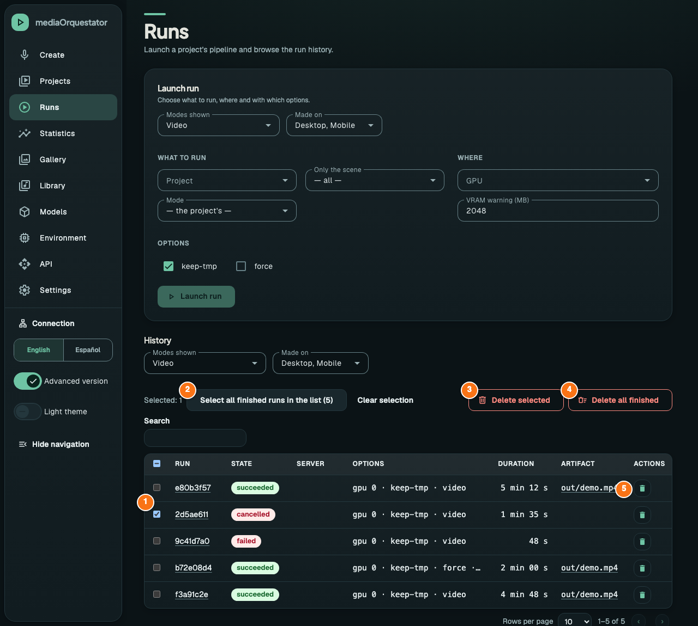

1. Checkbox to select a run.
2. **Select all finished runs in the list**.
3. **Delete selected**.
4. **Delete all finished** (respects the project filter).
5. The row's trash can deletes only that run.

Click the header of a column (Run, State, Options, Duration, Artifact) to **sort** the whole history by it: once ascending, twice descending, a third time back to the original order. The projects list and the *Slowest runs* table of the statistics sort the same way.

**Searching and choosing the modes.** The projects list, the run history and the *Slowest runs* table have a **Search** box above the rows: type one or more words (case and accents do not matter, every word must appear) and only the matching rows stay, with how many out of how many; *Clear the search* undoes it, and the text is remembered while you stay in the dashboard. As the number of projects grows, the **Modes shown** selector (above the projects table, and also in the Gallery) lets you pick which modes you want to see: video, images, music, any combination. Only **video** is chosen the first time, so the list has no *Mode* column; projects of the other modes appear when you choose their mode. The choice is the same in the projects list and in the Gallery (whose project selector lists only the chosen modes) and is remembered in the browser. Next to it, **Made on** tells the projects made on the **desktop** from the **mobile** ones: those are the requests of the Create page, named `mobile-…`, whichever device made them. Both are shown by default; the choice is shared by the projects list, the Gallery, the run history, the Statistics and the song library, and is remembered in the browser. A project you create or import is shown even if its mode was hidden, and a project whose `scenes.yaml` cannot be read (it has no mode) is always listed so you can fix it.

Before deleting it always asks for confirmation:

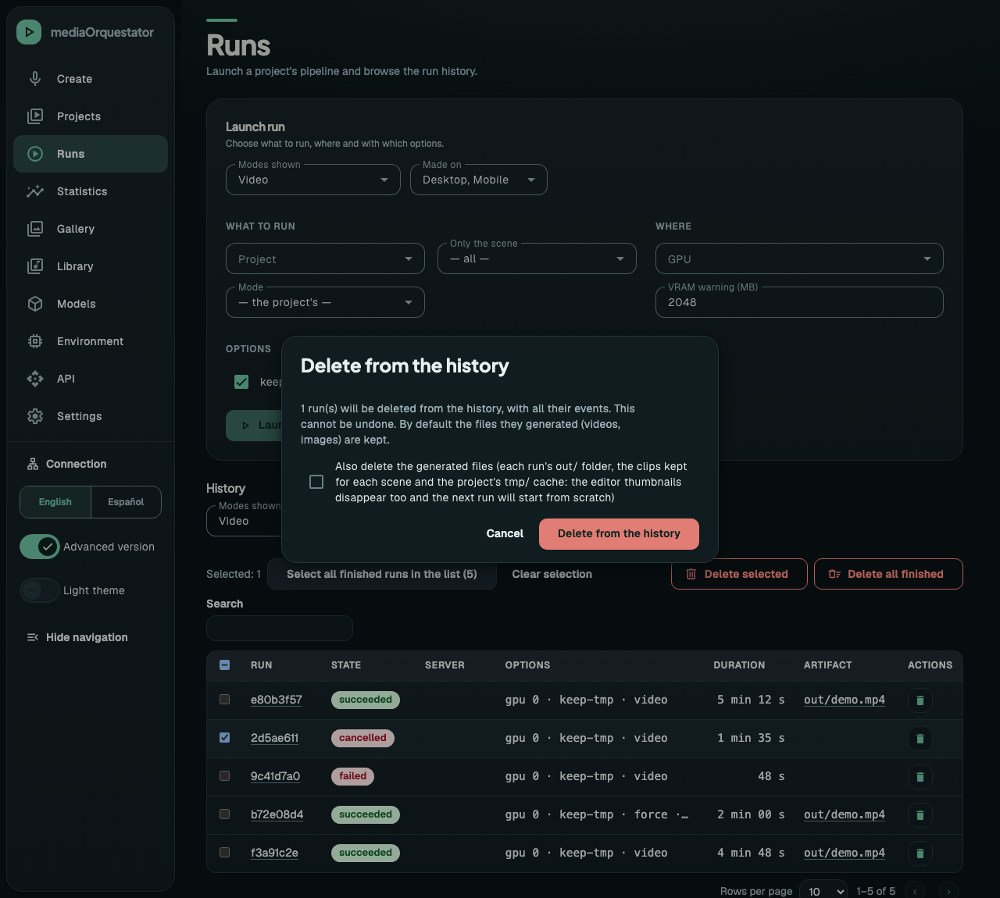

The dialog says how many runs will be deleted, that it **cannot be undone** and that **by default the files they generated (videos, images) are kept**: only the history entry is deleted. The unchecked box **Also delete the generated files** also removes each run's `out/` folder, the clips kept for each scene and the project's `tmp/` cache (the editor thumbnails disappear and the next run starts from scratch). **Cancel** leaves everything as it was. Queued or running runs are never deleted: cancel them first.

## 9. Statistics

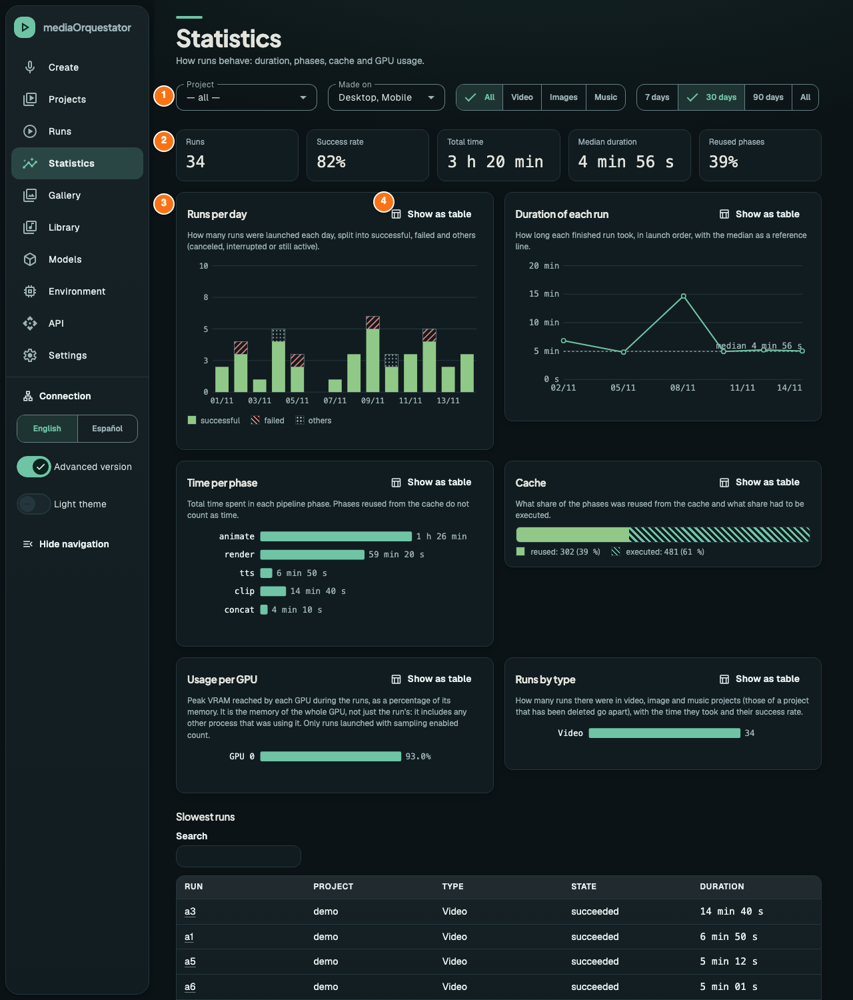

1. **Filters**: project, **type** (all, video, images or music: only the runs of projects of that kind) and period (7 days, 30 days, 90 days or all).
2. **Summary**: how many runs, success rate, total time, median duration and what percentage of the work was reused from the cache.
3. **Charts**: runs per day, duration of each run, time per phase, cache, VRAM use per GPU and **runs by type** (how many runs, how long and how often they worked in video, image and music projects). The *Slowest runs* table also says the type of each project. If you saved the Grafana address in **Settings**, **Open Grafana** appears at the top right.
4. **View as table**: each chart can be switched to a table with the same numbers.

It helps you tell, for example, which phase takes you the longest, or whether the cache is saving you work.

## 10. Quick recipe: your first video in 10 steps

1. Start the server (section 3) and open the dashboard.
2. **Environment**: check that the four binaries are green.
3. **Models**: install **Stable Diffusion 1.5** (the "Para empezar", i.e. "To get started", entry) and a voice.
4. **Projects → Create project**.
5. Open the project. In **Defaults**, leave *Single checkpoint* and choose SD 1.5 and the voice.
6. In **Scenes**, write a prompt and a narration text.
7. (Optional) Press **Improve with AI** and review what it proposes.
8. **Runs**: choose the project and **GPU**, leave *keep-tmp* ticked and **Launch run**.
9. Watch it progress in the monitor.
10. When it finishes, play the video and, if you do not like something, change **only that scene** and launch again: the cache makes it fast.

When that works: try the realistic models (Krea 2 / IntoRealism, with "Use recommended settings" or the **Photorealism** style from [Style and quality](#style-and-quality-choosing-without-getting-lost)) and then animation with Wan. If you want more quality only where it matters, give one scene **High** from its "Quality of this scene" section and leave the rest as it is.

## Mobile and light theme

The dashboard adapts to a phone screen: in the advanced version the menu becomes a hamburger button, as in the picture (the simple version, which is the default on a phone, uses a bar of tabs instead; see [Simple and advanced version](#from-your-phone-the-create-page)). It also has a light theme, with the switch at the bottom of the menu (marked **1** in the second picture):

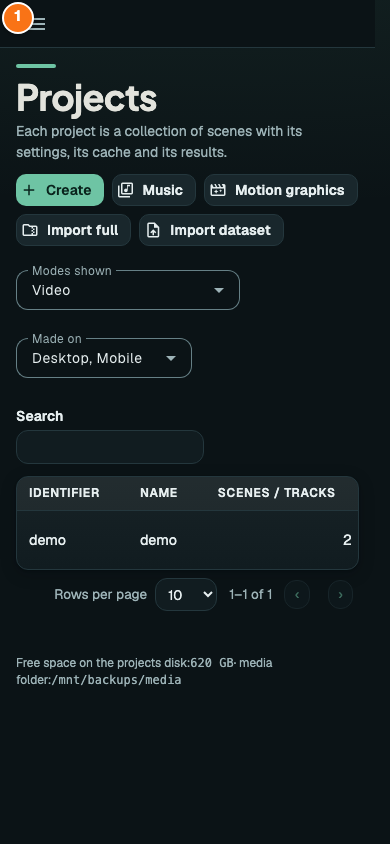

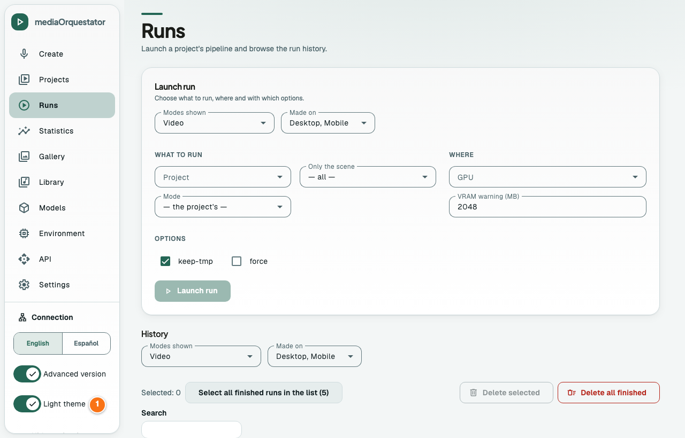

## Music: creating songs

Music is a feature **independent** of the video: it is not mixed with the narration or the images. You describe the style, write your lyrics if you want, and a complete song (with voice or instrumental) is generated with [acestep.cpp](https://github.com/ServeurpersoCom/acestep.cpp), on your machine and with no cloud.

### What you need

1. **The engine**: `bash scripts/build-acestep.sh` (see [Environment](#the-environment-screen-the-first-thing-to-look-at): `ace-lm` and `ace-synth` must show green).
2. **The models**: in **Models**, **Music** tab, install a bundle. It is four files (language model, text encoder, synthesis model and VAE) and they are downloaded like the others, from that same place; they are stored apart, in `models/music/`.

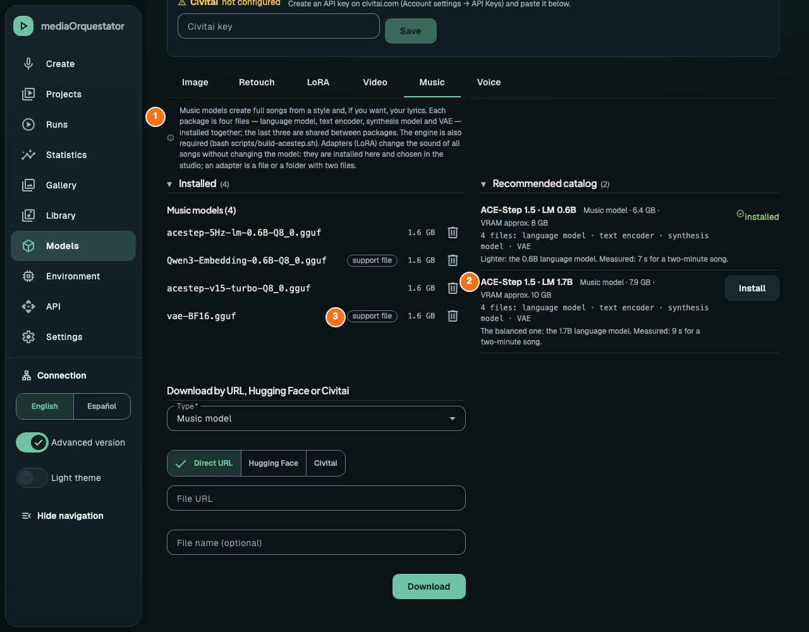

1. **The tab's note**: explains that each bundle is four files and that the engine is needed.
2. **The catalog bundle**: with its size, the approximate VRAM, what was measured and the license. The 1.7B one is the balanced one; the 0.6B one is lighter.
3. **Support pieces**: the text encoder and the VAE are shared between bundles, so installing the second only downloads its language model.

### The studio

On **Projects**, **Music project** creates a project and opens the studio:

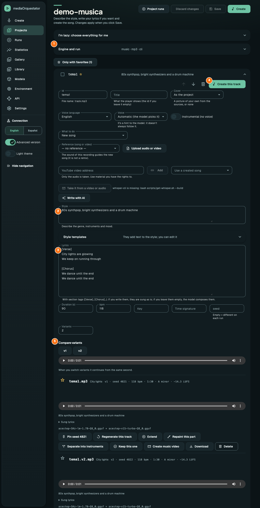

1. **Engine and run** (a collapsible card, closed at the start: its header summarizes mode, format and engine): the project mode (changing it is a pending action until you save: it warns about what will stop being used and "Discard changes" undoes it), the format (mp3 or wav), the models (if you choose none, the defaults are used), the **engine** (programs or server), the steps, the common style and the adapter, the GPU and **force**.
2. **Style**: describe the genre, the instruments and the mood (the [templates](#style-templates) below help you get started).
3. **Lyrics**: with section tags (`[Verse]`, `[Chorus]`…). **If you write them yourself, they are sung as written** and it is faster; if you leave them empty, the model composes them (the model sings in the language you ask for). With **Instrumental** there is no voice and the lyrics are disabled. The **Voice language** is on "Automatic": it is deduced from your lyrics and, if there are none, it is English; choose a specific language if you want another (for example, Spanish with a description in Spanish and no lyrics).
4. **Create this track**: generates only that song. **Create** (at the top) generates all of them. Unsaved edits are saved first. While it works you see the phases `compose` (the language model; it does not appear if you bring your own lyrics) and `synth`, and you can cancel.
5. **Result**: a player for each variant, with its seed, bpm, duration and key, what was actually sung and, if the model changed your lyrics, what you asked for. From there: **Pin seed** (saves the seed in the track so you can reproduce that variant), **Regenerate this track** and **Download**.

Songs are **collapsible cards**: closed, they show their name and the start of the style (with a red mark if something needs fixing). With a single song it opens on its own; when you **add** another the previous one closes and the new one opens, so you always have in front of you the one you are writing.

Useful notes:

- A track **without a seed** comes out different on every run; when you like a variant, pin it.
- With **Variants** you ask for several versions of the same track.
- The real duration may not match the one requested: what comes out is as long as the music the model composes.
- The files end up in `out/<project>/` (`track.mp3`, or `track_v2.mp3` with variants) next to a `manifest.json` with everything needed to reproduce them. The full reference is in `docs/MUSIC_MODE.md`.
- A 3-minute song takes about 20 seconds in total on one of the example GPUs (11 s composing and 9 s synthesizing).

### Voice and quality

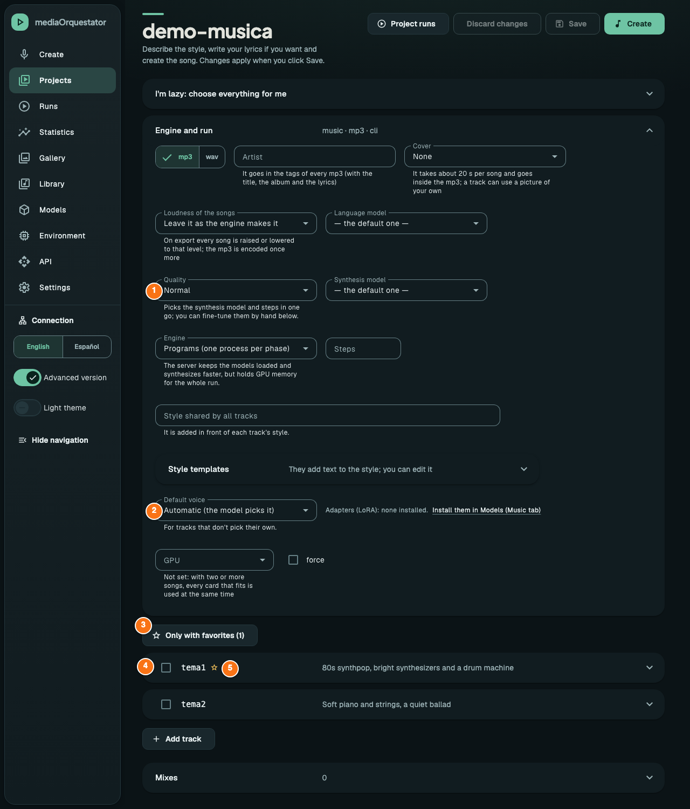

**I'm lazy**, at the top of the studio, does it all for you: you only say **how long you are willing to wait** and it chooses the quality level, the language model that writes the lyrics of the songs that have none (the biggest installed one) and **how many versions of each song to make** (up to 4: more versions, more to choose from). It shows what it would write and **how long it takes**; nothing changes until you press **Apply this**, and **Undo** puts everything back.

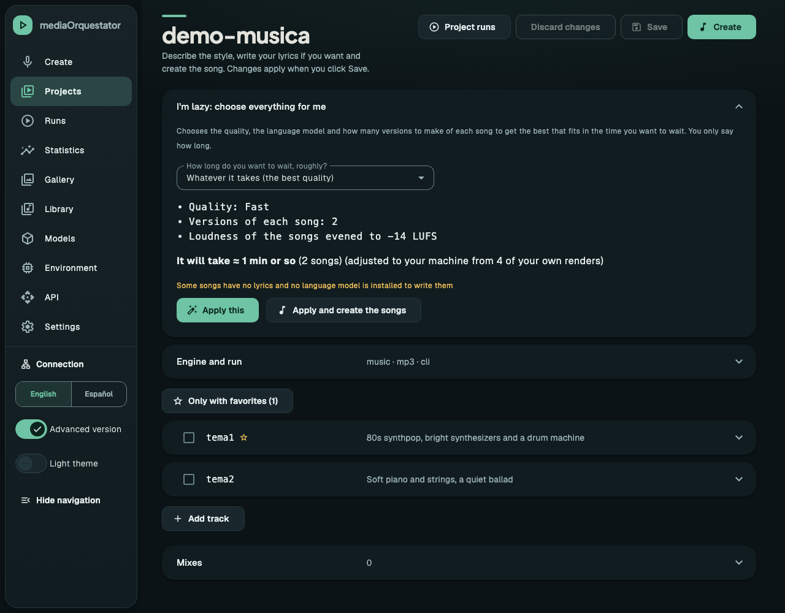

A song is quick (seconds), so what takes long is many songs times many versions: with 3 songs and 4 versions each it estimated about 3 minutes and took 2 min 40 s. The estimate uses what was measured here (an RTX 5060 Ti) scaled by length and card; if the card is not in the table it says the figure is a guess.

**Tags and cover.** Every mp3 comes out **tagged** (title, artist, album, track number, the style and the **lyrics sung**), so any player shows the song. Give a track a **Title** (otherwise it uses its id) and the project an **Artist** (otherwise it uses the project's name). And with **Cover > Automatic** each song also gets a **cover**: a square picture made with the image model from its style (about 20 s per song), which goes inside the mp3 and is saved next to it. A track can use a picture of your own from its sources, or none. If the picture cannot be made the song is still created, without a cover. I'm lazy includes a box for it.

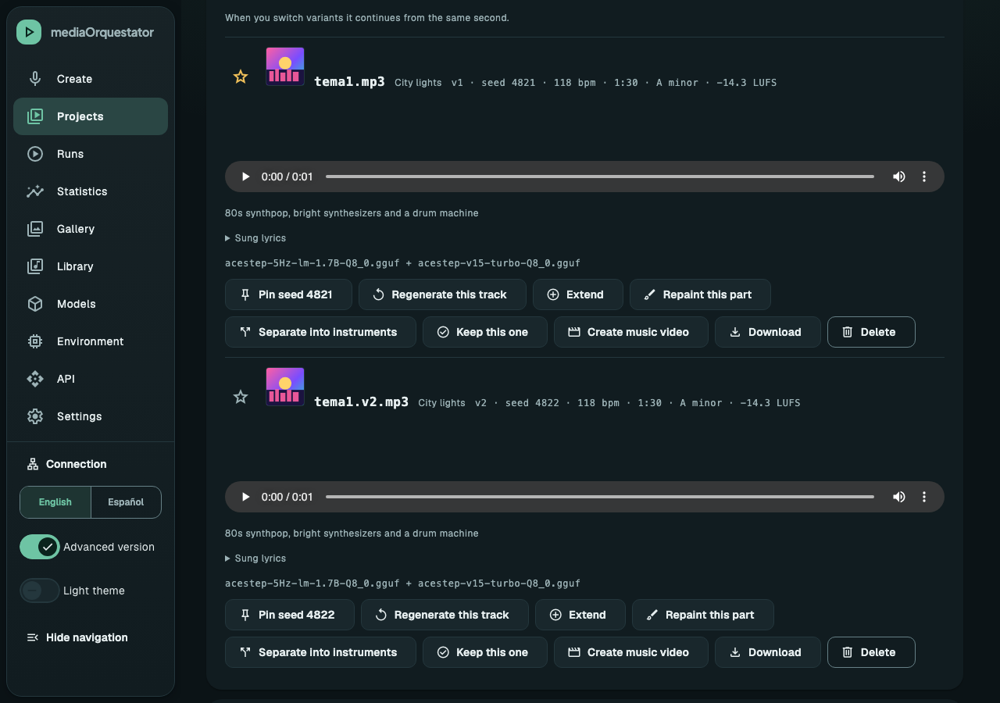

**Library.** The **Library** screen gathers the songs of **all your music projects** in one list. **Search** them (title, project, style or lyrics; accents and capitals do not matter), filter by project or minimum stars, give each song **1 to 5 stars** (press the same star again to remove them) and group them into **playlists** with the playlist button of each song; a playlist keeps its own order (arrows move a song up or down). The list is paginated (5, 10, 20 or 100 songs per page, 10 by default). **Play all** goes through everything the list shows, on every page, song after song. The stars and playlists are saved in `projects/.library.json`, not inside the projects.

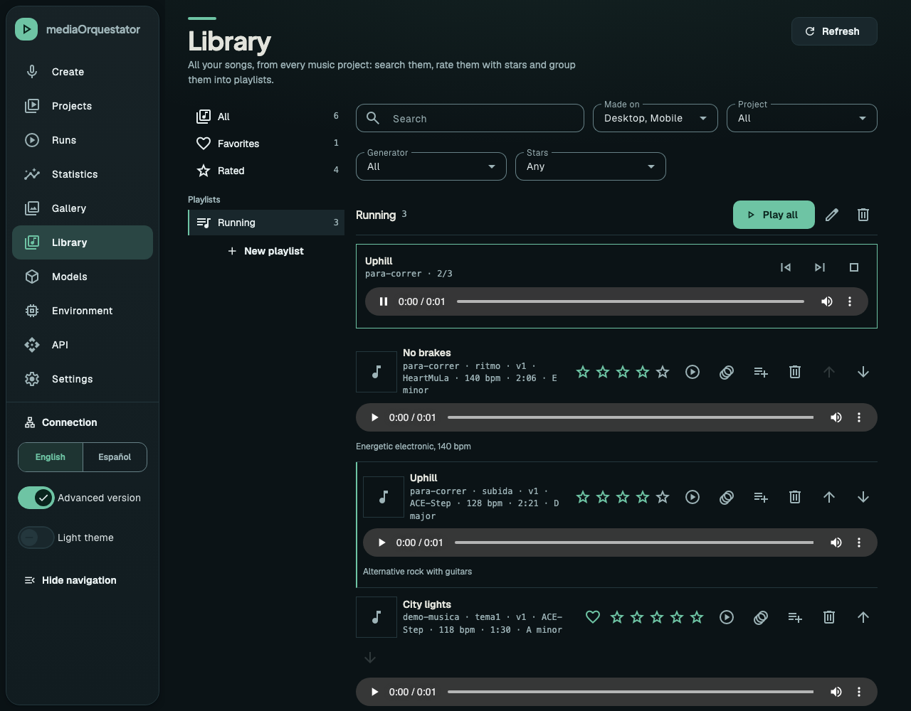

**Two cards, two songs at once.** If your machine has two graphics cards that can each make a song (9 GB or more), creating several songs uses both at the same time without you choosing anything: with 4 one-minute songs it took 43 s on one card and 20 s on both. A single song cannot be split, so one song with several versions still goes one after another. Choosing the GPU by hand in *Engine and run* overrides this.

**Even volume.** In the studio's *Engine and run* panel, **Loudness of the songs** evens every song to −14 LUFS (the level the music platforms play at) or −16 LUFS (a bit softer), so they all sound at the same volume one after another. It is done when the songs are exported, so changing it regenerates nothing. I'm lazy sets −14.

**Automatic check.** Every finished song is measured (under a second) and the studio shows its loudness next to it. If something is wrong it tells you: it sounds **saturated** (the peak reaches the maximum), it has a **long silence** (4 s or more), it is **very quiet or very loud**, or it **lasts differently** from what you asked (more than 15 % off). It is only a notice: the song is kept.

**Music video.** Each song of the results has a **Create music video** button. It cuts the song into shots by its lyrics (the time of each section follows the text it sings; about 6 seconds a shot, as you choose), **writes the picture of each shot with the AI** (the assistant keeps the same character and look all along; if it is not available the pictures come from the style and the lyrics), lets **I'm lazy** choose the models for the time you want to wait, and creates a **video project** with the song as its soundtrack, one scene per shot, a camera movement in each and a crossfade between them: **Create project** opens it in the editor and **Create and generate** launches it. The cuts between sections follow the song: the text gives a first guess of where each section starts, and the plan then moves every cut to the clearest change of loudness nearby (the chorus comes in where the song gets louder); the dialog tells you how many cuts it adjusted. The video lasts exactly what the song does. With a 1-minute song it made 10 shots and, estimated at 7 minutes, took 5 min 30 s. Shots are still pictures with camera movement; **Animate the shots** makes them move, much more slowly (each animation lasts a few seconds and repeats). You can animate **only the shots of the chorus** (the sections tagged Chorus, Hook, Estribillo or Coro): the verses stay as moving pictures, the chorus comes alive and the time to wait lands in between.

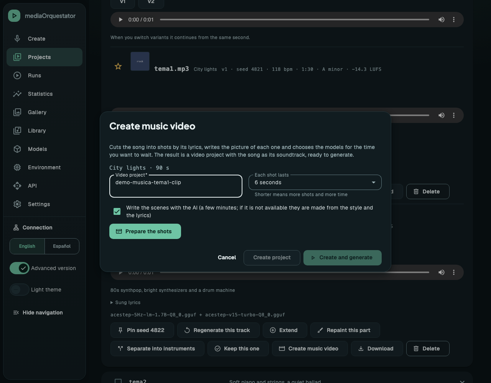

1. **Quality** (in *Engine and run*): chooses the synthesis model and its steps in one go. **Fast** uses the turbo model (about 6 s for a two-minute song), **Normal** the default XL turbo (7 to 9 s; it writes nothing in the file) and **Maximum** the SFT model with 50 steps and shift 1 (10 to 11 s), the one that **Extract** needs. A level whose model is not installed is marked as such; if you change the model, the steps or the shift by hand it reads **Custom**.
2. **Default voice**: the voice for the tracks that do not choose their own. Each track has its own **Voice** selector next to the language: woman, man, duet (man and woman), child, choir or deep voice; **Automatic** leaves it to the model. The engine has no voice parameter: the choice adds a phrase in English to the end of the style (for example *female vocals*), so it is a hint the model follows more or less faithfully. We tried more (chipmunk, an old raspy voice, a robot) and they did **not** come out as asked, so they are not offered. You can always write the voice yourself in the style.
3. **Only with favorites**: appears when you have starred songs (see below) and lists only the tracks that have one.
4. **Checkbox of each track**: ticks the tracks to turn into a mix ([see Mixes](#mixes-joining-songs-and-audio)). Ticking does not unfold the card.
5. **Star** next to the name: the track has a favorite song.

### Variants: compare, keep one, favorites and lengthen

With **Variants** a track makes several versions of the same song. Once they exist, the track's card helps you choose:

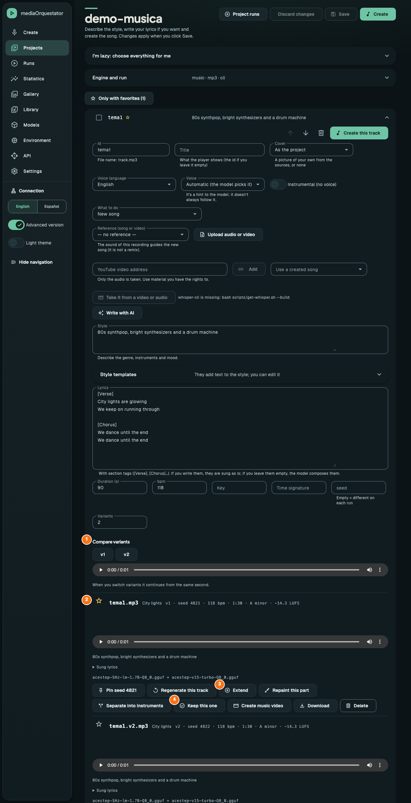

1. **Compare variants**: one player with a button per variant. When you switch from one to another it **continues from the same second** (and keeps playing if it was playing), so you hear the difference without searching for it.
2. **Star**: marks that song as a **favorite**. The mark is saved with the project (`favorites` in `scenes.yaml`) and is identified by the track and its **seed**, so it survives changing how many variants the track makes. If you rename the track, its favorites follow it; if you delete it, they go with it. In the mixer's *Add track* menu the favorites come first.
3. **Lengthen**: asks for the seconds to add (5 to 180) and adds a new track that **repaints the last 4 seconds and goes on** past the end of the song, with the same style and the lyrics that were sung. Nothing is saved or created yet: add the verses that continue and press *Create*. Measured: a 30 s song became 60 s. What is painted is up to the model, so the continuation may not keep the chorus or the melody: try more than one seed. To redo a part in the middle of a song instead, see [The waveform](#the-waveform-pick-a-part-to-repaint-and-separate-instruments).
4. **Keep this one**: after asking, the track keeps that variant (it gets its seed and a single variant), the mix clips that played it become the track's only song and the ones that played another variant are removed, it saves and creates the track again. It is instant, because nothing is generated: the run reuses from the cache the song made with exactly the same inputs, so **the one you heard is the one you keep** (the engine does not always give the same song twice). The other variants' files are **deleted** from the project.

### The waveform: pick a part to repaint and separate instruments

Every song in a track's results is drawn as a **waveform** with a line that follows the player and the part already played brighter. **Click** anywhere on it to continue from that second. If the server cannot read the audio, the song keeps its player and shows no waveform. It works for songs of any generator (it only reads the file).

When a track's task is **Repaint**, the source is drawn the same way and you pick the part to redo by **dragging** on it:

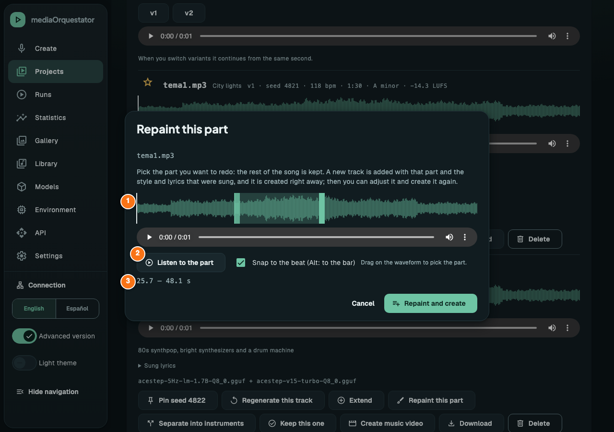

1. **The waveform and the range**: drag to pick the part (the two bars are its ends: drag them to adjust, or focus one with the keyboard and move it with the arrow keys, a tenth of a second at a time, a whole second with Shift; Home and End go to the extremes). Dragging fills the **From** and **To** fields, rounded to a tenth of a second. Typing in them moves the range, and an end past the song's end stays as typed (it is how a song is lengthened) and is drawn as reaching the end.
2. **Listen to the part**: plays the source from the start of the range and stops at its end, so you hear what you are about to redo before spending a generation on it. If the track has a **BPM** a box appears to **snap to the beat** (hold Alt to snap to the bar).
3. **The numbers**: they stay; the waveform is just a way to fill them.

Next to **Repaint this part** the song has **Separate into instruments**: see below.

**Repaint this part** is also a button on every created song: it opens the same waveform, you pick the part, hear it and press *Repaint and create*; the song is copied to the project's sources (as *Lengthen* does) and a track `<name>_repintado` is added with that range, the style and the lyrics that were sung, and it is **created right away**, alone (the rest of the project is not touched); then you can adjust it and create it again. If the song is one of several variants of its track the name says which (`ballad_v3_repintado`). If the song was made by HeartMuLa or DiffRhythm2 the repainted part will sound like ACE-Step, which is the one that repaints.

**Separate into instruments** (on every created song and on the chosen source of a track) lists the twelve stems the engine knows: voice, backing voice, drums, bass, guitar, keyboard, percussion, strings, synth, effects, brass and woodwinds. Tick one or more (none is ticked at first) and press **Create N tracks**: the studio adds **one *Extract* track per stem**, all from the same song, and creates them **one after another** (the run panel says *Track 2 of 4*). They are named `<song>_<stem>`, and when the song is one of several variants of its track, with the variant: `ballad_v3_vocals`. Each appears in the results as a song with its waveform and the line *Extract: Vocals ← source*, and the original song does not change. Each stem takes about 10 s, so with more than 3 a line tells you how many generations you are asking for. Extracting needs a synthesis model that is **not the turbo one** (the SFT of the Music catalog): the window says so; if the project's own model is a turbo one it offers, ticked, to **switch the project to the quality level *Maximum*** (note that the project's other songs will also use that level, slower, the next time you create them; unticked, the engine refuses the tracks) and, if no such model is installed, it says where to get it and adds nothing. When the tracks have their songs, **Remove these tracks** takes them out of the project with their songs (after asking) and leaves the original alone; it disappears as soon as you edit the list of tracks in any other way.

With **HeartMuLa** or **DiffRhythm2** as the generator the studio offers neither action (those generators only make new songs) and one line above the results says that ACE-Step does it and how: upload the song as a source to a project that uses ACE-Step. The waveform stays.

### Style templates

Typing the genre by hand in the style is easy to get wrong. Under each track's **Style** box (and under the project's "Common style") there is a collapsed list of **templates**, grouped by family: Rock and pop, Electronic, Acoustic and folk, Urban, Jazz and blues, Film and orchestra, World.

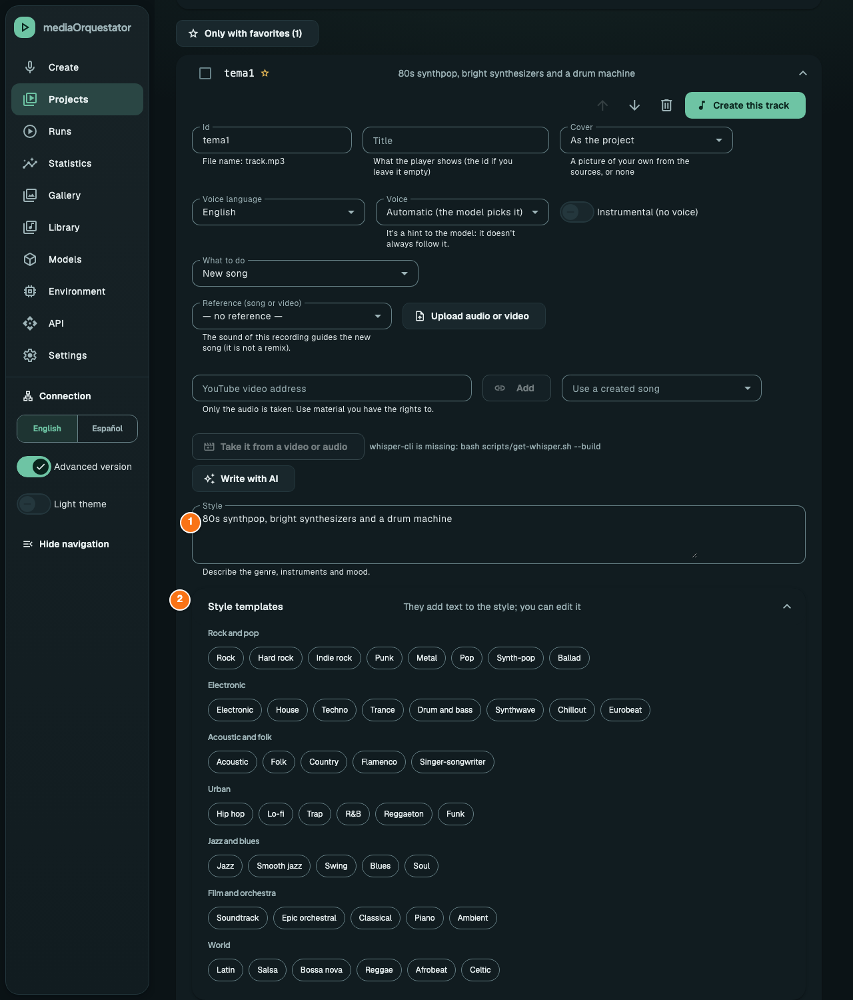

1. **The style**: the text of each template you pick is added here.
2. **The templates**: choosing **Soundtrack** adds at the end of the style, after a comma, a text in English (the language the model understands best) that describes that genre: *cinematic film score with sweeping strings, a slowly building emotional arc and a spacious mix*. Hover over a template to see it in full. You can combine several, and choosing it again removes it.

A template shows as marked while its text is in the style as-is; if you edit it, it lets go on its own. It is not a new field: the style is still a single text you can touch up.

### Remix: a song that already exists

In a track's **What to do** selector you can choose **Remix** instead of "New song": it starts from a song you already have and reinterprets it in another style. **Faithful remix** stays closer to the original melody and structure, **Repaint** redoes only a section (from second X to second Y) and keeps the rest, and **Extract** isolates the voice or an instrument (it needs the SFT model, not the turbo one).

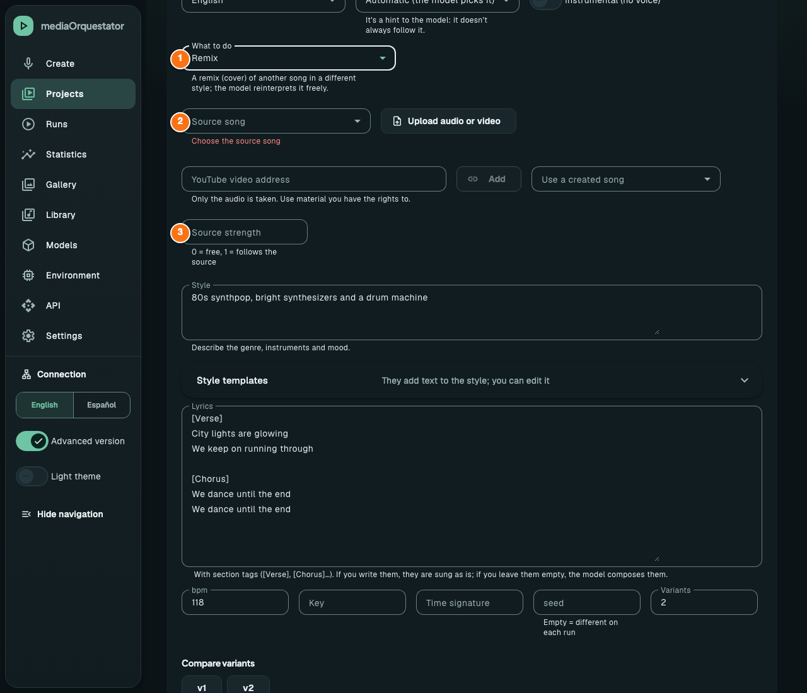

1. **What to do**: the track type, with an explanation below.
2. **Source song**: the one to be transformed. You can pick one of the project's, **upload an audio or a video** (from a video the sound is extracted and saved as mp3; the video is not kept) or **use a song created** right here (it is copied, so the remix keeps working even if you regenerate or delete the original). It plays in a player so you can check it is the right one.
3. **Source strength**: 0 is free and 1 follows the source. In Repaint the start and end seconds are asked for; in Extract, what to extract.

With a remix the duration is decided by the source, and the language model is not used. The result says which song it comes from.

### Reference: the sound of another recording

A **new song** can also have a **reference**: a recording (or the audio of a video) whose sound guides the song. It is not a remix: the structure, lyrics and duration still come from your style; the reference only steers how it sounds.

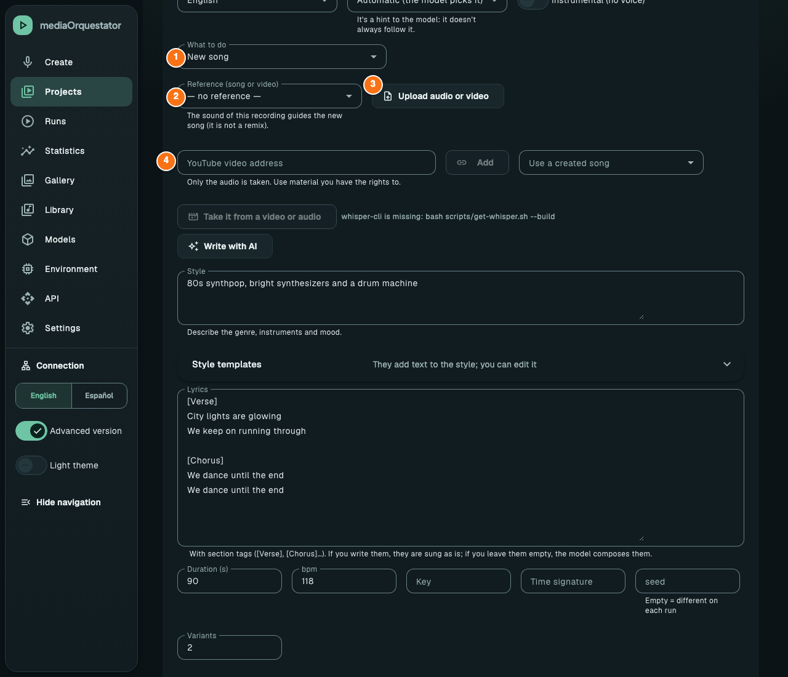

1. **What to do**: leave it on "New song".
2. **Reference (song or video)**: the audio that serves as the sound model; optional.
3. **Upload audio or video**: uploads a recording or a video (converted to mp3). What you upload stays in the project's sources and can be reused in other tracks.
4. **Address of a YouTube video**: paste the address and press **Add**; only the audio is taken and it is selected as the reference. It needs `yt-dlp` (`bash scripts/get-ytdlp.sh`, once; it shows in Environment as optional). Only single videos of up to 20 minutes, with no accounts or cookies: a private one, or one that asks you to sign in, is rejected with the reason. Use only material you have the rights to.

It is a tendency, not a copy: do not expect it to reproduce the recording.

### Mixes: joining songs and audio

When you already have created tracks (or audio in the sources), the **Mixes** card, under the songs, joins them into a single song: one on top of another (a voice over a backing track) or one after another (verse and chorus).

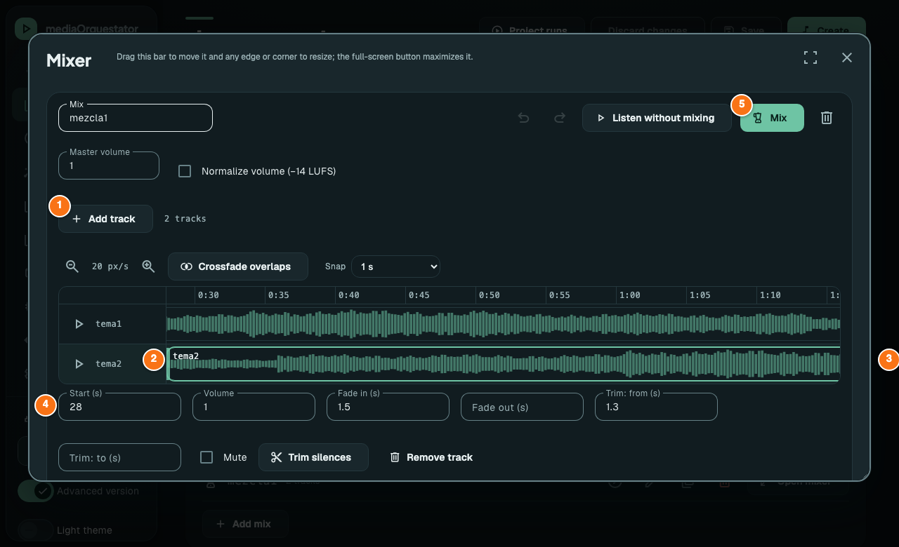

1. **Add mix**: the **mixer opens in a window** (each mix has its row with **Open mixer**, plus buttons to **listen** to the finished mix, **rename**, **duplicate** and **remove** it without opening the mixer; tick the checkbox of several tracks and press **Mix these** to create a mix with them one after another; the mixer has undo and redo buttons, also Ctrl+Z / Ctrl+Shift+Z) that you can **move** by dragging its title, **resize** from any edge or corner (it can reach both edges of the screen), **maximize** with the full-screen button (or by double-clicking the bar) and **close** with the X (or with Esc), and inside it **Add track** (in its own row above the timeline): you choose one of the songs already created or an audio from the sources. Each track is a bar with its waveform and, to its left, a ▶ button to **listen to it alone** (the part it uses, at its volume and without fades); when you press another, the first one stops. While it plays, a **small marker** moves by itself inside that track; and when you hear the already-made **mix**, a **vertical bar** crosses all the tracks so you see where it is. **You can move that bar (or the marker) by dragging it** wherever you want and it plays from there; also with a click on the time **ruler**, or with the keyboard arrows (1 s; with Shift, 10 s). A track playing alone never goes outside the part it uses. And you do not need to mix to hear the result: **"Listen without mixing"** (next to Mix) plays **all the tracks together** in the browser, each in its place, with its trims, volume and fades; it is an approximation (the file is generated by **Mix**), but **any change — moving a track, raising the volume, muting it… — is heard instantly**, without stopping it. It pauses, stops, and you can drag the bar or click the ruler to jump to any point even if you have never mixed. While a track plays alone, **volume, fade and trim changes are heard right away**, without stopping (up to volume 2 if the browser allows it; the already-made mix does not change until you press Mix again).
2. **Drag** a bar horizontally to decide when it comes in; with the **magnet** (1 s by default) it snaps to the grid, and with the keyboard arrows it moves one step at a time. The **zoom** changes the time scale.
3. **Trim** the ends by dragging the handles, or press **Trim silences**: each generated song has almost 2 seconds of silence at the start and several at the end, and without trimming them a gap is left when joining two.
4. **Clip panel**: start, volume (0 to 2), fade in and out, trim and **Mute**. For them to sound good together, use the same bpm and the same key in the tracks.
5. **Mix** saves and renders only that mix (it is quick, a few seconds). When it finishes the player appears; if you change anything, it warns that there are unmixed changes.

A track not yet created shows a warning: it has to be created first. The details (file fields, cache, `--only`) are in `docs/MUSIC_MODE.md`.

The mixer has more tools:

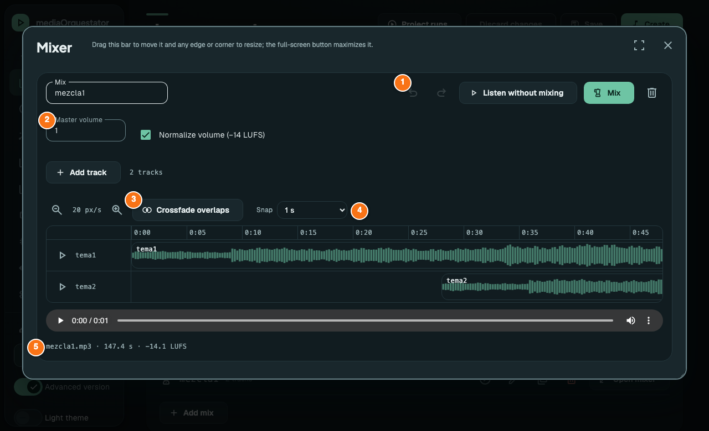

1. **Undo / redo** (also Ctrl+Z and Ctrl+Shift+Z): they undo the last change to the project, up to 100 steps; dragging a clip counts as one. They do not act while you type in a field, where the browser undoes the text.
2. **Master volume and Normalize**: the volume scales the whole mix after adding the clips (0 to 2) and **Normalize** brings it to **−14 LUFS**, the level of music platforms, whatever your clips added up to. In *Listen without mixing* the master volume is heard and the normalization is **approximated** from the loudness of each track (a couple of dB off at most); the file *Mix* writes is the exact one.
3. **Fade overlaps**: where one track starts before the previous one ends, it puts a fade out on the first and a fade in on the second lasting the overlap. It is written as normal fades (you see them in the panel and can adjust them) and it is one undo step.
4. **Magnet**: besides seconds it offers the **beat** and the **bar** of the first song that has a tempo, and it draws those lines. When you drop a track the **first beat** of its song (found by the server in its first 30 seconds) lands on the line, not the start of the file, so a song that opens with a soft intro still fits.
5. **Loudness of the mix**: once mixed, next to the file and its length you read its loudness in LUFS (for example −14,1).

In the list of mixes, each row lets you **listen** to the mix, **rename** it, **duplicate** it and **remove** it without opening the mixer, and says **Outdated: a track changed** (with a **Mix again** button) when you created again a song that the mix uses.

### HeartMuLa: better songs (optional)

ACE-Step is fast, but if you want the best quality there is a second generator, **HeartMuLa**: it takes about ten times longer (a 2-minute song takes about 2 minutes) and the songs sound much better. It runs in a Docker container and **only appears when your machine can run it** (or when you point to another machine that has it); otherwise the option is simply not there.

> **Update (2026-10-22):** HeartMuLa, DiffRhythm2 and LAION-CLAP now run as .NET services, not in Docker: `bash scripts/get-services.sh` installs them into `bin/services`, and the **Start** / **Stop** buttons of the Environment screen launch and end them in the same way. The screenshots and the Docker steps below are kept for the case where you start the server with `MO_MUSIC_BACKEND=docker`. See [INSTALL.md](../../mediaOrquestator/docs/INSTALL.md#music-services-net).

To have it on this machine you need Docker working with your NVIDIA card, the container image and the weights (about 21 GB):

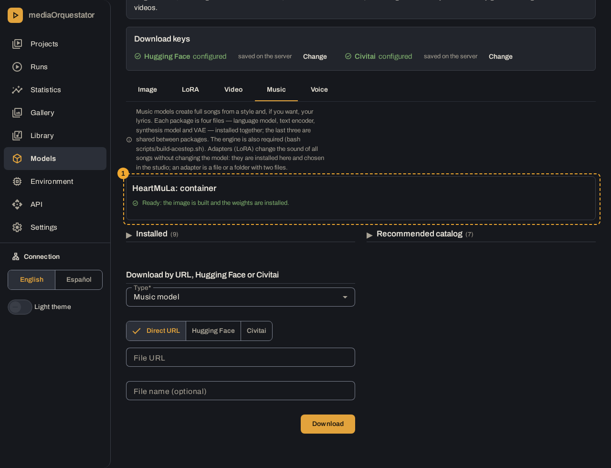

1. **Models, Music tab**: the *HeartMuLa: container* box says whether the image is built and, if not, offers **Build the container** (a few minutes, about 6 GB downloaded). The weights are the *HeartMuLa* entry of the catalog below it. (`bash scripts/install.sh` also builds the image.)
1. **Environment, Music containers panel**: choose the card (by default the one with most free memory) and press **Start**. The container stays up between songs until you press **Stop**, and HeartMuLa and DiffRhythm2 can be up at the same time (HeartMuLa on the 16 GB card and DiffRhythm2 on the 12 GB one, if you have both). If it is stopped, the music project says so, with a link to Environment, and the create buttons stay disabled.

If there is no Docker here, or the card is too small (it needs about 10.5 GB free), run the container on another machine and give its address in **Settings**:

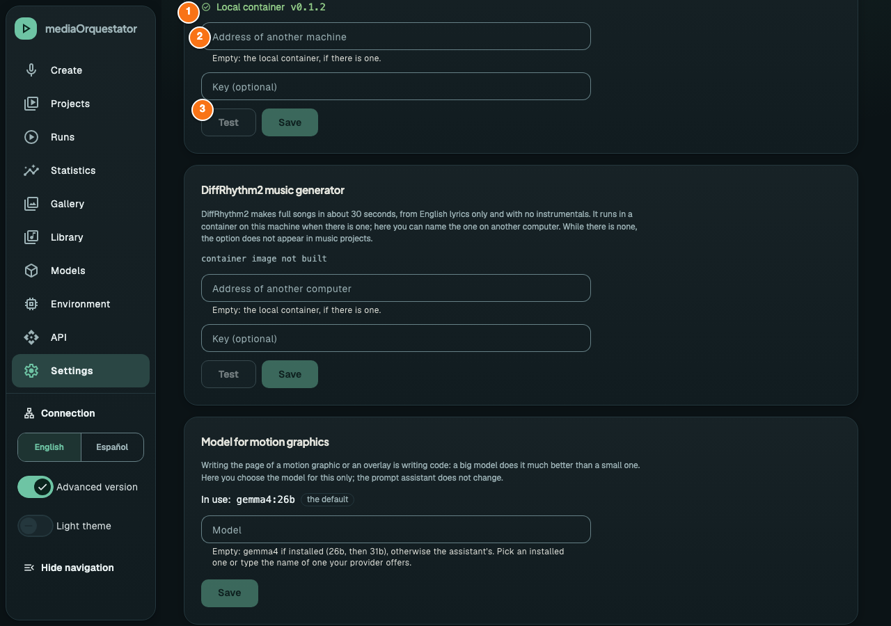

1. **What is in use**: this machine's container, or the external service.
2. **Address of another machine** (and a key, if you set one there). A machine that is not this one receives your lyrics and tags, so you have to tick that you accept it before saving.
3. **Test** asks the service whether it is ready, without sending anything of yours.

When it is available, the **Engine and run** panel of a music project shows the **Generator** selector:

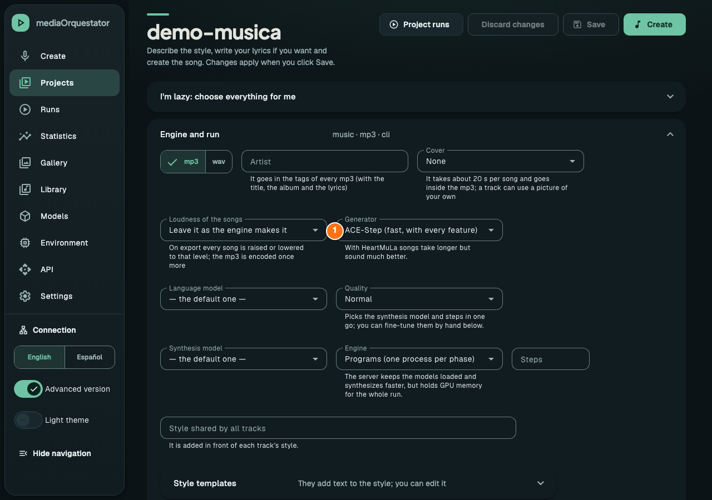

1. Choose **HeartMuLa**: what only ACE-Step understands (language model, quality, key, time signature, bpm, reference and the remix tasks) disappears.

Each track then asks for **tags** instead:

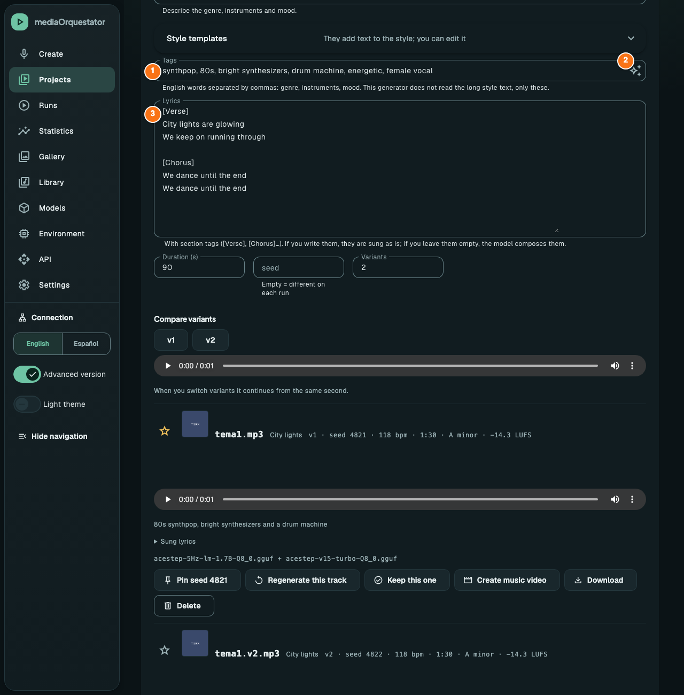

1. **Tags**: a few English words separated by commas (genre, instruments, mood). HeartMuLa does not read the long style: it reads these and the lyrics.
2. The **sparkles** button writes them from the track's style with the assistant (when it is available); you can edit them.
3. **Lyrics** with `[Verse]` and `[Chorus]` marks: HeartMuLa needs them (no instrumental tracks) and the song lasts as long as the lyrics.

The container exists only while a run is making songs: it starts when the run starts and stops when it ends, so it does not hold your GPU memory in between. The reference is in [docs/MUSIC_MODE.md](../../mediaOrquestator/docs/MUSIC_MODE.md#generador-heartmula-opcional) (in Spanish).

### DiffRhythm2: full songs in half a minute (optional)

A third generator, **DiffRhythm2**, makes a full song of about two and a half minutes in about half a minute, with the lyrics aligned. It has one big limit: **it reads English lyrics only** (a Spanish lyric comes out badly pronounced), and it makes no instrumentals, remixes, covers, references or lengthened songs. It runs in a container like HeartMuLa and appears in the **Generator** selector only when it can run.

To have it on this machine you need Docker with your NVIDIA card (about 8 GB of GPU free):

1. **Models, Music tab**: the *DiffRhythm2: container and weights* box has one button, **Build the container and download the weights**. It builds the image (about 6 GB) and then downloads the weights (about 9.5 GB) with a progress bar; the weights are not in the image and the service never downloads anything by itself.
2. If this machine cannot run it, run the container on another one and give its address in **Settings › DiffRhythm2 music generator**; it works like HeartMuLa's card (address, key, **Test**, and the tick to accept that lyrics and style are sent there).

Choosing **DiffRhythm2** in the generator selector shows a notice with the limits above and hides what it cannot use: the voice language other than English, the instrumental switch, the voice style, the tasks (remix, cover, repaint, extract), the reference, bpm, key, time signature, **Lengthen**, **Repaint this part** and **Separate into instruments** (one line above the results says that ACE-Step does those; the waveform of each song stays). Each track asks for **tags** (English words separated by commas) and English lyrics with `[verse]`, `[chorus]`… marks. Tracks you already had that it cannot make (in Spanish, instrumental, with a task) are not touched: the studio lists them so you can decide. Variants, favorites, mixes, the video clip and the library work as always. The reference is in [docs/MUSIC_MODE.md](../../mediaOrquestator/docs/MUSIC_MODE.md#generador-diffrhythm2-opcional) (in Spanish).

### Importing songs

If you have many songs in a file, **Import dataset** also creates them. Choose **Songs** instead of "Video scenes" (the third choice, **Animated graphics**, is the same wizard for graphics; see [the worked examples](../../mediaOrquestator/docs/IMPORT.md#worked-examples)) and upload the JSON or HTML (the same format as for scenes):

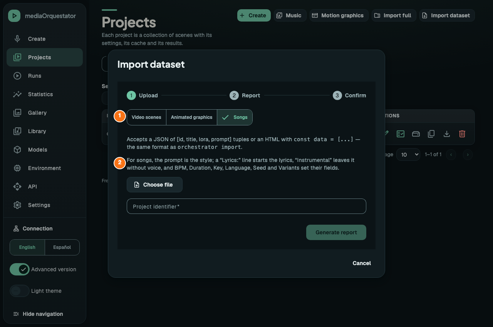

1. **What is imported**: video scenes, animated graphics or songs.
2. **How each entry is read**: the prompt text is the style; a `Lyrics:` line starts the lyrics, an `Instrumental` line leaves it without voice, and `BPM:`, `Duration:`, `Key:`, `Language:`, `Seed:`, `Variants:` set their fields. You will see the report of what was applied and what was discarded before anything is created, and when it finishes the music studio opens.

### Exporting a project, and importing it elsewhere

In the **Projects** list, the **download** button of each row exports the project in two ways:

- **Full project (.zip: settings, models used and recipe)**: the one to use to repeat a project somewhere else. It carries everything the project says (`scenes.yaml`: models, resolution, steps, sampler, voice, animation engine, LoRA, camera, look…), your own files (`sources/`) and **the recipe** (`RECIPE.md` to read, `recipe.json` for the program): which models, voice and LoRA it uses, with the **settings it generates with**, whether they are the **catalog's recommended ones** (or which you changed, e.g. "steps 20 → 4") and where each file is downloaded from. It does not carry the models themselves (they are tens of GB and belong to each machine) nor what was generated.
- **Scenes only (JSON, without settings or models)**: the scenes (or the songs) in the format that **Import dataset** reads, to edit them as text or take them to a project that already has its own settings. Each entry carries its text plus `Dialogue:`, `Negative:`, `Motion:`, `Seed:`, `Speed:`, `Silence:` and `Variants:`, with the subject prompt in front of every scene. Models, resolution, steps and the rest are not in it: the message after exporting lists what stayed out.

To bring a full project in, use **Import full project** (next to "Import dataset"):

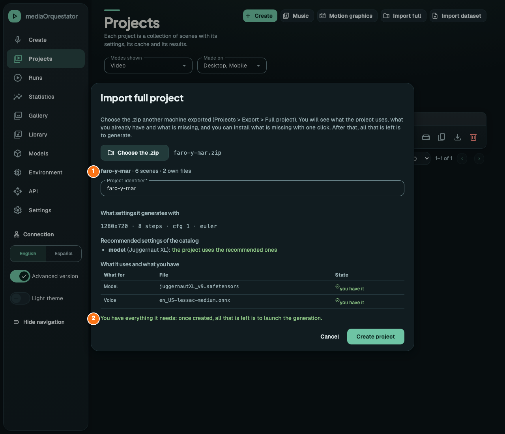

1. Choose the `.zip`. The dialog does not create anything yet: it shows the project's name, how many scenes it has, **what settings it generates with**, **the catalog's recommended settings** (green if the project uses them, orange with the difference if not) and **a table of every file it uses** with "you have it" or "missing".
2. When everything is green you read "once created, all that is left is to launch the generation". **Create project** opens it in the editor, and from there it is **Runs > Launch**. You can also create it with something missing and install it later.

If something is missing, it says so and offers **Install everything that is missing** (mark **1** in the next picture; or one by one): it downloads from the catalog, with its progress bar, and when it finishes the table updates by itself. A file that is not in the catalog is listed by name so you can look it up. If the project uses a picture or clip of its own that the `.zip` does not carry, it says so under "What has to be fixed".


The same thing from the terminal: `bin/orchestrator export projects/demo/scenes.yaml -o demo.dataset.json` (add `-format zip -lang en` for the full project; the flags go before the file). In a dataset you write by hand, `Motion: leaves move in the wind, static camera` is all it takes to animate a scene.

### The AI assistant for songs

Each track has a **Write with AI** button: you describe the song in your own words (in whatever language you like) and a local model (Ollama, on CPU, as with images) proposes the style, in English, and the lyrics, in your language. It is a suggestion: you see it and **apply or discard** it. With "Instrumental" it proposes only the style. With HeartMuLa or DiffRhythm2 it also proposes the **tags** and writes the structure tags those generators read, so the track can be created right away. It does not work while a run is in progress (it needs several GB of memory). It has the same **AI model** selector as the editor (and shares its choice): if the model refuses to write the lyrics, the warning says so and you can choose another.

### Take it from a video or audio

The **Take it from a video or audio** button of a new track reads a song you already have: pick an mp3 or wav (yours, one of the project's sources or the audio of a YouTube video) or a video, and you get a **proposal to review** with its lyrics, language, tempo and key, a style and (for HeartMuLa and DiffRhythm2) the tags. Nothing is written into the track until you press **Apply**, and everything can be edited first. The lyrics are read by Whisper on this computer's CPU (install it once with `bash scripts/get-whisper.sh`): it is a **transcription** (in a 3 minute test with known lyrics about one word in four was wrong), so review it. The tempo and the key are **estimates** (right in about 7 songs out of 8 and 7 out of 10 respectively in our tests; the tempo can come out at half or double, and the buttons next to it switch to those). For a video you can also ask for a description of its picture. *Separate the voice first* exists, but in our test it changed almost nothing, so it is off. See `docs/MUSIC_MODE.md` for the details and the measures.

### Other music options

- **Common style** (in the project panel): a text prepended to every track's style, so they share a sound.
- **Adapter (LoRA)**: if you have installed adapters (Music tab of Models), you can choose one for the whole project and another, with its strength, for a track.
- **Engine**: by default each phase starts its program. With **Server** the run uses a single `ace-server` with the models loaded, somewhat faster with many tracks, at the cost of occupying GPU memory for the whole run.
- All of this, with the details and limits, is in `docs/MUSIC_MODE.md`.

## Your own images and background music

Until now each image has been drawn by the model from a prompt. If you already have the image, there are three ways to use it, and the video can carry background music.

### A scene with your image (video)

In the editor, each video scene has a **Generate with AI / My image** selector. With **My image** you choose an image from the project or **upload one** (`.png`, `.jpg`, `.jpeg` or `.webp`), and no prompt is needed any more: the drawing model is not called.


1. **Generate with AI / My image**: the source of this scene's image.
2. **The image**: it is fitted to the project's resolution (scaled to cover it and cropped from the centre, so whatever overflows is lost) and here you see it as you uploaded it. If every scene brings its own image, `sd` is not even needed.
3. **Camera movement**: besides zoom, pan and handheld shake, there are **rotate_cw** and **rotate_ccw**, which slowly **rotate** the image over the clip (clockwise or counter-clockwise). The intensity sets how much it turns, from 5° to 45°, and the image is enlarged just enough so no empty corners show (with 16:9 and high intensity the enlargement is noticeable: lower the intensity for a gentler turn).

The rest is like any scene: narration, grain, white balance and, if you want, animating it with Wan (in that case write the **motion_prompt**, because there is no image prompt to lean on).

### Starting from your own image to generate another (img2img)

In a **generated** scene (in images mode, or in video with "Generate with AI") you can press **Start from an image of mine**: generation starts from your image instead of from noise, and the prompt says what to do with it ("make it watercolour", "day to night"…).


1. **Starting image (optional)**: the section. To remove it, "Remove the starting image".
2. **The image**: from the project or uploaded, fitted to the resolution as in the previous case.
3. **Strength**: how far the result may move away from your image. **Low** (for example 0.3): it looks like the original and changes only a little. **High** (0.9): the prompt reinterprets it almost entirely. 0.6 by default.

**If the image already carries its recipe.** When you upload it ("Upload image, GIF or video") the file is searched for the data it was generated with: prompt, negative prompt, seed, steps, cfg and model. If there is any, a dialog appears with checkboxes to apply them to the scene: the prompt, the negative and the seed come ticked; steps and cfg do not (they are saved as the scene's own settings); if the scene already had a prompt, the new one comes unticked and the dialog warns that it would replace it. The model is only shown, saying whether you have it installed. After applying, the notice carries "Undo". If the image carries nothing, nothing is asked. PNGs from `sd`, A1111 and ComfyUI are read, videos made by `sd`, and WebP with EXIF or XMP; a GIF almost never carries them, and an image that has passed through a website or a chat has usually lost them. If you upload a **GIF or a video**, its first frame is the starting image (the video is not kept).

With several **variants**, all start from the same image, each with its seed: it is a good way to see the range of interpretations. It works with checkpoints such as Stable Diffusion 1.5 or XL; it also works with model sets (Krea 2 and IntoRealism behave the same), but the strength acts more abruptly there: at 0.3 the image barely changes, at 0.6 the composition is kept but a style change ("as an oil painting") hardly applies, and from 0.75 up the composition is lost (at 0.9 it even came out duplicated in two panels). Try values between 0.5 and 0.7.

### Describing a picture or a clip: a prompt from a reference

If you have a picture or a clip that shows what you want, you do not need to put it into words: under the prompt of a **generated** scene, press **Describe a reference** and choose a file (`.png`, `.jpg`, `.jpeg`, `.webp`, or a clip `.mp4`, `.mov`, `.webm`, `.mkv`). A local vision model reads it and the editor shows a **Proposal** with the prompt and, beside it, **the model that wrote it**; **Use** puts it in the scene's prompt (which you can keep editing) and **Discard** throws it away. The scene is then generated from that text only: the file is never passed to the drawing model, so this is not img2img and nobody's face is copied.


1. **One scene / Several scenes (one per shot)**: how a clip is described; chosen before picking the file.
2. **Who wrote it**: the model (and the provider, if it is not the built-in Ollama) is always shown.
3. **A shot**: its time range, its prompt (editable) and a checkbox to drop it.
4. **Create N scenes**: inserts the checked shots after the current scene; nothing changes until you press it.

- **Which model.** `gemma4:26b` by default (about 12 s)<!--[private]-->; tick **More detail** for `muse-glimmer:30b` (slower, more precise with clothes and bodies)<!--[/private]-->. They are models you install in Ollama (`ollama pull gemma4:26b`); nothing is downloaded by itself and nothing leaves your machine.
- **A clip**, by default, is one scene: 4 to 8 key frames are read and merged into **one** prompt, plus a short **movement** prompt that goes to the scene's `motion_prompt` if the scene is animated. A clip may last up to 5 minutes.
- **One scene or one per shot.** By default a clip is **one** scene. Choose **Several scenes (one per shot)** before picking the file and the clip is cut at its shot changes (at most 12 shots; shots under 1.5 s are merged into the previous one): the proposal lists **one entry per shot** with its time range, an editable prompt and a checkbox to drop it. **Create N scenes** inserts the checked ones right after the current scene, in order, without touching any existing scene; each one records the model (`described_by`), and in a video project its length is the shot's (as silence, so the project validates; replace it with narration if you want). If the project animates, the new scenes animate with that shot's movement. A clip without cuts becomes one scene, and the editor says so.
- **If the model refuses** (or answers something that is not a description) the editor says so and offers **Try with** the other installed vision models; nothing is invented. The refusal is the model's own, the application adds no content filter. Adult material was described literally in our tests with swimwear and lingerie; for anything stronger, try your own files.
- **Age check.** Before describing anything, every person or character in the file (every frame, for a clip) is checked. If someone is or looks under 18 (photograph, drawing or anime), or their age cannot be confirmed, nothing is described and the file is deleted. The prompts it writes always give an adult age. It is a safeguard made by a model, not a guarantee, and what you upload remains your responsibility.
- **While a run is in progress** it waits (it needs the memory), and the uploaded file is deleted as soon as you use or discard the proposal. From the terminal: `bin/orchestrator describe photo.png`.

### Background music under the voice

A **video** can carry a soundtrack under the narration. It is in the collapsed **Background music** section of the editor:


1. **None / Generate it / A file**: generates an instrumental track from a description, or uses an audio of yours (which you can upload; if you upload a video its sound is taken, or paste the address of a YouTube video to take its audio, with `yt-dlp` installed).
2. **Music style**: always instrumental. It is generated with the music engine (the same models as the Music tab of Models), lasts as long as the video (rounded up to multiples of 10 s) and is cached: the same style and the same duration are not generated again.
3. **Volume, fade and ducking under the voice**: the volume goes from 0 to 1 (0.25 by default), the music fades in and out (2 s) and, while the voice speaks, it lowers itself. Without a seed, the same style always gives the same music.

When the scenes have been joined everything is mixed in a single ffmpeg pass: the video is not re-encoded and the audio ends up volume-normalized. In the run monitor you will see two new phases, `bgm` and `mix`. The full reference, with the events and the limits, is in `docs/MUSIC_MODE.md`.
